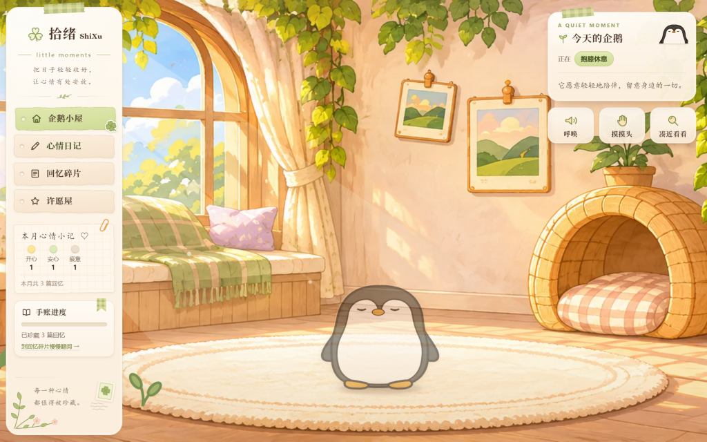
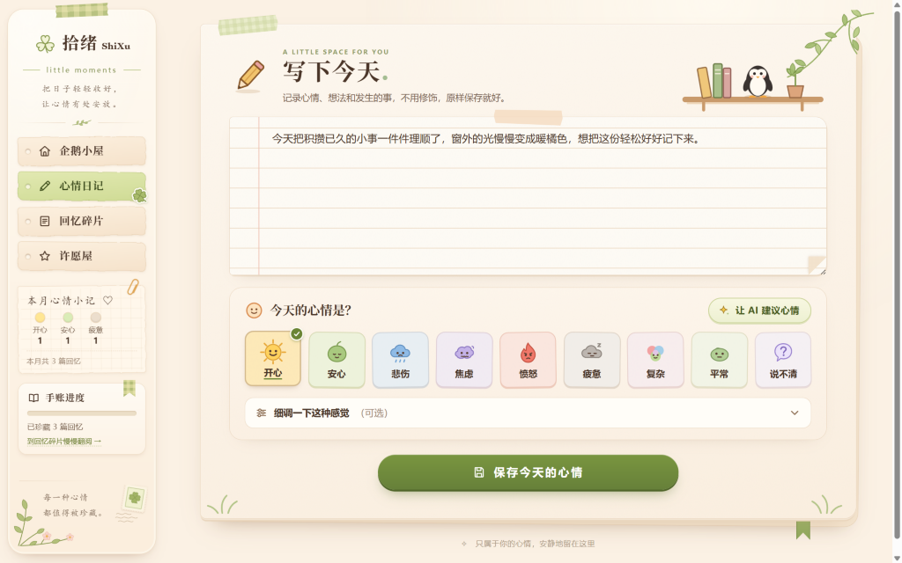
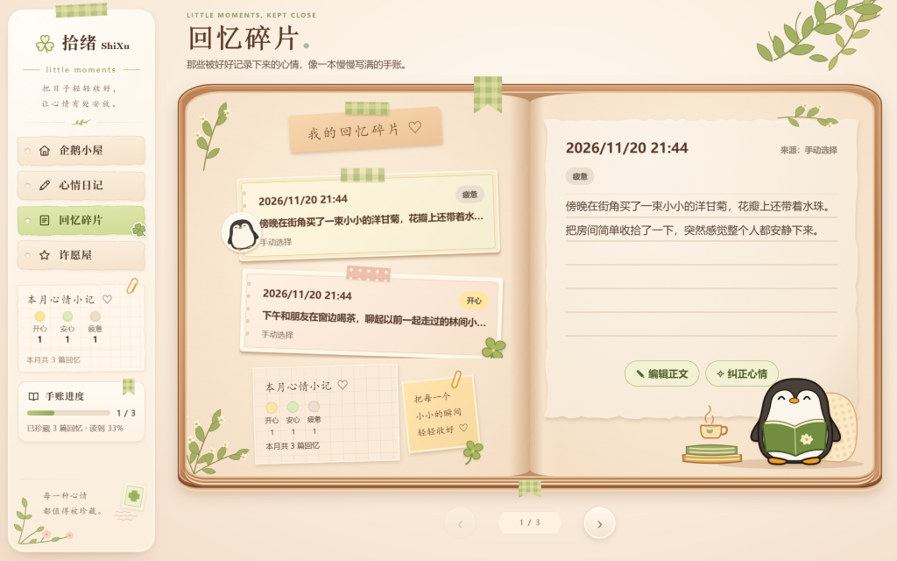
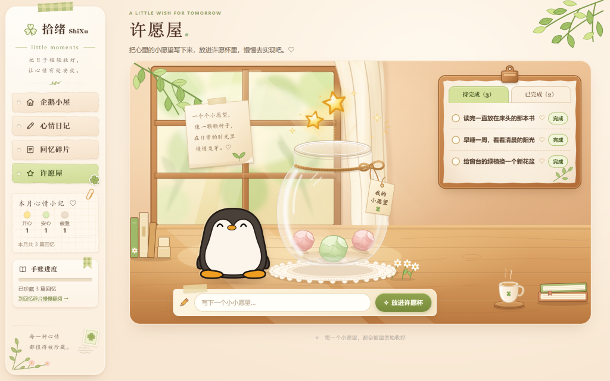
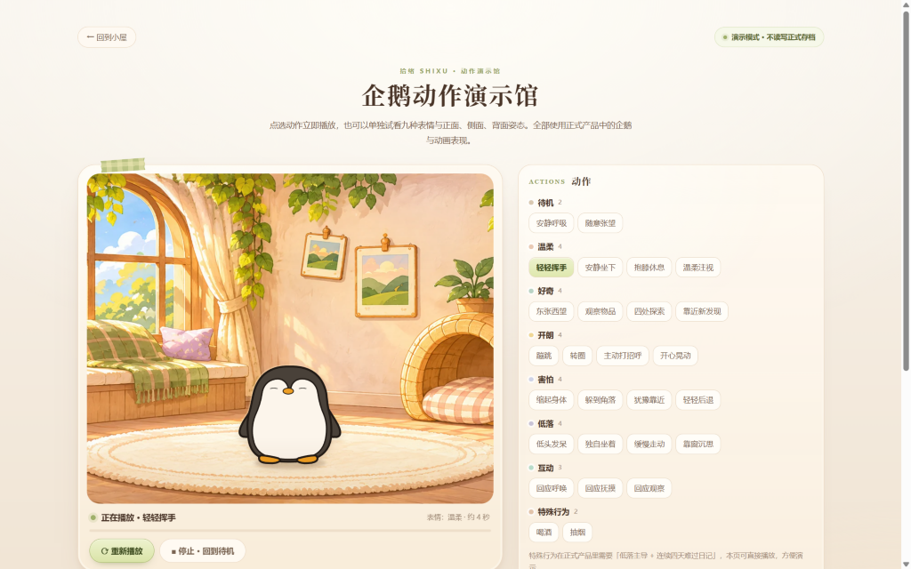
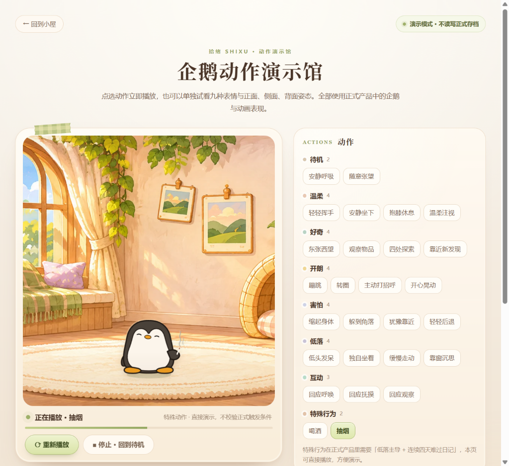
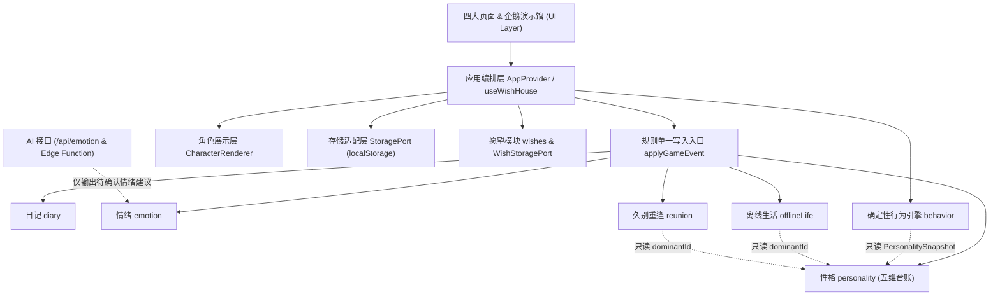

<div align="center">

# 拾绪 · ShiXu

**把日子轻轻收好，让心情有处安放**

*快乐化作成长的印记，悲伤被温柔收藏。*

<p>
  一款融合 <strong>AI 情绪识别</strong>、<strong>确定性五维性格养成</strong> 与 <strong>绘本风情感陪伴</strong> 的交互式 Web 应用。<br/>
  写下真实的日常心情，陪伴一只住在阳光小屋里的原创黑白企鹅，在长久相处中长出独一无二的性格与生活节奏。
</p>

<p>
  <a href="https://shixu-486cn1yd59z.qoder.zone/">
    
  </a>
  <a href="https://shixu-486cn1yd59z.qoder.zone/penguin-demo.html">
    
  </a>
</p>

<p>
  
  
  
  
  
  
  
</p>

<br/>



<p>
  <sub>▲ <strong>企鹅小屋</strong>：窗边自然光洒落地毯，原创黑白企鹅正在按自己的主导性格安静陪伴</sub>
</p>

</div>

---

<p align="center">
  <a href="#-四大手帐空间">四大空间</a> ·
  <a href="#-核心体验与产品机制">核心机制</a> ·
  <a href="#-企鹅的生命感与动作展示">企鹅生命感</a> ·
  <a href="#-技术架构与边界设计">技术架构</a> ·
  <a href="#-本地运行与部署">本地运行</a> ·
  <a href="#-已实现与未来规划">版本与规划</a>
</p>

## 🌿 拾绪是什么

很多记录心情的应用只是一张静态表单：写完、保存、列表多一行字。

**拾绪（ShiXu）** 希望让情绪被认真接住——你写下的每一篇日记都不会被改写或评判，而是通过**人工确认的心情与维度**，化作陪伴企鹅长期性格成长的微弱养分。日复一日，这只住在暖阳小屋里的小企鹅会慢慢形成属于你们相处的脾气与习惯：在窗边发呆、捧着书安静陪伴、在屋里好奇张望，或是在你离开几天后轻轻问候一句：

> *“最近过得还好吗？”*

没有连续签到压力，没有饥饿值与掉级惩罚，也不做心理诊断或分数榜单——**所有情绪都值得被温柔安放。**

---

## 📖 四大手帐空间

拾绪由四个风格统一的绘本手帐页面构成，数据保存在你的浏览器本地，打开即可体验。

<table>
  <tr>
    <td width="50%" valign="top">
      
      <p><strong>🏡 企鹅小屋（<code>/</code>）</strong></p>
      <p>企鹅的独立生活空间。展示当前自主行为、主导性格的自然语言描述、三种即时互动（呼唤 / 摸摸头 / 凑近看看），以及你离开期间的离线生活片段与久别重逢问候。</p>
    </td>
    <td width="50%" valign="top">
      
      <p><strong>✏️ 心情日记（<code>/diary</code>）</strong></p>
      <p>信纸质感的记录空间。正文<strong>原样保存、不设字数上限、不被 AI 改写或润色</strong>；可从九类情绪中选择并微调主观感受维度，也可一键请求 AI 给出心情建议后再亲自确认。</p>
    </td>
  </tr>
  <tr>
    <td width="50%" valign="top">
      
      <p><strong>📔 回忆碎片（<code>/memories</code>）</strong></p>
      <p>对开式手帐本，支持沿书脊真实翻页阅读。左侧汇集时间索引、本月心情小记与阅读进度，右侧呈现完整原文，支持随时编辑正文与纠正当时心情。</p>
    </td>
    <td width="50%" valign="top">
      
      <p><strong>🌟 许愿屋（<code>/wishes</code>）</strong></p>
      <p>把心里的小愿望折成手作纸团放进透明玻璃杯；当你亲手点下「完成」时，纸团会轻盈升起，化作杯口上方闪烁的星星。独立于日记与性格系统，不设截止日与催促。</p>
    </td>
  </tr>
</table>

---

## ✨ 核心体验与产品机制

### 1. AI 情绪识别：只做建议，不越界

日记情绪识别面向**阿里云百炼（Model Studio）决策模型**（`decision-model-preview`，TypeSafe System One 兼容协议）设计。单次请求将日记原文作为纯数据送入，并行提出 5 个结构化问题（1 个 `Choice` 主情绪 + 4 个 `Score` 连续维度），经严格结构与概率容差校验后返回建议：

- **九类情绪**：`开心 joy` · `安心 calm` · `悲伤 sadness` · `焦虑 anxiety` · `愤怒 anger` · `疲惫 tired` · `复杂 mixed` · `平常 neutral` · `说不清 unknown`
- **多维刻画**：`Valence`（效价）· `Arousal`（唤醒度）· `Dominance`（控制感）· `Intensity`（情绪强度）+ 各回答最小聚合 `Confidence`（置信度）
- **严格的人机边界**：
  - AI 输出仅作为**待确认建议**，必须由用户亲自确认或改判后才会进入正式保存；低置信度（`< 0.6`）或 `unknown` 会额外提醒核对。
  - **AI 无权修改性格分数、判定主导性格、选择企鹅动作或写入存档。**
  - 无服务端 Key、请求超时、输入超限或网络异常时，自动降级为手动心情选择，**完整日记原文仍可正常保存**。

> **关于在线 AI 接口的现状说明**：仓库已完成 Next.js `/api/emotion` 与 Qoder Sites Edge Function `/functions/v1/app` 的共享核心实现（`functions/shared/`），支持百炼两位小数概率响应兼容与密钥隔离；出于公开静态站点的费用边界考虑，当前公开体验版默认关闭服务端真实模型调用（`AI_EDGE_ENABLED` 默认关闭），在本地或自托管环境配置 `.env.local` 后即可启用真实百炼识别，未配置时手选流程完整可用。

### 2. 五维性格养成：缓慢、稳定、无惩罚

长期被用户确认过的情绪，会按确定性规则（`personality-v2`）缓慢累积进五维性格贡献账本：

| 性格维度 | ID | 行为倾向表现 | 主导描述示例 |
| :--- | :--- | :--- | :--- |
| **温柔** | `gentleness` | 轻轻挥手、安静坐下、抱膝休息、温柔注视 | *“它常常带着温柔，静静陪伴着你。”* |
| **好奇** | `curiosity` | 东张西望、观察物品、四处探索、靠近新发现 | *“它喜欢观察新事物，四处探索。”* |
| **开朗** | `cheerfulness` | 蹦跳、转圈、主动打招呼、开心晃动 | *“它常常活泼地活动，向你表达亲近。”* |
| **害怕** | `fearfulness` | 缩起身体、躲到角落、犹豫靠近、轻轻后退 | *“它喜欢待在安心的角落，小心地观察周围。”* |
| **低落** | `low_mood` | 低头发呆、独自坐着、缓慢走动、靠窗沉思 | *“它最近更喜欢安静独处，慢慢度过时光。”* |

- **只表达不评判**：五维分数独立保存、不做归一化，界面**不展示精确分值、排名或雷达图**，也不对用户作任何心理健康推断；界面只呈现当前最高分主导性格的文字陪伴与行为差异。
- **防抖动主导切换**：只有另一维度严格超过当前主导分时才发生切换，分数并列时保留当前主导，避免情绪波动导致性格反复横跳。
- **温柔底线**：单次记录与单日净增量均设上限，编辑正文不改变成长，纠正心情只按替换规则重算该条贡献；悲伤、焦虑与愤怒是正常情绪表达，**不存在任何扣分、掉级或离线惩罚**。

### 3. 许愿屋：杯中纸团与升起的星

许愿屋拥有独立的数据领域（`src/domain/wishes.ts`）与本地存储键（`shixu.wishes.v1`），不与日记情绪和五维性格耦合：

- 写下愿望后，玻璃杯中会落入一颗带有手作折痕与固定槽位的彩色纸团（刷新页面不会打乱位置）。
- 当你手动点击「完成」，对应的纸团会伴随着粒子升起，变为杯口上方闪烁的金色星星。
- 没有任何截止日期、打卡提醒或未完成惩罚——没实现的愿望只是安静待在玻璃杯里，陪你慢慢往前走。

---

## 🐧 企鹅的生命感与动作展示

### 活在小屋里的日常细节

- **组件化原创 SVG 角色**：将企鹅身体与五官拆分为独立 SVG 层，实现 **9 种组合表情** 与 **正 / 左 / 右 / 背 4 种朝向**。
- **常驻生命层（Stage 9 Life Layer）**：在所有行为之上叠加自然眨眼、坐/站差异化呼吸起伏、随指针轻微跟随的视线与低频歪头，并支持页面隐藏自动暂停与 `prefers-reduced-motion` 低动态降级。
- **保存后的短暂回应**：日记正式保存成功后（不强制跳离日记页），回到小屋时企鹅会短暂中断自主动作看向你，按本次情绪与性格给出一次性自然反馈（仅正式保存的 `开心` 会触发短暂爱心）。
- **离线生活与久别重逢**：网页关闭期间不运行后台代理；再次打开时，系统依据最后一次有效活动时间（`lastActiveAt ?? lastVisitAt`）与当前主导性格，幂等地补全有限的离线生活片段（如照顾植物、探索房间、靠窗沉思）。超过 3 天未访问时，企鹅会主动问候一次「最近过得还好吗？」，你可以自由回应或跳过，不产生任何数值增减。

### 🎭 企鹅动作演示馆（`/penguin-demo`）

为了让访客无需连续多日记录日记也能直观感受企鹅的细腻动态，项目内置了与正式存档完全隔离的 **[企鹅动作演示馆](https://shixu-486cn1yd59z.qoder.zone/penguin-demo.html)**，可随时点播全部 27 个行为动作、9 种表情与 4 个方向姿态：

<div align="center">
  
</div>

<details>
<summary><strong>🌙 叙事彩蛋：连续低落下的特殊行为（点击展开查看实机画面与设定说明）</strong></summary>

<br/>

当且仅当同时满足以下两个条件时，企鹅在日常活动中有 **15%** 的概率进入一段持续 **8 秒** 的特殊叙事动画（「喝酒」或「抽烟」）：

1. 企鹅当前最高分的主导性格为 **「低落（<code>low_mood</code>）」**；
2. 用户 **连续 4 个自然日** 每天至少正式保存 1 条 **「悲伤（<code>sadness</code>）」** 日记（第 4 天保存后具备触发资格）。

> **产品立场声明**：该机制仅作为虚构角色的叙事彩蛋，用于安静映照情绪低谷期的陪伴感。它不提供任何成长积分、隐藏奖励或解锁进度；当主导性格改变、连续记录中断或情绪纠正导致不再满足条件时即刻停止触发。拾绪**绝不将烟酒宣传、美化或推荐为应对情绪的方式**。

<table>
  <tr>
    <td width="50%" align="center">
      
      <br/><sub>特殊叙事动作 · <code>drink</code>（坐下拿起深绿色啤酒瓶）</sub>
    </td>
    <td width="50%" align="center">
      
      <br/><sub>特殊叙事动作 · <code>smoke</code>（安静坐着与缓缓飘散的轻烟）</sub>
    </td>
  </tr>
</table>

</details>

---

## 🏛️ 技术架构与边界设计

拾绪采用 **模块化单体（Modular Monolith）** 架构：所有核心业务规则均以无副作用的 TypeScript 纯函数实现，并通过显式契约、版本化配置与单一写入边界协作，不引入数据库、后端账号体系、复杂全局状态框架或前端动画库。

### 核心技术栈

| 层级 | 选型与实现 | 说明 |
| :--- | :--- | :--- |
| **前端框架** | Next.js 16 (App Router) · React 19 · TypeScript 5 | 支持常规全栈运行与 `output: "export"` 纯静态导出 |
| **视觉与动效** | Tailwind CSS 4 · 原生 SVG + CSS Keyframes | 手帐纹理、书脊翻页（View Transition）、组件化企鹅与生命层 |
| **AI 情绪分析** | 阿里云百炼 `decision-model-preview` | TypeSafe System One 协议，Next Route 与 Edge Function 共享校验核心 |
| **托管与边缘能力** | Qoder Sites（静态托管 + Deno Edge Function） | 构建脚本自动归一化 Windows RSC 分段路径并适配 `.html` 路由 |
| **本地持久化** | 浏览器 `localStorage`（`StoragePort` / `WishStoragePort`） | 支持 `Snapshot` v1→v4 迁移、损坏原文导出恢复、跨标签页冲突检测 |

### 模块依赖与单一写入边界



- **显式时间与确定性**：领域层纯函数不调用 `Date.now()`、`Math.random()` 或网络请求；时间、`dayKey`、`eventId` 与随机种子均由应用层显式传入，确保 `applyGameEvent` 幂等、可重放、可测试。
- **完整的本地数据主权与保护**：
  - 日记与性格快照存储在 `shixu.snapshot.v1`（当前 `schemaVersion = 4`），愿望存储在独立的 `shixu.wishes.v1`；**无登录、无云端数据库、个人日记不持久化至第三方服务器**。
  - 若检测到存档损坏或来自更高版本，系统会保留原始数据并提供导出与手动重置入口，绝不静默覆盖；多标签页并发写入会触发修订号检查与冲突提示。

### AI 协同开发与设计工作流

拾绪在研发过程中采用 **Spec & 契约驱动的 AI 协同工程流**：
1. **文档先行与边界锁定**：通过仓库内 `AGENTS.md` 与 `docs/` 系列规格文档先行约定五维数值模型、AI 权限隔离与存档迁移链。
2. **概念视觉到高保真代码复刻**：先确定手帐/小屋/企鹅概念视觉基线，再在浏览器多视口下逐轮精细还原——包括日记信纸横线与文字行高的相位对齐、手帐本沿书脊的 3D 翻页细节、许愿杯内折痕纸团的立体光影与落底排布，以及企鹅眨眼与身体动作的 SVG 坐标解耦。
3. **分阶段分支与独立 PR 审查**：每个能力模块遵循「任务卡 → 独立功能分支 → 最小主流程与异常路径验证 → PR 审核合入」的工程节奏推进。

---

## 💻 本地运行与部署

### 环境要求

- Node.js `^20.17.0 || >=22.9.0`（仓库含 `.nvmrc`）
- npm `11+`

### 快速启动

```bash
# 1. 克隆仓库
git clone https://github.com/goodluck55k/ShiXu.git
cd ShiXu

# 2. 安装依赖
npm install

# 3. 启动本地开发服务器
npm run dev
```

打开 [http://localhost:3000](http://localhost:3000) 即可访问（本地开发时，演示馆入口为 `/penguin-demo`）。

> **零密钥开箱可用**：不配置任何环境变量即可完整体验全部四大页面、手动心情选择、五维性格养成、企鹅自主行为、离线重逢与许愿屋功能。

### 启用阿里云百炼 AI 情绪识别（可选）

如需在本地或自托管 Next.js 服务端启用真实 AI 心情建议，可复制 `.env.example` 为 `.env.local` 并填入你的阿里云百炼服务端配置：

```bash
cp .env.example .env.local
```

核心服务端环境变量（**仅服务端读取，严禁使用 `NEXT_PUBLIC_` 前缀或提交至仓库**）：

- `MODEL_API_KEY`：阿里云百炼 API Key
- `BAILIAN_WORKSPACE_ID`：百炼业务空间 ID（或通过 `MODEL_BASE_URL` 指定完整 Endpoint）
- `MODEL_NAME`：默认 `decision-model-preview`
- `AI_PROVIDER_MODE`：默认 `bailian`（仅在本地测试/演示时可设为 `mock`）

### 常用构建与检查命令

| 命令 | 用途 |
| :--- | :--- |
| `npm run build` | 标准 Next.js 生产构建（含 `/api/emotion` 服务端路由） |
| `npm run start` | 启动标准 Next.js 生产服务 |
| `npm run build:export` | 构建 Qoder Sites 静态产物至 `out/`（自动归一化 Windows RSC 分段路径并移除开发预览页） |
| `npm run typecheck` | TypeScript 全量类型检查（`tsc --noEmit`） |
| `npm run lint` | ESLint 代码规范检查 |
| `npm run test:wishes` | 运行许愿屋领域与存储测试 |

---

## 🗺️ 已实现与未来规划

为保证信息透明，以下严格区分**当前 `main` 分支已实现能力**与**后续规划方向**：

### ✅ 当前已实现（V1 核心闭环）

- **四大正式页面与隔离演示馆**：企鹅小屋 `/`、心情日记 `/diary`、回忆碎片 `/memories`（含沿书脊翻页）、许愿屋 `/wishes` 与企鹅动作演示馆 `/penguin-demo`。
- **完整的情绪与性格引擎**：九类情绪与 VAD 调节、AI 建议契约与手选降级、五维性格贡献账本与防抖动主导判定、纠正心情单条替换重算。
- **企鹅角色与生命系统**：原创黑白企鹅 SVG、9 种表情、4 朝向、27 种行为决策、Stage 9 常驻眨眼/呼吸/视线生命层、保存后一次性反馈、连续低落特殊叙事彩蛋、离线生活与久别重逢。
- **本地存储与静态托管**：`Snapshot` v1→v4 自动迁移、损坏与未来版本保护、独立愿望存储、Qoder Sites 静态导出与 Edge Function 共享实现（公网版 AI 默认关闭）。

### 🔭 后续规划（尚未实现）

- **阶段九 · 语言表达与动作扩展**：
  - 本地手写风企鹅台词气泡（`speech-v1`，按时机 × 主导性格 × 时间段选句，已规划预留未来语音/对话接口）。
  - 日常展示变体小动作（如打哈欠、伸懒腰、梳理羽毛、打盹）与直接点击企鹅的精细反馈。
- **公开 AI 联调与平台层防护**：在具备平台级全局限流与持久预算控制后，评估开启线上站点的真实百炼情绪分析。
- **跨设备与移动端长周期验收**：进一步完善多尺寸移动视口细节与长期存档自然触发验证。
- **V2 独立模块（规划中）**：基于只读性格快照与 `AppearanceConfig` 扩展点的饰品装扮系统（V1 不含商店、货币或收集体系）。

---

## 📚 相关文档

仓库内保留了完整的产品规格、数值设计与技术边界文档，欢迎深入查阅：

- [产品规格（PRODUCT_SPEC）](docs/PRODUCT_SPEC.md) — 产品定位、核心循环、四大页面职责与范围内外
- [性格与行为规格（COMPANION_SPEC）](docs/COMPANION_SPEC.md) — 五维评分、主导规则、27 种行为与连续低落特殊规则
- [系统架构（ARCHITECTURE）](docs/ARCHITECTURE.md) — 模块边界、领域事件、数据模型与存档迁移链
- [AI 情绪识别契约（AI_CONTRACT）](docs/AI_CONTRACT.md) — 百炼决策模型五问协议、校验容差与权限边界
- [分阶段开发路线（ROADMAP）](docs/ROADMAP.md) — 研发阶段演进与验收基线
- [阶段九生命感设计（STAGE9_DESIGN）](docs/STAGE9_DESIGN.md) — 常驻生命层、台词气泡与后续演进规划

## 📄 开源协议

本项目基于 [MIT License](LICENSE) 开源。
