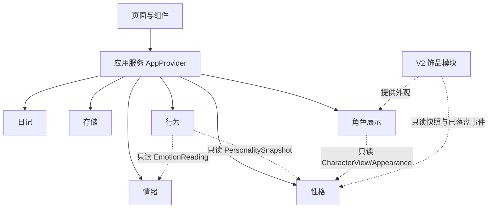

# 拾绪 ShiXu · 系统架构

> 状态：V1 架构基线。标注「已实现」的以 `main` 分支代码为准；「阶段 N 规划」表示尚未合入。产品范围见 [PRODUCT_SPEC](PRODUCT_SPEC.md)，性格与行为参数见 [COMPANION_SPEC](COMPANION_SPEC.md)。

## 1. 架构原则

1. **模块化单体**：一个 Next.js 应用、一个仓库，按职责拆分领域模块；不拆微服务、不做多包发布、不引入消息队列或插件运行时。
2. **契约驱动**：模块之间只通过本文列出的公开类型与函数协作；禁止跨模块读取/修改私有状态，禁止组件直接改存档。
3. **配置驱动**：性格维度、情绪映射、成长幅度、行为权重、描述文案由带版本号的配置对象定义；React 组件与页面不得硬编码这些规则。
4. **确定性**：所有正式状态变化由纯函数规则完成；时间、`dayKey`、`eventId`、随机种子由应用层显式提供，领域层不调用 `Date.now()`、`Math.random()` 或网络。
5. **单一写入边界**：只有应用服务（`AppProvider`）可以组合模块并调用存储；存档成功后才更新界面正式状态。
6. **独立任务卡**：每个阶段/模块任务必须填写 [MODULE_TASK_CARD](MODULE_TASK_CARD.md)，先声明契约变更再写代码。

不引入：Tauri/Rust、数据库、登录、微服务、Agent 框架、向量库、复杂全局状态框架、动态插件加载器。

## 2. 模块划分

| 模块 | ID | 负责 | 公开契约 | 私有状态 | 配置 |
| --- | --- | --- | --- | --- | --- |
| 日记 | `diary` | 原文记录、编辑、历史读取 | `Entry`、`DiaryEntryInput` | 日记正文与修订（通过快照持有） | 无业务阈值 |
| 情绪 | `emotion` | 九类情绪、VAD、AI 建议规范化与确认 | `EmotionReading`、`Analysis`、`EmotionSuggestion`、`validateAnalysis` | 无持久状态 | `MANUAL_EMOTION_DEFAULTS` |
| 性格 | `personality` | 长期台账、五维派生、描述、只读查询 | `PersonalityState`、`PersonalitySnapshot`、`PersonalityRuleConfig`、`derivePersonality` | 贡献台账 | `PERSONALITY_RULES_VERSION` + 规则配置 |
| 行为 | `behavior` | 性格与情绪驱动的行为选择、互动反应 | `BehaviorContext`、`BehaviorDecision`、`BehaviorRuleConfig`、`selectBehavior` | 无持久状态（运行时序号） | `BEHAVIOR_RULES_VERSION` + 规则配置 |
| 角色展示 | `character` | 按视图渲染小人、表情、动作、图层 | `CharacterView`、`AppearanceConfig` | 无 | 图层/动作映射 |
| 存储 | `storage` | 版本化存档、加载、保存、恢复、迁移入口 | `StoragePort`、`LoadResult`、`SaveResult` | localStorage 键 | 迁移表 |
| 装扮（V2） | `decoration` | 饰品状态、解锁、穿戴 | 仅预留读取与外观扩展点 | V2 自行持有 | V2 定义 |

### 2.1 依赖方向



- 行为模块不导入性格模块的内部实现，只接收 `PersonalitySnapshot`。
- 角色展示模块不导入性格、行为或存储模块，只接收视图数据。
- 存储模块不导入规则模块，不决定分数、奖励或行为。
- 页面不直接调用 `localStorage`，不直接修改 `Snapshot`。
- V2 模块不得写 `PersonalityState`，不得修改行为规则。

### 2.2 模块任务卡的边界要求

每张任务卡必须写明：模块归属、输入/输出、修改了哪些公开契约、内部状态所有权、配置与版本、明确不做、最小验收。跨模块修改必须同时更新本文与调用方，不允许「先改代码再补文档」。

## 3. 目录规划

| 路径 | 状态 | 责任 |
| --- | --- | --- |
| `src/app/{layout,page}.tsx`、`src/app/companion/page.tsx`、`src/app/memories/page.tsx` | 已实现 | 路由与页面壳，共享根布局状态 |
| `src/app/api/emotion/route.ts` | 已实现 | 服务端情绪识别入口 |
| `src/application/AppProvider.tsx` | 已实现 | 状态编排、保存、草稿、恢复、跨标签页冲突 |
| `src/application/useEmotionAnalysis.ts` | 已实现 | AI 建议请求、过期响应丢弃、降级 |
| `src/domain/types.ts` | 已实现，阶段二扩展 | 公共类型与契约 |
| `src/domain/emotions.ts` | 已实现 | 手选默认 VAD、规范化 |
| `src/domain/rules.ts` | 已实现，阶段二扩展 | 领域事件、原子结算、迁移入口 |
| `src/domain/schema.ts` | 已实现，阶段二扩展 | 存档结构校验 |
| `src/domain/companion.ts` | 已实现（三维护账） | 阶段二拆分为 `personality.ts` + 配置 |
| `src/domain/personality.ts` | 阶段二规划 | 五维派生、描述、只读查询 |
| `src/domain/behavior.ts` | 阶段三规划 | 确定性行为选择、互动反应 |
| `src/domain/characterView.ts` | 已实现（静态占位） | 由快照/行为推导视图 |
| `src/config/personality.ts` | 阶段二规划 | `PersonalityRuleConfig` |
| `src/config/behavior.ts` | 阶段三规划 | `BehaviorRuleConfig` |
| `src/lib/storage/{port,localStorageAdapter}.ts` | 已实现 | 存储接口与浏览器实现 |
| `src/components/character/CharacterRenderer.tsx` | 已实现（静态占位） | SVG 渲染与图层白名单 |
| `src/components/emotion/*`、`src/components/memories/*` | 已实现 | 记录、纠正、历史界面 |

阶段二不要求一次性重命名所有文件；但新代码必须落在上表声明的目标位置，旧文件只做兼容或删除，不允许出现两份性格实现。

## 4. 核心数据模型

### 4.1 情绪与日记（已实现，字段保持）

```ts
type EmotionLabel = "joy" | "calm" | "sadness" | "anxiety" | "anger" | "tired" | "mixed" | "neutral" | "unknown";
type EmotionSource = "ai" | "manual" | "corrected";

interface EmotionReading {
  label: EmotionLabel;
  valence: number;    // 0–1
  arousal: number;    // 0–1
  dominance: number;  // 0–1
  intensity: number;  // 0–1
  confidence: number | null;
  source: EmotionSource;
}

interface Entry {
  id: string;
  text: string;            // 原文，保存后不改写
  createdAt: number;
  updatedAt: number;
  dayKey: string;          // YYYY-MM-DD，保存时冻结
  revision: number;
  originalAnalysis: Analysis | null;
  analysisMeta: AnalysisMeta | null;
  effectiveEmotion: EmotionReading;
  corrections: EmotionCorrection[];
  awardedXp?: number;      // 旧字段，只兼容保留，不读取、不写入
  rulesVersion: string;    // 日记/事件规则版本（V1 为 "rules-v1"），不是性格规则版本
}
```

`Analysis`、`EmotionCorrection`、`AnalysisMeta` 保持 [AI_CONTRACT](AI_CONTRACT.md) 与现有 `src/domain/types.ts` 的定义。`Entry.text` 不设产品字数上限，只校验非空白。

### 4.2 性格（阶段二，schemaVersion 3）

```ts
type DimensionId = "liveliness" | "courage" | "gentleness" | "sensitivity" | "curiosity";

interface PersonalityContribution {
  dayKey: string;
  label: EmotionLabel;
  entryRevision: number;
  deltas: Record<DimensionId, number>; // 结算后的最终增量，派生只求和
  rulesVersion: string;     // 该条贡献结算时使用的 personality-* 版本
}

interface PersonalityState {
  contributions: Record<string, PersonalityContribution>; // key = entryId
  rulesVersion: string;     // 新结算使用的版本 "personality-v1"；不用于重读旧分数
}

interface PersonalitySnapshot {
  scores: Record<DimensionId, number>;        // 派生，不落盘
  descriptions: Record<DimensionId, string>;
  rulesVersion: string;
}

interface PersonalityRuleConfig {
  rulesVersion: string;
  dimensions: Array<{ id: DimensionId; label: string; description: string }>;
  initialScore: number;
  minScore: number;
  maxScore: number;
  perSaveCap: number;
  dailyNetCap: number;
  intensityBands: Array<{ maxExclusive: number; factor: number }>;
  emotionDeltas: Record<EmotionLabel, Record<DimensionId, number>>;
  descriptions: Record<DimensionId, { low: string; balanced: string; high: string }>;
  bands: { lowMax: number; highMin: number };
}
```

- 分数永远由 `contributions` 纯派生：`clamp(initial + Σdeltas, min, max)`；`deltas` 是写入时已受单次/单日上限约束的最终增量，派生不再按日重算，不存储第二份分数。
- `initialScore`/`minScore`/`maxScore` 是存档级不变量；变更必须走显式迁移，不能只升 `rulesVersion` 就让旧分数随当前配置变化。
- 纠正只重算被纠正条目：先扣除旧贡献，以其余贡献的当日合计为余量；其他条目、其他日期不重算。余量不足时该条最终增量可为 0。
- 旧 `CompanionState.contributions`（三维护账）不进入 `PersonalityState`；迁移后放入 `legacy`。
- 配置集中在 `src/config/personality.ts`，组件与页面不得引用 `emotionDeltas` 自行算分。

### 4.3 行为（阶段三，运行时）

```ts
type BehaviorId = "idle" | "stroll" | "rest" | "explore" | "play";
type TimeBand = "morning" | "afternoon" | "evening" | "night";
type InteractionType = "call" | "pat" | "observe";

interface InteractionEvent {
  id: string;
  type: InteractionType;
  occurredAt: number;
  seed: number;
}

interface BehaviorContext {
  personality: PersonalitySnapshot;   // 只读
  emotion: EmotionReading | null;     // 当前已确认情绪
  interaction: InteractionEvent | null;
  dayKey: string;
  timeBand: TimeBand;
  sequence: number;
  seed: number;
  lastBehaviorId: BehaviorId | null;
  consecutiveCount: number;
}

interface BehaviorDecision {
  behaviorId: BehaviorId;
  pose: string;
  expression: string;
  durationMs: number;
  reasonCode: string;
}

interface BehaviorRuleConfig {
  rulesVersion: string;
  behaviors: Array<{ id: BehaviorId; label: string; baseWeight: number; pose: string; expression: string }>;
  dimensionWeights: Array<{ dimension: DimensionId; band: "low" | "high"; weights: Partial<Record<BehaviorId, number>> }>;
  emotionWeights: Record<EmotionLabel, Partial<Record<BehaviorId, number>>>;
  timeWeights: Record<TimeBand, Partial<Record<BehaviorId, number>>>;
  minShare: number;
  maxConsecutive: number;
  tickIntervalMs: [number, number];
  interactionDurationMs: [number, number];
}
```

行为决策不写 `Snapshot`，不需要 `eventId` 幂等；互动反馈与保存后情绪表现只存在于运行时内存。

### 4.4 角色视图

```ts
interface AppearanceConfig {
  layerIds: string[];        // 必须经过图层白名单
  effects?: string[];
}

interface CharacterView {
  expression: string;
  pose: string;
  animation: string;
  visibleLayerIds: string[];
  effects: string[];
  appearance?: AppearanceConfig;  // V1 不填；V2 饰品提供
}
```

### 4.5 存档（schemaVersion 3）

```ts
interface SnapshotV3 {
  schemaVersion: 3;
  revision: number;
  entries: Entry[];
  character: {
    latestEntryId: string | null;
    currentEmotion: EmotionReading | null;
  };
  personality: PersonalityState;
  memories: MemoryEvent[];
  appliedEventIds: string[];
  legacy?: {
    character?: { totalXp?: number; stage?: number };
    decorations?: unknown;      // v2 DecorationState 原样保留
    companion?: unknown;        // v2 contributions/habits/world 原样保留
  };
}
```

- `legacy` 只在迁移旧存档时出现；V1 不读、不展示、不参与结算，只保证原样往返。
- `MemoryEvent` 类型在 V1 只新增 `ENTRY_SAVED`、`ENTRY_TEXT_EDITED`、`EMOTION_CORRECTED`；旧 `ITEM_*`、`STAGE_REACHED` 只用于读取历史，不再产生。
- 旧 `DecorationState`、`HabitProgress`、`WorldTrace` 类型可暂时保留为兼容类型，但不得进入 V1 业务逻辑。

## 5. 模块接口与领域事件

| 接口 | 模块 | 状态 | 说明 |
| --- | --- | --- | --- |
| `analyzeEmotion(input)` | emotion（服务端） | 已实现 | 调用 Provider 或 mock，只返回 `Analysis` |
| `validateAnalysis(value)` | emotion | 已实现 | 字段、范围、九类标签校验 |
| `createManualEmotion(label, dims?)` | emotion | 已实现 | 手选默认 VAD，`confidence=null` |
| `derivePersonality(state, config)` | personality | 阶段二 | 纯派生五维分数与描述 |
| `describePersonality(snapshot)` | personality | 阶段二 | 返回页面文案，不含数字 |
| `selectBehavior(context, config)` | behavior | 阶段三 | 确定性加权选择 |
| `deriveCharacterView(snapshot, decision?)` | character | 阶段二/三 | 视图映射，只读 |
| `applyGameEvent(snapshot, event, context)` | rules | 已实现，阶段二扩展 | 唯一正式状态变更入口 |
| `migrateSnapshotV1toV2(v1)` | storage/rules | 已实现 | 保留 |
| `migrateSnapshotV2toV3(v2)` | storage | 阶段二 | 新增；只做结构转换，不调用计分规则 |
| `StoragePort.load/save/readRaw/reset` | storage | 已实现 | 签名不变，`Snapshot` 升为 v3 |

### 5.1 V1 领域事件

| 事件 | 作用 | 幂等键 | 前置校验 |
| --- | --- | --- | --- |
| `CONFIRM_ENTRY` | 创建日记、确认情绪、写贡献 | `eventId` + `entryId` | 正文非空白、entryId 不存在 |
| `EDIT_ENTRY_TEXT` | 原样改正文 | `eventId` + `expectedEntryRevision` | entry 存在、修订匹配 |
| `CORRECT_EMOTION` | 替换情绪与贡献 | `eventId` + `expectedEntryRevision` | entry 存在、修订匹配 |

- `applyGameEvent` 先查 `appliedEventIds`：重复 `eventId` 返回 `changed=false`，不产生副作用。
- `RESTORE_DECORATION`、`EQUIP_DECORATION`、`UNEQUIP_DECORATION` **不属于 V1**；`GameEvent` 联合类型可保留兼容分支但必须显式拒绝，不得悄悄执行业务。
- 回忆事件 id 由 `eventId + 类型 + entryId` 确定性生成，保证重放不重复。
- `GameContext` 只含 `now` 与 `dayKey`，由应用层生成；任何新增上下文（种子、时间段）必须显式加入契约。

### 5.2 应用流程（保存）

1. 页面产生草稿（正文、情绪、维度、AI 建议）。
2. 应用服务校验并生成 `eventId`、`entryId`、`now`、`dayKey`；重复点击复用冻结值。
3. 调用 `applyGameEvent` 得到候选 `Snapshot`；`changed=false` 直接结束。
4. 调用 `storage.save(candidate, expectedRevision)`。
5. 只有 `saved` 才更新 React 正式状态与 `lastConfirmedSave`；失败保留草稿与旧状态，不提前结算。
6. `confirmedSave` 只作为运行时上下文，供陪伴页一次性情绪反馈；消费一次即清除，刷新即失。

行为循环：可见时由应用层按 `tickInterval` 用显式种子与序号调用 `selectBehavior`，把 `BehaviorDecision` 映射为 `CharacterView` 交给角色层；不写存档。

## 6. 本地持久化与迁移

- 键：`shixu.snapshot.v1`（保持不变，值内区分版本）。
- 加载结果：`missing`、`ready`、`unsupported-version`、`corrupt`、`unavailable`；同一套 schema 校验用于读取与写入前检查。
- 保存：一次写完整快照；检查 `expectedRevision`；跨标签页冲突时暂停提交并提示；空间不足保留旧状态与草稿；临时体验模式只改内存，不覆盖正式存档。
- 损坏/版本过新：保留 `raw`，提供导出与重置，不静默覆盖。
- 迁移 v1→v2：已实现（补 `companion` 默认值，保留日记/情绪/历史）。
- 迁移 v2→v3（阶段二）：
  1. `entries`、`memories`、`appliedEventIds`、`revision` 原样保留；`Entry.text`、`effectiveEmotion`、`corrections` 逐字不动。
  2. `character.latestEntryId`、`currentEmotion` 保留；`totalXp`、`stage` 移入 `legacy.character`。
  3. `companion`（三维护账、habits、world）整体移入 `legacy.companion`，不换算、不计分。
  4. `decorations` 整体移入 `legacy.decorations`，不读取、不修改。
  5. 新建 `personality = { contributions: {}, rulesVersion: "personality-v1" }`，五维从初始分开始。
  6. 迁移只在内存完成；下次成功保存才落盘；失败不改变原存档。
  7. 不追溯旧日记、不静默改写不可识别字段、不删除用户历史。
  8. 迁移后旧条目没有 `PersonalityContribution`；之后对这些条目的纠正只更新 `effectiveEmotion`、`revision`、`corrections` 与回忆事件，不补建贡献、不改变性格分数。这是“不追溯”的一部分，不属于结算失败。
- 读取与写入校验除检查单条 `deltas` 范围外，还必须按 `dayKey` 聚合检查同日单维合计的绝对值不超过 `dailyNetCap`，防止构造存档或重复结算绕过上限。
- 迁移函数只读类型与配置，不导入计分/派生逻辑；`storage` 不得因新增 v2→v3 迁移而依赖 `rules`（既有 v1→v2 兼容迁移后续可一并移出，不阻塞阶段二）。
- 旧三维护账是否换算成五维：**待确认**；确认前一律不换算。

## 7. 角色渲染

- 原创全白小人使用 React + SVG；V1 规划 `viewBox="0 0 240 320"`。
- 图层顺序：后景特效 → 身体/四肢 → 表情/五官 → 头部细节 → 装饰图层（V2）→ 前景特效。
- 图层 ID 必须来自白名单；未知 ID 忽略并回落到基础形象，不得崩溃。
- `CharacterRenderer` 只接收 `CharacterView` 与可选外观，不读取 `Snapshot`、不调用规则函数。
- 尊重 `prefers-reduced-motion`；页面隐藏时暂停动画与行为调度。
- 现有静态占位渲染属于阶段五之前的临时载体，不得当作定稿视觉继续美化。

## 8. 兼容与交付

- 新增/修改公共类型必须同步本文、[COMPANION_SPEC](COMPANION_SPEC.md) 与调用方；不同步视为未完成。
- 存档结构变化必须提供迁移函数、失败路径与最小验证（旧档读取、正文/情绪不变、重复保存幂等）。
- V1 不引入 V2 业务字段；V2 接入时新增独立字段与迁移，不允许复用 `legacy` 执行业务。
- 演示前检查：手选主流程、AI 降级、刷新恢复、损坏存档提示、纠正替换、行为确定性。
