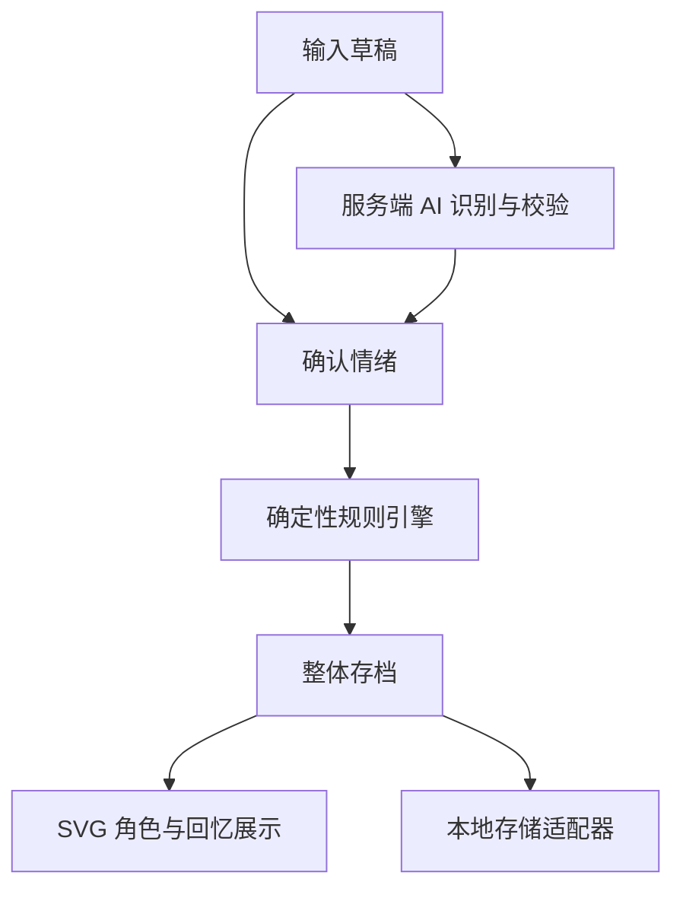

# 拾绪 ShiXu · 系统架构

本文按状态区分四类内容：**【已实现·P1】** main 已合入基线（PR #4）；**【已合入·PR #5】** 多页面 UI 与独立活动空间；**【已合入·C1·PR #8】** 隐藏性格贡献台账与 v1→v2 迁移（2026-11-10）；**【规划·C2–C6】** 尚未实现的接口与状态。项目约束见 [AGENTS](../AGENTS.md)；养成规则与数值唯一来源是 [COMPANION_SPEC](COMPANION_SPEC.md)；产品基线见 [PRODUCT_SPEC](PRODUCT_SPEC.md)；阶段见 [ROADMAP](ROADMAP.md)。当前 UI 仅为功能载体，处于 UI 冻结（AGENTS.md 第 2.2 节）。

## 1. 技术决策

| 层 | 固定方案 | 责任与边界 |
| --- | --- | --- |
| 页面 | Next.js App Router + React + TypeScript | 路由、输入、确认、回忆和状态展示；三路由结构由 PR #5 提供（已合入） |
| 样式 | Tailwind CSS | 响应式布局、组件外观、减少动态效果 |
| 角色 | React + 原创 SVG 独立图层 | 只消费规则产生的 CharacterView 与运行时行为状态，不改存档 |
| 领域 | TypeScript 纯函数 | 情绪到视觉、性格贡献、习惯结算、行为选择、世界成长、纠正；无 IO、随机或隐式时间 |
| 自主行为调度 | 应用层轻量有限状态机 + 显式时钟/种子 | 驱动选择、动画与打断，向领域提交结算事件；不自行决定规则结果 |
| AI | Next.js 服务端 Route Handler + 阿里云百炼 Provider 适配器 | 百炼决策模型（候选 `decision-model-preview`）的 Choice / Score（或等价结构）→ 校验与明确映射 → EmotionReading；不生成日记、不读写游戏存档、不决定性格或装饰 |
| 状态编排 | React Context + reducer / 应用服务 | 确认事件、串行规则调用、保存、刷新界面；唯一游戏提交入口 |
| MVP 持久化 | 浏览器 localStorage | 单个带版本 snapshot；schemaVersion 演进见第 6 节 |

不引入 Tauri、Rust、微服务、复杂 Agent、消息队列、云数据库、向量库；不为性格评分引入数据库或事件溯源系统。依赖版本沿用 P1 已锁定基线（Node 要求见仓库 .nvmrc 与 package.json），后续分支不无关改动。

## 2. 数据流与权限

【已实现·P1】确认主线：

直接手选绕过 API；任何识别响应均不能跳过确认进入规则。AI 调用不接收角色状态，不持有写入工具。应用服务生成 id、now、dayKey，再显式传给规则；规则内部不访问网络、localStorage、Date.now 或 Math.random。首次确认提交时应用服务生成并冻结该次操作的 now、dayKey（连同 eventId、entryId）；同一次逻辑操作保存失败后重试必须复用原有 eventId、entryId 与冻结的时间上下文，跨午夜重试不重新归日，新建另一条记录才使用新的时间上下文。

一次确认：校验输入 → 基于当前 snapshot 计算新 snapshot → 存储成功 → 更新 React 状态与成功提示。保存失败保留草稿、不改变旧 snapshot、不提前结算任何成长，可复用冻结的 eventId/entryId/时间上下文重试；不显示已保存。动作播放是提交结果的表现，不再次触发结算。请求和确认串行处理，防双击；同一 entryId 重试幂等。

【规划·V2】新增数据流：

- CONFIRM_ENTRY 扩展（C1）：保存成功时原子写入日记、性格贡献台账与回忆；向应用层暴露保存成功结果与本次确认情绪（含 eventId/entryId），供 C4 构造一次性共鸣上下文；C1 不实现导航与共鸣动画，保留已有保存流程。
- 自主生活循环（C3）：调度器（应用层）→ selectBehavior（领域纯函数，显式种子）→ 运行时动画 → 完整完成后提交 BEHAVIOR_SETTLED → 规则按单日上限结算习惯进度 → changed 才保存。页面隐藏暂停调度与动画；关闭网页不模拟离线生活，不产生虚构离线经历。
- 互动（C4）：用户互动 → INTERACT → 规则记录互动回忆（不改变性格与习惯进度）→ 保存；即时回应是运行时表现。
- 优先级：用户互动与新确认情绪共鸣可打断普通自主行为；被打断的行为不计入习惯积累；同时只有一个主要行为。
- 即时共鸣衔接（C4）：保存成功后应用层构造一次性共鸣上下文（eventId/entryId + 确认 EmotionReading，运行时内存，不写存档）并自动导航至 `/companion`；小人页面消费一次该上下文播放对应共鸣，结束后恢复正常自主活动。保存失败不构造上下文、不跳转、不播放；页面刷新、重复渲染、普通路由切换不重复触发同一次共鸣（上下文消费一次即清除、刷新即失，不从存档历史重建）；手动选择与 AI 确认共用同一路径；共鸣是运行时反馈，不触发额外性格/习惯结算；prefers-reduced-motion 下静态反馈。C1/C2 保留已有保存流程，不提前开发该衔接。
- 装饰结算（C5）：CONFIRM_ENTRY / CORRECT_EMOTION 成功改变性格贡献后，同一原子提交内用 `derivePersonality` 的确定性分数评估装饰条件，按滞回规则产生解锁、回收或再获得；回收自动取消穿戴资格，并追加永久历史。保存失败不改变任何装饰状态；不按情绪标签直接回收，不在页面打开、路由切换、离线或时间流逝时评估；AI 不参与。

【已合入·PR #5】多页面共享状态：AppProvider 与 AppShell 提升到根 layout，三路由（`/`、`/companion`、`/memories`）共享同一份 snapshot 与内存草稿（draft 提升进 Provider，不持久化）。V2 调度器同样位于应用层，跨路由只加载一次存档，路由切换不重复结算、不丢失草稿。

日记 text 无产品人为字数上限，只校验非空白而不修改正文；存储、历史展示和编辑均保留完整原文，正文按纯文本保留空白显示（如 white-space: pre-wrap）。AI 输入超限独立降级为手选，不截断日记。正文编辑走 EDIT_ENTRY_TEXT，不自动重识别或改变心情；主动重识别/手选经确认后才走 CORRECT_EMOTION。API 的 inputRevision 是草稿/选择版本，与存档 Entry.revision 区分；正文或手选改变、切换记录、保存/取消时使旧请求失效，详见 AI 契约。

## 3. 目录规划

| 路径 | 状态与内容 |
| --- | --- |
| src/app/layout.tsx、page.tsx、globals.css | 已实现·P1；PR #5 已改为根 layout 共享状态与三路由（已合入） |
| src/app/companion/page.tsx、src/app/memories/page.tsx、src/components/AppShell.tsx、src/components/character/CompanionScreen.tsx | 已合入·PR #5：小人活动空间、回忆页与导航 |
| src/app/api/emotion/route.ts | 规划·C2：POST 情绪接口，服务端调用百炼，无游戏写权限 |
| src/components/emotion/ | 已实现·P1：手选草稿与维度调整；AI 建议与纠正的最小临时控件规划·C2（不进行 UI 重设计） |
| src/components/character/ | 已实现·P1：CharacterRenderer（静态占位视图）；行为动画规划·C3；共鸣图层规划·C4；装饰穿戴最小呈现规划·C5 |
| src/components/memories/ | 已实现·P1：历史列表；新回忆类型与装饰历史展示规划·C4/C5 |
| src/domain/types.ts、schema.ts、rules.ts、emotions.ts、characterView.ts | 已实现·P1/C1：公共类型、校验与规则（rules 已实现 CONFIRM_ENTRY / EDIT_ENTRY_TEXT / CORRECT_EMOTION；characterView 仍为静态占位） |
| src/domain/companion.ts | 已实现·C1：性格评分、贡献台账、纠正替换、描述派生、v1→v2 迁移；行为选择与习惯结算规划·C3；世界痕迹规划·C4 |
| src/domain/decorations.ts | 规划·C5：装饰目录、条件评估、状态转换与永久历史纯函数；不自行决定产品参数 |
| src/application/ | 已实现·P1：AppProvider、ids；自主行为调度器规划·C3；保存成功共鸣衔接规划·C4；装饰评估与提交编排规划·C5 |
| src/lib/ai/server/ | 规划·C2：server-only 百炼适配器、请求构造、原始输出校验与映射 |
| src/lib/storage/ | 已实现·P1：StoragePort 与 localStorage 适配器；v1→v2 已实现·C1；v2→v3 迁移规划·C5 |
| docs/ | 本套指南（含新增 COMPANION_SPEC） |

以上路径按需要创建，不预先铺设空目录或占位框架。可在同模块中少量合并文件，但领域、AI、存储、渲染的依赖边界不能混淆。

## 4. 核心数据模型

### 4.1 已实现·P1 基线

公共类型已存在于 src/domain/types.ts，是模块协作基线，不得破坏性改名：

| 类型 | 必要字段与约束 |
| --- | --- |
| EmotionReading | label、VAD、intensity、confidence（manual/corrected 时 null）、source；边界见 AI 契约 |
| Entry | id、text（完整原文）、createdAt、updatedAt、dayKey、revision（初始 0）、originalAnalysis（可空）、analysisMeta（可空）、effectiveEmotion、corrections、awardedXp、rulesVersion；存在于 entries 即已确认保存，草稿只在应用层 |
| CharacterState | totalXp、stage、latestEntryId、currentEmotion |
| DecorationState | ownedIds、equippedBySlot、hiddenById；隐藏记录含 hiddenEventId、sourceEntryId、slot、hiddenAt、reason |
| MemoryEvent | id、type、entryId（可空）、occurredAt、rulesVersion、有限结构 payload（不复制完整正文，正文经 entryId 引用 Entry） |
| Snapshot | schemaVersion=2、revision、character、entries、decorations、memories、appliedEventIds、companion |
| CharacterView | expression、pose、animation、visibleLayerIds、effects；只读派生结果 |

实现事实：applyGameEvent 已实现 CONFIRM_ENTRY、EDIT_ENTRY_TEXT、CORRECT_EMOTION（C1，PR #8）；旧装饰 RESTORE/EQUIP/UNEQUIP 事件仍抛出「后续阶段实现」，且旧装饰隐藏/恢复语义不再执行；deriveCharacterView 返回静态占位；无 AI 路由。GameEvent 判别联合与九种 MemoryEvent 类型已定义；C2 接入情绪接口，C3 行为结算，C4 共鸣/世界痕迹，C5 装饰历史与穿戴按 ROADMAP 实现。Entry.text 是正文唯一正式存储位置；回忆 payload 只保存必要摘要；corrections 与成长事件完整保留。

### 4.2 已实现·C1 扩展（schemaVersion=2）

Snapshot 新增 companion 字段（命名规划，落地时同步类型与校验）：

| 字段 | 内容与约束 |
| --- | --- |
| companion.contributions | Record<entryId, {dayKey, label, deltas:{exploration, serenity, affinity}, entryRevision}>；有效贡献台账，性格唯一事实来源；dayKey 为该日记冻结值，deltas 为经单日上限截断后的实际应用值 |
| companion.habits | Record<habitId, {countedDayKeys: string[], totalCount: number, formedAt: number \| null}>；形成阈值与每日计数上限见 COMPANION_SPEC 第 5 节 |
| companion.world | 世界成长痕迹列表（C4 候选结构：{id, entryId \| null, dayKey, kind, label, createdAt}）；具体机制待确认，不提前冻结 |
| companion.companionRulesVersion | 初始 `companion-v1`；调参升版本，不追溯扣除已记录成长 |

性格分数是纯派生值：每维 `clamp(初始分 + Σ deltas, 下限, 上限)`，参数唯一来源 COMPANION_SPEC 第 2.3 节；不单独维护第二份可漂移的分数存档。derivePersonality 输出内部分数（仅供领域与调度消费）与用户可见的自然语言描述、习惯标签；UI 不得展示精确数值。

持久化与纯展示状态的边界：

| 持久化（Snapshot 内，原子提交） | 运行时/展示（不写存档） |
| --- | --- |
| entries、贡献台账、习惯进度、世界痕迹、memories、appliedEventIds、revision、旧版兼容字段 | 当前行为与场景位置、动画播放、共鸣播放与一次性共鸣上下文（eventId/entryId，消费一次即清除、刷新即失）、最近行为序列（防机械重复）、种子序号、草稿（PR #5 内存共享）、UI 状态 |

新增 GameEvent（规划）：BEHAVIOR_SETTLED（eventId、behavior、target 可空、completedAt，context 提供 now/dayKey）、INTERACT（eventId、targetId）。CORRECT_EMOTION 已由 C1 扩展为同时修订性格贡献（第 5.1 节）。新增 MemoryEvent 类型（规划）：HABIT_FORMED、COMPANION_INTERACTION、WORLD_TRACE_ADDED（候选，C4）。普通行为完成不默认生成回忆事件，避免写放大；仅习惯结算产生变化时写入。

### 4.3 装饰历史（规划·C5，schemaVersion=3）

Snapshot 新增 `decoration` 字段（字段名为规划，落地时同步类型与校验）：

| 字段 | 内容与约束 |
| --- | --- |
| decoration.history | 追加式事件数组，每项至少 `{id, decorationId, type: "OBTAINED" \| "RECLAIMED" \| "REOBTAINED", occurredAt, dayKey, entryId \| null, rulesVersion, basis:{scores, thresholds, result}}`；首次获取用 OBTAINED，回收后再达标用 REOBTAINED |
| decoration.decorationRulesVersion | 初始 `decoration-v1`；调参升版本，不改写旧事件，不追溯删除已有历史 |
| 当前状态 | 各装饰当前状态由最近一次事件与当前条件派生；不维护无法由历史重建的独立状态字段 |
| 旧字段 | 旧 `decorations.ownedIds / equippedBySlot / hiddenById` 只读兼容；不据此执行新的解锁/回收，旧数据映射待确认 |
| 穿戴 | 仅当前已获得且可穿戴的装饰可进入 `equippedBySlot`；回收时自动移除穿戴资格，但不删除获取与穿戴历史 |

装饰规则只读 `derivePersonality` 的确定性分数与装饰历史，纯函数、无 IO、无随机、不按情绪标签直接回收。`schemaVersion 2→3` 迁移保留全部旧字段、日记与性格历史，初始化空装饰历史；旧拥有数据未确认映射前不伪造首次获取时间。

旧版字段兼容：Entry.awardedXp、CharacterState.totalXp/stage、DecorationState 全部保留历史记录，不销毁；旧 XP 与旧装饰结算不再执行（PRODUCT_SPEC 第 5 节），也不进入新验收。MemoryEvent 既有类型与 payload 语义不变；originalAnalysis/corrections 仅保存规范化情绪与修订信息，禁止将厂商原生 answers 或整份响应写入 Snapshot。

## 5. 模块接口

【已实现·P1/C1】与【规划·C2–C6】签名：

| 接口 | 输入 → 输出 | 不允许做的事 |
| --- | --- | --- |
| analyzeEmotion(request)（规划·C2，百炼） | EmotionRequest → Promise<EmotionResponse> | 直接写 Snapshot、参与性格或装饰结算 |
| validateAnalysis(raw)（规划·C2） | unknown → Result<Analysis, ValidationError> | 静默制造成功情绪 |
| applyGameEvent(snapshot, event, context)（P1/C1 已实现） | Snapshot + GameEvent + {now, dayKey} → {snapshot, events, changed} | IO、随机、隐式读取时间 |
| deriveCharacterView(snapshot)（P1 占位实现） | Snapshot → CharacterView | 存储或状态变更 |
| scoreContribution(label, dayDeltas, params)（已实现·C1） | label + 当日各维合计 + 参数 → 经日上限截断的 deltas | 复制数值表（引用 COMPANION_SPEC）、IO |
| reviseContribution(contributions, entryId, newLabel, params)（已实现·C1） | 台账 → 替换修订后的台账 | 额外叠加、级联改写其他条目、改变原 dayKey |
| derivePersonality(companion)（已实现·C1） | Snapshot.companion → 内部分数 + 自然语言描述 + 习惯标签 | 向 UI 暴露精确数值、修改存档 |
| evaluateDecorations(personality, history, catalog, params)（规划·C5） | 派生分数 + 历史 + 目录 + 规则版本 → 本次状态变更事件（无变化返回空） | AI 决策、按情绪标签直接回收、隐式时间/随机、删除旧历史 |
| deriveDecorationView(history, personality, catalog)（规划·C5） | 历史 + 派生分数 + 目录 → 各装饰当前状态、可穿戴性与历史视图 | 修改存档、把精确性格数值暴露给 UI |
| selectBehavior(personality, habits, recent, seed)（规划·C3） | 显式状态与种子 → {behavior, target, duration} | Math.random、永久锁定单一行为、排除最低概率 |
| deriveResonance(emotion)（规划·C4） | 确认 EmotionReading → 共鸣变体与幅度（label × VAD/intensity） | 由模型指定动画 |
| migrateSnapshotV1toV2(v1)（已实现·C1） | 有效 v1 Snapshot → v2 Snapshot（纯函数、默认值、不追溯） | 丢弃旧字段、IO、自动覆盖不可识别数据 |
| migrateSnapshotV2toV3(v2)（规划·C5） | 有效 v2 Snapshot → v3 Snapshot（初始化空装饰历史，保留旧字段） | 丢弃旧数据、伪造历史时间、IO |
| StoragePort.load()（P1 已实现） | → Promise<LoadResult> | 自行修改规则 |
| StoragePort.save(snapshot, expectedRevision)（P1 已实现） | → Promise<SaveResult> | 失败时伪报成功 |
| StoragePort.readRaw / reset（P1 已实现）；正式 export / import（规划·C6） | 原始导出与显式重置；导入按同一 schema 校验并迁移 | 执行导入文本中的代码 |

重复 eventId 返回 changed=false；重复 CONFIRM_ENTRY 的 entryId 也不能重复结算。时间戳、随机种子一律由 context/应用层显式提供；种子可用 dayKey + 存档 revision + 递增序号的稳定散列，保证可复现。新增事件先增加判别联合和消费端，不能将 unknown 直接断言为有效事件。GameEvent 不能由 AI 直接创建。

### 5.1 领域事件与修订幂等

所有输入含稳定 eventId，重试复用同一 eventId、entryId 与首次确认时冻结的 now、dayKey，成功保存 snapshot 时原子写入 appliedEventIds 与回忆。先查重复 eventId，再做修订/状态校验；无效操作不产生部分写入。应用以加载状态及 StoragePort 的 expectedRevision 控制提交，不采用事件回放系统。

| GameEvent / 主要载荷 | 转换与约束 |
| --- | --- |
| CONFIRM_ENTRY：entryId、text、确认情绪、规范化建议/元信息（可空） | P1 已实现，C1 扩展：校验非空白但不 trim 正文；entryId 已存在则 changed=false；固定使用首次确认冻结的 dayKey；设置 latestEntryId；同一次提交写入性格贡献台账（按单日上限截断）与回忆，暴露保存成功结果与确认情绪供 C4。C5 在同一原子提交内追加装饰评估与历史 |
| EDIT_ENTRY_TEXT：entryId、expectedEntryRevision、text | 契约已定义，C1 已实现：仅原样更新正文、updatedAt，Entry.revision 加 1，记编辑回忆；保留心情、建议、性格贡献、创建时间和 dayKey；不运行任何成长或装饰规则 |
| CORRECT_EMOTION：entryId、expectedEntryRevision、新确认情绪、规范化建议/元信息（可空） | 契约已定义，C1 已实现：Entry.revision 加 1；corrections 保存旧/新有效情绪、修订号、时间与建议；originalAnalysis 保留首次建议。性格贡献按 COMPANION_SPEC 第 2.4 节替换修订：同 entryId 只有一份有效贡献，沿用原冻结 dayKey，不叠加、不级联重算同日其他条目；仅最新记录更新 currentEmotion；不删除历史、不追回已形成的习惯。C5 在替换贡献后重新评估装饰，只追加实际发生的状态变更 |
| BEHAVIOR_SETTLED：behavior、target（可空）、completedAt（规划·C3） | 应用层在行为完整完成后提交，显式 now/dayKey；规则按单日上限结算习惯进度；无变化则 changed=false 不写存档；被打断或刷新不计数 |
| INTERACT：targetId（规划·C4） | 记录互动回忆；不改变性格分数与习惯进度；即时回应是运行时表现 |
| RESTORE_DECORATION / EQUIP_DECORATION / UNEQUIP_DECORATION | 旧「情绪触发隐藏/恢复」语义废止，RESTORE_DECORATION 不再作为现行机制。C5 用 EQUIP/UNEQUIP 表达穿戴：必须当前已获得且可穿戴；回收时自动取消穿戴资格但不删除历史；解锁/回收由 CONFIRM/CORRECT 内部确定性评估，不能由客户端事件直接授予；均不运行性格规则 |

EDIT_ENTRY_TEXT 和 CORRECT_EMOTION 仅接受 expectedEntryRevision 等于现有 Entry.revision，下一修订由规则设为旧值 + 1，不允许以新 eventId 绕过旧修订校验。Entry.revision 与 Snapshot.revision 分别表示记录修订和整体保存版本；任一修订都不赋予同一 entryId 第二次首次结算资格。回忆 id 由 eventId + 事件类型 + 目标 id 确定性生成，不删除旧回忆。

旧装饰隐藏/恢复细则（情绪触发隐藏、积极全量恢复、hiddenById 与槽位关系）已废止，不再作为实现依据；旧字段只作兼容保留，不因消极情绪隐藏或回收任何内容。新装饰状态由隐藏性格条件驱动，规则、状态与历史见 [COMPANION_SPEC](COMPANION_SPEC.md) 第 7 节和本文第 4.3 节；回收自动取消穿戴，但保留全部历史。

## 6. 本地持久化与恢复

【已实现·P1】基础契约：

- localStorage key 为 `shixu.snapshot.v1`；一次写入完整 snapshot，避免日记已保存但其他状态未保存的分裂。初始化只在客户端 hydration 后执行，服务端渲染不能读取 window。
- load 结果区分 missing、ready、unsupported-version、corrupt、unavailable。load、save 共用同一套完整 Snapshot schema 校验：字段缺失、类型错误、非法枚举或关键关联不合法均不得判为 ready；只有 missing 可生成全新存档；损坏或不支持的存档保留原始内容，不静默覆盖，页面提供原始数据导出和用户明确确认后的重置入口。
- save 复用同一套 schema 校验并检查 expectedRevision，拒绝过期更新；成功增加 snapshot.revision。MVP 只支持一个写入标签页，检测另一个标签页变化后暂停提交并提示重新加载。
- 空间不足/访问被禁时保留旧状态与草稿，提示本次未保存。临时体验模式（P1 已有入口，V2 性格/共鸣规则同样适用）：用户主动选择时显著告知「仅本次会话，刷新后无法保留」；会话内可运行完整性格计算与即时共鸣，成长结果只在内存中有效；不写入或覆盖已有本地正式存档（含异常存档）；页面刷新或会话结束后临时成长可以丢失；不得把临时内存提交描述为已持久化。普通模式仍须整体存档成功后才正式结算性格；保存失败不改变任何正式状态。

【已实现·C1】schemaVersion 1 → 2 演进契约：

- key 名沿用 `shixu.snapshot.v1`（历史命名），版本以 payload.schemaVersion 为准，避免双 key 迁移丢档。
- load 识别有效 v1 存档后在内存中经纯函数迁移为 v2：entries、character、decorations、memories、appliedEventIds、revision 原样保留；不修改 P1 日记正文、情绪与历史；新增 companion 默认值（空台账、空习惯、空世界、companionRulesVersion）。缺少新版字段不得把旧版有效存档判为损坏。
- 迁移结果只在下一次成功 save 时原子落盘（携带 expectedRevision）；保存失败旧存档保持不动。
- 默认不追溯旧日记计入性格（待确认，见 COMPANION_SPEC 第 11 节）；仅新规则启用后确认的日记进入贡献台账，避免未经用户同意改变历史成长结果。
- 不可识别版本（如高于当前支持版本）进入 unsupported-version；结构损坏进入 corrupt；两者均保留 raw、提供导出与显式重置，不允许自动覆盖。
- 性格、习惯、回忆、世界痕迹与日记共用同一提交边界；保存失败不改变任何正式状态。原始存档导出与显式重置能力保留（P1 已有 readRaw/reset 与恢复入口）。
- 【规划·C5】schemaVersion 2→3：新增装饰历史与 `decorationRulesVersion`；旧字段、日记、情绪、贡献、回忆原样保留；迁移只在下一次成功保存时落盘。旧装饰拥有数据是否映射进新目录待确认，未确认前只读兼容、不伪造历史。
- 装饰历史与当前状态同属正式存档；导入/恢复不得清空或重写历史；规则版本升级或导入后是否立即重新评估属待确认，未确认前不在加载时静默改动装饰状态。
- 将来换 IndexedDB/数据库只替换 StoragePort 与必要迁移；不为未来数据库提前引入 ORM/鉴权。

## 7. SVG 图层与动作

【已实现·P1】CharacterRenderer 渲染基础白色小人（静态占位视图）。【已合入·PR #5】CompanionScreen 提供 1200×700 viewBox 的远景/角色/前景三层静态宽场景与心情状态栏；角色尚无自主行为。

【规划·V2】角色固定 viewBox 建议 `0 0 240 320`，图层由后到前：后景特效 → 身体与四肢 → 服饰 → 五官 → 头部/徽章配件 → 前景特效。每层独立 React 组件，使用稳定 id、锚点、slot 和有限配置；本体白色，装饰不改基础身体资源；初始不绘制五官图层。场景增加可互动对象图层（花朵、树荫、蝴蝶等候选目录）与角色真实位置；位置与当前动画是运行时状态，不写存档。

规则决定 expression/pose/animation 与共鸣变体；渲染器仅选取本地白名单 SVG，未知图层 id 安全跳过并回落到基础身体。不将 AI 字符串作为 SVG、HTML 或组件代码。MVP 用 CSS/React 控制短动作，无需额外动画引擎；prefers-reduced-motion 下改静态表现；页面隐藏暂停动画。首屏不随机生成外观，避免 hydration 不一致。C5 装饰只使用现有图层/槽位与简单穿戴控件做「功能所需的最小呈现」，不新增正式视觉设计，也不因 UI 冻结删除已有页面或导航。

## 8. 兼容与交付

公共类型为模块协作基线；P1 已实现契约不得破坏性改名；新增字段优先可选默认，破坏性改动同步所有调用方、存档版本与迁移（第 6 节）。不为后续模块无限等待：占位必须明确标识（P1 的 awardedXp=0 与静态视图是已标识占位，不是最终玩法）。最后一次最小主流程验证范围见 [WORKFLOW](WORKFLOW.md)，阶段边界见 [ROADMAP](ROADMAP.md)。当前 UI 仅为功能验证载体，处于 UI 冻结（AGENTS.md 第 2.2 节）：C2–C6 只做功能所需的最小呈现，不得借架构调整重做布局、美化视觉或新增装饰性组件；正式视觉设计是 C6 之后的独立阶段。
