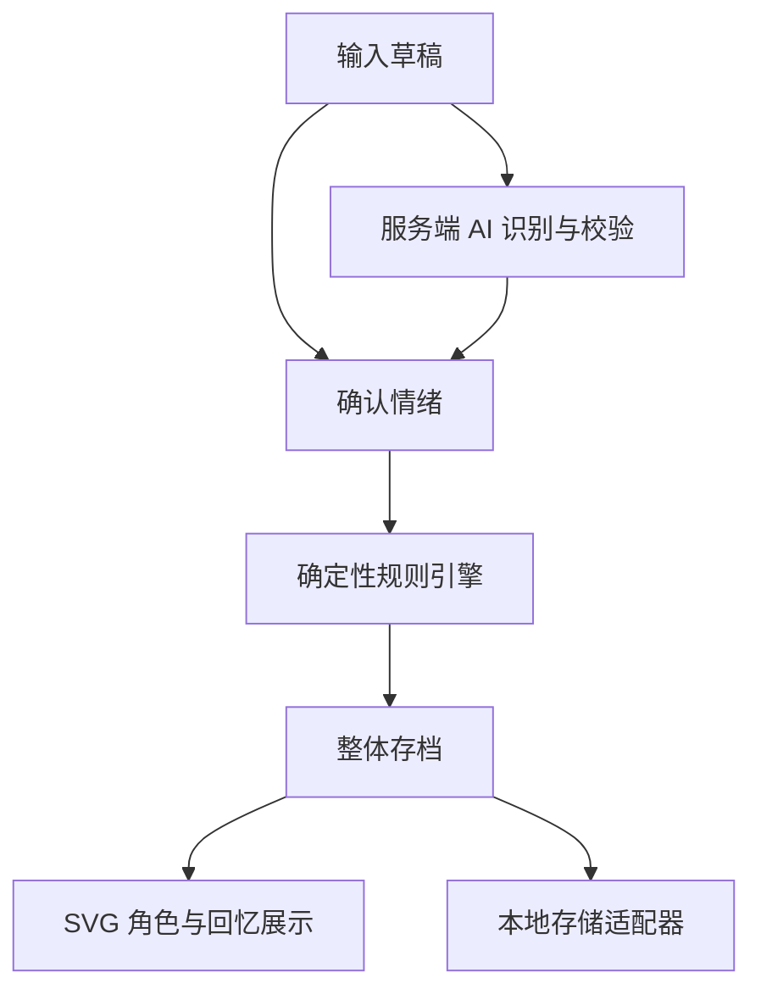

# 拾绪 ShiXu · 系统架构

状态：规划接口，不代表代码已经存在。采用简单模块化单仓库，先完成可运行 MVP，再按 [ROADMAP](ROADMAP.md) 扩展。项目约束见 [AGENTS](../AGENTS.md)。

## 1. 技术决策

| 层 | 固定方案 | 责任与边界 |
| --- | --- | --- |
| 页面 | Next.js App Router + React + TypeScript | 路由、输入、确认、回忆和状态展示 |
| 样式 | Tailwind CSS | 响应式布局、组件外观、减少动态效果 |
| 角色 | React + 原创 SVG 独立图层 | 只消费规则产生的 CharacterView，不改经验或存档 |
| 领域 | TypeScript 纯函数 | 情绪到视觉、经验、解锁、隐藏、恢复、纠正 |
| AI | Next.js 服务端 Route Handler + provider 适配器 | 仅产出经校验的情绪数据，不读写游戏存档 |
| 状态编排 | React Context + reducer / 应用服务 | 确认事件、串行规则调用、保存、刷新界面 |
| MVP 持久化 | 浏览器 localStorage | 单个带版本 snapshot；未来通过同一接口换数据库 |

不引入 Tauri、Rust、微服务、复杂 Agent、消息队列、云数据库、向量库。具体依赖版本在骨架分支选用当时兼容的稳定组合，提交锁文件并记录 Node 要求；指南不抄参考仓库过期或相互冲突的运行条件。

## 2. 数据流与权限

直接手选绕过 API；任何识别响应均不能跳过确认进入规则。AI 调用不接收角色状态，不持有写入工具。应用服务生成 id、now、dayKey，再显式传给规则；规则内部不访问网络、localStorage、Date.now 或 Math.random。

一次确认：校验输入 → 基于当前 snapshot 计算新 snapshot → 存储成功 → 更新 React 状态与成功提示。保存失败保留草稿和旧 snapshot，可重试；不显示已保存。动作播放是提交结果的表现，不再次触发奖励。请求和确认串行处理，防双击；同一 entryId 重试幂等。

## 3. 目录规划

| 路径 | 内容 |
| --- | --- |
| src/app/layout.tsx、page.tsx、globals.css | 页面入口和全局样式 |
| src/app/api/emotion/route.ts | POST 情绪接口，无游戏写权限 |
| src/components/emotion/ | 草稿输入、AI 建议、手选与纠正 |
| src/components/character/ | CharacterRenderer 与 SVG layers |
| src/components/memories/ | 回忆列表、隐藏装饰恢复入口 |
| src/domain/types.ts | EmotionReading、Entry、Snapshot、GameEvent、CharacterView |
| src/domain/rules/ | 配置、状态转移、视觉派生；无 React 和 IO |
| src/application/ | React 状态容器与用例编排；唯一游戏提交入口 |
| src/lib/ai/server/ | server-only provider、提示词、原始输出校验 |
| src/lib/storage/ | StoragePort、localStorage 实现与版本迁移 |
| docs/ | 本套指南 |

以上路径按需要创建，不预先铺设空目录或占位框架。可在同模块中少量合并文件，但领域、AI、存储、渲染的依赖边界不能混淆。

## 4. 核心数据模型

| 类型 | 必要字段与约束 |
| --- | --- |
| EmotionReading | label、VAD、intensity、confidence（manual 时 null）、source；边界见 AI 契约 |
| Entry | id、text、createdAt、dayKey、revision、originalAnalysis、effectiveEmotion、corrections、awardedXp、rulesVersion |
| CharacterState | totalXp、stage、latestEntryId、currentEmotion；经验/阶段永久保留 |
| DecorationState | ownedIds、equippedBySlot、hiddenById；隐藏记录含 sourceEntryId、slot、hiddenAt、reason |
| MemoryEvent | id、type、entryId（可空）、occurredAt、rulesVersion、有限结构 payload |
| Snapshot | schemaVersion=1、revision、character、entries、decorations、memories、appliedEventIds |
| CharacterView | expression、pose、animation、visibleLayerIds、effects；只读派生结果 |

MemoryEvent 类型至少有 ENTRY_SAVED、EMOTION_CORRECTED、ITEM_UNLOCKED、ITEM_HIDDEN、ITEM_RESTORED、STAGE_REACHED。GameEvent 是用户确认后的领域输入（CONFIRM_ENTRY、CORRECT_EMOTION、RESTORE_DECORATION，后期 TICK），不能由 AI 直接创建。

entries 中固定保存 awardedXp，日上限按该 dayKey 的首次奖励合计，纠正不重算奖励。ownedIds 单调增加；隐藏记录不删除所有权。角色 stage 阈值、物品目录、情绪表和数值只在领域配置维护，对应 PRODUCT_SPEC 的 rules-v1。

## 5. 模块接口（规划签名）

| 接口 | 输入 → 输出 | 不允许做的事 |
| --- | --- | --- |
| analyzeEmotion(request) | EmotionRequest → Promise<EmotionResponse> | 直接写 Snapshot |
| validateAnalysis(raw) | unknown → Result<Analysis, ValidationError> | 静默制造成功情绪 |
| applyGameEvent(snapshot, event, context) | Snapshot + GameEvent + {now, dayKey} → {snapshot, events, changed} | IO、随机、隐式读取时间 |
| deriveCharacterView(snapshot) | Snapshot → CharacterView | 存储或状态变更 |
| StoragePort.load() | → Promise<LoadResult> | 自行修改奖励规则 |
| StoragePort.save(snapshot, expectedRevision) | → Promise<SaveResult> | 失败时伪报成功 |
| StoragePort.export / import | 后期按同一 schema 校验 | 执行导入文本中的代码 |

重复 eventId 返回 changed=false；重复 CONFIRM_ENTRY 的 entryId 也不能重复奖励。时间戳、随机效果种子若以后需要，一律由 context 显式提供；当前可用 eventId 的稳定散列选择有限动作变体。新增事件先增加判别联合和消费端，不能将 unknown 直接断言为有效事件。

## 6. 本地持久化与恢复

- localStorage key 为 `shixu.snapshot.v1`；一次写入完整 snapshot，避免日记已保存但库存未保存的分裂。初始化只在客户端 hydration 后执行，服务端渲染不能读取 window。
- load 结果区分 missing、ready、unsupported-version、corrupt、unavailable。只有 missing 可生成全新存档；损坏或未知版本保留原值，不静默覆盖。页面允许导出原始文本或在用户明确选择后重置。
- save 校验 schema 和 expectedRevision，拒绝过期更新；成功增加 snapshot.revision。MVP 只支持一个写入标签页，检测另一个标签页变化后暂停提交并提示重新加载，不宣称 localStorage 支持跨标签页事务锁。
- 空间不足/访问被禁时保留旧状态与草稿，提示本次未保存；可提供明确的临时会话模式，但不得显示持久化成功。
- 将来换 IndexedDB/数据库只替换 StoragePort 与必要迁移；不为未来数据库提前引入 ORM/鉴权。新 schema 需迁移或明确保留旧数据，不因升级丢档。

## 7. SVG 图层与动作

固定 viewBox 建议 `0 0 240 320`，图层由后到前：后景特效 → 身体与四肢 → 服饰 → 五官 → 头部/徽章配件 → 前景特效。每层独立 React 组件，使用稳定 id、锚点、slot 和有限配置；本体白色，装饰不改基础身体资源。初始不绘制五官图层。

规则决定 expression/pose/animation；渲染器仅选取本地白名单 SVG，未知图层 id 安全跳过并回落到基础身体。不将 AI 字符串作为 SVG、HTML 或组件代码。MVP 用 CSS/React 控制短动作，无需额外动画引擎；prefers-reduced-motion 下改静态表现。首屏不随机生成外观，避免 hydration 不一致。

## 8. 兼容与交付

公共类型为模块协作基线；新增字段优先可选默认，破坏性改动同步所有调用方和存档版本。不为后续模块无限等待：骨架用简化界面，情绪模块用手选，角色模块用固定 CharacterView，均明确标识。最后一次最小主流程验证范围见 [WORKFLOW](WORKFLOW.md)。
