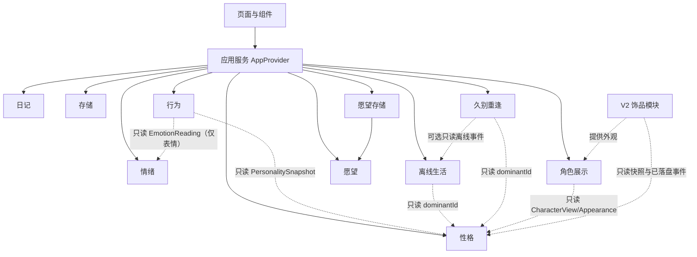

# 拾绪 ShiXu · 系统架构

> 状态：V1 架构基线。标注「已实现」的以 `main` 分支代码为准；「阶段 N 规划」表示尚未合入。产品范围见 [PRODUCT_SPEC](PRODUCT_SPEC.md)，性格与行为参数见 [COMPANION_SPEC](COMPANION_SPEC.md)。
>
> 存档结构为 `schemaVersion` 4（STO-05，PR #35 已合入）；v1/v2/v3 读取时迁移。本文档版本与存档版本无关。截至本版，`main` 已含 `schemaVersion` 4、五维 `personality-v2` 台账与迁移（PR #18）、主导行为引擎（PR #19）、离线自主生活（PR #20）、久别重逢（PR #22）、AI 情绪识别复核（PR #23）与待处理重逢问候持久化/确认（PR #35）。阶段七的原创企鹅正面母版（PR #27）、九种组合表情（PR #28）、侧背面与基础动作（PR #30）、特殊动作视觉（PR #31）、特殊行为正式接入（PR #32）、生活空间与三页正式 UI（PR #38）及回忆手帐翻页（PR #41）均已合入。特殊行为配置已开启，真实长期自然触发待进一步验收；完整体验、移动端与跨设备验收未完成。许愿屋独立开发包（PR #43）新增独立 `wishes` 领域模块与 `shixu.wishes.v1` 存储，不修改 `Snapshot` v4，已合入 `main`。正式数据仅保存在浏览器 localStorage，没有登录、数据库或云同步。阶段八已于 2026-11-17 开始 S8-00 启动审计，S8-03 已完成 Qoder Sites 静态托管与 `.html` 路由适配，S8-03G 已本地实现 AI Edge Function（未部署、未真实调用）；真实百炼联调仍未完成。当前整体进度以 [ROADMAP](ROADMAP.md) §1.1 为准。

## 1. 架构原则

1. **模块化单体**：一个 Next.js 应用、一个仓库，按职责拆分领域模块；不拆微服务、不做多包发布、不引入消息队列或插件运行时。
2. **契约驱动**：模块之间只通过本文列出的公开类型与函数协作；禁止跨模块读取/修改私有状态，禁止组件直接改存档。
3. **配置驱动**：性格维度、情绪映射、成长幅度、主导规则、行为权重、离线活动、重逢文案由带版本号的配置对象定义；React 组件与页面不得硬编码这些规则。
4. **确定性**：所有正式状态变化由纯函数规则完成；时间、`dayKey`、`eventId`、随机种子由应用层显式提供，领域层不调用 `Date.now()`、`Math.random()` 或网络。
5. **单一写入边界**：只有应用服务（`AppProvider`）可以组合模块并调用存储；存档成功后才更新界面正式状态。
6. **独立任务卡**：每个阶段/模块任务必须填写 [MODULE_TASK_CARD](MODULE_TASK_CARD.md)，先声明契约变更再写代码。

不引入：Tauri/Rust、数据库、登录、微服务、Agent 框架、向量库、复杂全局状态框架、动态插件加载器。

## 2. 模块划分

| 模块 | ID | 负责 | 公开契约 | 私有状态 | 配置 |
| --- | --- | --- | --- | --- | --- |
| 日记 | `diary` | 原文记录、编辑、历史读取 | `Entry`、`DiaryEntryInput` | 日记正文与修订（通过快照持有） | 无业务阈值 |
| 情绪 | `emotion` | 九类情绪、VAD、AI 建议规范化与确认 | `EmotionReading`、`Analysis`、`EmotionSuggestion`、`validateAnalysis` | 无持久状态 | `MANUAL_EMOTION_DEFAULTS` |
| 性格 | `personality` | 五维贡献账本、派生分数、主导性格、描述 | `PersonalityState`、`PersonalitySnapshot`、`PersonalityRuleConfig`、`derivePersonality`、`resolveDominant` | 贡献台账、`dominantId`、规则版本 | `PERSONALITY_RULES_VERSION` + 规则配置 |
| 行为 | `behavior` | 主导行为、普通待机、特殊行为、互动反应 | `BehaviorContext`、`BehaviorDecision`、`BehaviorRuleConfig`、`selectBehavior` | 无持久状态（运行时序号） | `BEHAVIOR_RULES_VERSION` + 规则配置 |
| 离线生活 | `offlineLife` | 按离线窗口生成有限生活事件 | `OfflineLifeState`、`OfflineLifeEvent`、`OfflineLifeRuleConfig`、`planOfflineLife` | 事件历史（通过快照持有） | `offline-life-v1` |
| 久别重逢 | `reunion` | 判断长期未访问、生成问候、记录触发窗口与待处理问候 | `ReunionState`、`ReunionRuleConfig`、`evaluateReunion` | 已触发窗口与待处理问候（通过快照持有） | `reunion-v1` |
| 角色展示 | `character` | 按视图渲染企鹅、组合表情、动作与生活空间 | `CharacterView`、`AppearanceConfig` | 无（仅运行时展示状态） | 表情/动作/图层映射（阶段七） |
| 愿望 | `wishes` | 愿望创建、手动完成、纯文本校验、独立集合 | `Wish`、`WishCollection`、`createPendingWish`、`addWish`、`completeWishInCollection`、`validateWishCollection` | 愿望集合（独立 localStorage，不在快照内） | `WISH_SCHEMA_VERSION = 1` |
| 存储 | `storage` | 版本化存档、加载、保存、恢复、迁移入口 | `StoragePort`、`LoadResult`、`SaveResult`；`WishStoragePort`、`WishLoadResult`、`WishSaveResult` | localStorage 键 | 迁移表；愿望独立版本 |
| 装扮（V2） | `decoration` | 饰品状态、解锁、穿戴 | 仅预留读取与外观扩展点 | V2 自行持有 | V2 定义 |

### 2.1 依赖方向



- 行为模块不导入性格模块的内部实现，只接收 `PersonalitySnapshot`；主行为池只看 `dominantId`。
- 离线生活模块只读 `dominantId`，不读贡献账本、不写性格分数。
- 久别重逢模块只读 `dominantId` 与可选离线事件，不写性格、不写日记。
- 角色展示模块不导入性格、行为、离线或存储模块，只接收视图数据。
- 愿望模块不导入日记、情绪、性格、行为、离线、重逢或快照迁移逻辑；不读写 `Snapshot`，不调用 AI。
- 愿望存储只处理 `WishCollection` 的读取、修订检查、写入与恢复，不决定完成状态、不生成动画。
- 许愿屋展示层只接收愿望视图与一次性动画信号，不直接调用 localStorage 或修改 `Snapshot`。
- 存储模块不导入规则模块，不决定分数、奖励、行为或离线事件。
- 页面不直接调用 `localStorage`，不直接修改 `Snapshot`。
- V2 模块不得写 `PersonalityState`，不得修改行为、离线或重逢规则。

### 2.2 模块任务卡的边界要求

每张任务卡必须写明：模块归属、输入/输出、修改了哪些公开契约、内部状态所有权、配置与版本、明确不做、最小验收。跨模块修改必须同时更新本文与调用方，不允许「先改代码再补文档」。

## 3. 目录规划

| 路径 | 状态 | 责任 |
| --- | --- | --- |
| `src/app/{layout,page}.tsx`、`src/app/{diary,memories,wishes}/page.tsx`、`src/app/companion/page.tsx` | 已实现（阶段七/许愿屋） | `/` 企鹅小屋、`/diary` 心情日记、`/memories` 回忆手帐（含真实翻页）、`/wishes` 许愿屋；`/companion` 重定向到 `/`；四页已合入 `main`，移动端、断点与跨设备体验待验收 |
| `src/app/character-preview/*` | 已实现（仅开发预览） | 角色、表情、侧背面/动作与特殊行为模拟预览；不属于正式产品导航，不写正式存档 |
| `src/app/api/emotion/route.ts` | 已实现 | 服务端情绪识别入口 |
| `src/application/AppProvider.tsx` | 已实现，阶段二至五扩展 | 状态编排、保存、会话启动、恢复、跨标签页冲突、待处理问候投递与确认（PR #35 已合入）；问候本身持久化在快照中；保存反馈的“已开始展示”标记由 Provider 持有，不进入快照 |
| `src/application/useEmotionAnalysis.ts` | 已实现，阶段六扩展 | AI 建议请求、会话失效、过期响应丢弃、客户端超时与降级 |
| `src/lib/ai/client.ts` | 阶段六新增 | 浏览器侧识别会话、三元组关联、严格 analysis/analysisMeta 校验、HTTP 错误映射；不导入服务端 Provider |
| `src/lib/ai/endpoint.ts` | S8-03G 新增 | 静态导出请求 `/functions/v1/app`，常规 Next.js 请求 `/api/emotion` |
| `src/lib/ai/server/{config,provider}.ts` | 阶段六实现；S8-03G 改为适配层 | Node 配置读取与 `server-only` 边界；Provider 实际逻辑在 `functions/shared` |
| `functions/index.ts`、`functions/config.ts` | S8-03G 新增 | Qoder Sites 单一 Edge Function 入口；`Deno.env` 读取 Secret，`AI_EDGE_ENABLED` 默认关闭 |
| `functions/shared/*.ts` | S8-03G 新增，唯一 AI 核心 | 情绪标签/Analysis、envelope 契约、五问、原生校验映射、Provider、实例内保护与请求处理；Next 与 Edge 共用 |
| `src/domain/types.ts` | 已实现，阶段二扩展 | 公共类型与契约 |
| `src/domain/emotions.ts` | 已实现 | 手选默认 VAD、规范化 |
| `src/domain/rules.ts` | 已实现，阶段二至五扩展 | 领域事件、原子结算、会话启动入口 |
| `src/domain/schema.ts` | 已实现，阶段二扩展；v4 校验已实现（PR #35） | 存档结构校验（v1/v2/v3 读取校验与 v4 校验） |
| `src/domain/companion.ts` | 已实现（三维护账） | 阶段二拆分为 `personality.ts` + 配置，之后只作兼容/删除 |
| `src/domain/personality.ts` | 已实现（PR #18） | 五维派生、主导判定、描述、只读查询 |
| `src/domain/behavior.ts` | 阶段三已实现（PR #19） | 确定性主导行为/待机/特殊/互动选择 |
| `src/domain/offlineLife.ts` | 阶段四已实现（PR #20） | 离线窗口规划、活动选择、幂等 ID |
| `src/domain/reunion.ts` | 阶段五已实现（PR #22）；可靠投递已合入（PR #35） | 长期未访问判断、问候模板选择、待处理问候类型；存在待处理问候时不再触发新问候 |
| `src/domain/characterView.ts` | 已实现（阶段三最小接入，PR #19） | 由快照/行为推导视图 |
| `src/config/personality.ts` | 已实现（PR #18） | `PersonalityRuleConfig` |
| `src/config/behavior.ts` | 阶段三已实现（PR #19） | `BehaviorRuleConfig` |
| `src/config/offlineLife.ts` | 阶段四已实现（PR #20） | `OfflineLifeRuleConfig` |
| `src/config/reunion.ts` | 阶段五已实现（PR #22） | `ReunionRuleConfig` |
| 阶段七角色/表情/场景配置 | 视觉常量位于角色组件；场景布局位于 `roomLayout.ts` | 颜色、姿态与动作节奏暂为角色组件常量；房间区域、目的地映射与路径为 `roomLayout.ts` 常量；独立版本化场景配置未创建 |
| `src/lib/storage/{port,localStorageAdapter}.ts` | 已实现 | 存储接口与浏览器实现 |
| `src/domain/wishes.ts` | 已实现（PR #43） | 愿望类型、创建/完成纯函数、集合校验 |
| `src/lib/storage/wishStorage.ts` | 已实现（PR #43） | 独立 `shixu.wishes.v1` 读取/保存/重置、修订检查、Web Locks 写入互斥、损坏/未来版本保护 |
| `src/application/useWishHouse.ts`、`src/application/wishTypes.ts` | 已实现（PR #43） | 愿望加载、创建、完成、冲突、恢复、一次性完成动画信号、开发样例内存隔离 |
| `src/components/wishes/*` | 已实现（PR #43） | 许愿屋页面、玻璃杯、愿望板、输入、存储提示与稳定槽位；不改其他三页 |
| `scripts/wishTests.ts`、`scripts/run-wish-tests.cjs` | 已实现（PR #43） | 愿望领域/存储/槽位专项测试工具；不进入生产构建 |
| `src/components/character/CharacterRenderer.tsx` | 已实现（姿态/表情/动画载体） | 已接入原创企鹅正面母版（PR #27）、九种组合表情（PR #28）、侧背/基础动作（PR #30）、特殊动作（PR #31）与四页正式界面（PR #38）；移动端与跨设备体验待验收 |
| `src/components/character/{PenguinFront,PenguinFace,PenguinPoses}.tsx`、`specialMotion.ts` | 已实现（PR #27 / #28 / #30 / #31） | 正面母版、组合表情、侧背面与基础动作、特殊动作视觉；`drink` 使用啤酒瓶；`SPECIAL_MOTION_MS=8000` |
| `src/components/character/{CompanionScreen,RoomScene}.tsx`、`roomLayout.ts` | 已实现（PR #38） | 企鹅小屋、生活空间与正式 UI 场景；区域坐标、目的地与安全路径；移动端细节与跨设备体验待验收 |
| `src/components/character/OfflineLifePanel.tsx` | 阶段四已实现（PR #20） | 只读已落盘离线事件，区分本次与历史；不写日记/回忆/分数 |
| `src/components/character/ReunionPanel.tsx` | 阶段五已实现（PR #22）；可靠投递已合入（PR #35） | 只渲染快照中已提交且未处理的问候；回应/跳过走正式保存，成功后才清除，失败保留可重试 |
| `src/application/useBehaviorRuntime.ts` | 阶段三已实现（PR #19） | 行为调度、隐藏暂停、互动、保存后一次性反馈、低动态降级；不写存档 |
| `src/application/lowMoodStreak.ts` | PR #32 已合入 | 只读有效情绪与冻结 dayKey，连续四天含当天；正式配置已开启，长期自然触发待进一步验收 |
| `src/components/emotion/*`、`src/components/memories/*` | 已实现 | 记录、纠正、历史界面 |

阶段二不要求一次性重命名所有文件；但新代码必须落在上表声明的目标位置，旧文件只做兼容或删除，不允许出现两份性格实现，也不允许把离线/重逢逻辑塞进 `personality.ts`。

## 4. 核心数据模型

### 4.1 情绪与日记（已实现，字段保持）

```ts
type EmotionLabel = "joy" | "calm" | "sadness" | "anxiety" | "anger" | "tired" | "mixed" | "neutral" | "unknown";
type EmotionSource = "ai" | "manual" | "corrected";

interface EmotionReading {
  label: EmotionLabel;
  valence: number;    // 0–1
  arousal: number;    // 0–1
  dominance: number;  // 0–1
  intensity: number;  // 0–1
  confidence: number | null;
  source: EmotionSource;
}

interface Entry {
  id: string;
  text: string;            // 原文，保存后不改写
  createdAt: number;
  updatedAt: number;
  dayKey: string;          // YYYY-MM-DD，保存时冻结
  revision: number;
  originalAnalysis: Analysis | null;
  analysisMeta: AnalysisMeta | null;
  effectiveEmotion: EmotionReading;
  corrections: EmotionCorrection[];
  awardedXp?: number;      // 旧字段，只兼容保留，不读取、不写入
  rulesVersion: string;    // 日记/事件规则版本（V1 为 "rules-v1"），不是性格规则版本
}
```

`Analysis`、`EmotionCorrection`、`AnalysisMeta` 保持 [AI_CONTRACT](AI_CONTRACT.md) 与现有 `src/domain/types.ts` 的定义。`Entry.text` 不设产品字数上限，只校验非空白。九类情绪枚举在本阶段不改名、不增删；中文显示名差异见 [COMPANION_SPEC](COMPANION_SPEC.md) 2.4。

### 4.2 性格（阶段二起，v3/v4 共用结构）

阶段二实现：配置 `src/config/personality.ts`，领域查询与结算 `src/domain/personality.ts`，迁移 `src/domain/migrations.ts`。候选参数待验收。

```ts
type DimensionId = "gentleness" | "curiosity" | "cheerfulness" | "fearfulness" | "low_mood";

interface PersonalityContribution {
  dayKey: string;
  label: EmotionLabel;
  entryRevision: number;
  deltas: Record<DimensionId, number>; // 结算后的最终增量，派生只求和
  rulesVersion: string;                // 该条贡献结算时使用的 personality-* 版本
}

interface PersonalityState {
  contributions: Record<string, PersonalityContribution>; // key = entryId
  dominantId: DimensionId | null;      // 持久化，避免并列抖动
  rulesVersion: string;                // 新结算使用的版本，候选 "personality-v2"
}

interface PersonalitySnapshot {
  scores: Record<DimensionId, number>;        // 派生，不落盘
  dominantId: DimensionId;
  dominantDescription: string;                // 只给当前主导
  descriptions: Record<DimensionId, string>;  // 内部/调试；不进入用户界面
  rulesVersion: string;
}

interface PersonalityRuleConfig {
  rulesVersion: string;
  dimensions: Array<{ id: DimensionId; label: string; description: string }>;
  dominantPriority: DimensionId[];     // 并列顺序：温柔→好奇→开朗→害怕→低落
  initialScore: number;
  minScore: number;
  maxScore: number;
  perSaveCap: number;
  dailyNetCap: number;
  intensityBands: { lowExclusive: number; highInclusive: number; factors: [number, number, number] };
  roomFactor: number;                  // 未确认惯性公式前为 1.0
  emotionDeltas: Record<EmotionLabel, Record<DimensionId, number>>;
  descriptions: Record<DimensionId, { low: string; balanced: string; high: string }>;
  bands: { lowMax: number; highMin: number };
  rounding: "half-away-from-zero";
}
```

- 分数永远由 `contributions` 纯派生：`clamp(initial + Σdeltas, min, max)`；`deltas` 是写入时已受单次/单日上限约束的最终增量，派生不再按日重算，不存储第二份分数。
- 强度分档使用 `lowExclusive` 和 `highInclusive` 明确表达 0.35 与 0.7 的边界。
- 配置以 `rulesVersion` 为键注册；每条贡献按其自身 `rulesVersion` 解释。`PersonalityState.rulesVersion` 只决定“新结算使用哪个配置”，不能用来重新解释旧贡献或重新拒绝历史日。
- `initialScore`/`minScore`/`maxScore` 是存档级不变量；变更必须走显式迁移，不能只升 `rulesVersion` 就让旧分数随当前配置变化。
- `dominantId` 必须持久化：只有其他维度严格高于当前主导时才切换；并列保留当前主导。首次/迁移后为 `null`，按 `dominantPriority` 从最高分中取第一个。
- 纠正只重算被纠正条目：先扣除旧贡献，以该 `dayKey` 下所有已保存贡献的实际合计为余量（不区分版本），上限参数取原贡献的 `rulesVersion`；其他条目、其他日期不重算。余量不足时该条最终增量可为 0；若该日合计已越界（绝对值超过原版本上限），则只允许 0 或使合计绝对值严格减小（裁剪规则见 COMPANION_SPEC §2.6）。旧配置缺失时拒绝纠正；`canCorrectContribution` 提供只读可纠正状态，历史记录界面提示原因。
- `PersonalityContribution.entryRevision` 记录该条贡献最近一次结算时对应的日记修订号（新保存为 0，情绪纠正时更新）；正文编辑会提升 `Entry.revision`，但不改变贡献，也不更新该字段。当前实现仅把它作为审计元数据，不参与贡献校验、每日额度计算或纠正前置判断。
- 旧 `CompanionState.contributions`（三维护账）不进入 `PersonalityState`；迁移后放入 `legacy`，不自动换算。
- 配置集中在 `src/config/personality.ts`，组件与页面不得引用 `emotionDeltas` 自行算分，也不得展示 `scores`。
- 当前五维规则 `src/config/personality.ts` 的 `PERSONALITY_V2.dailyNetCap` 为 4。旧 `companion-v1` 的 `dailyNetCap` 为 6，仅供旧三维存档的兼容校验，不参与五维结算，也不触发迁移；不得把 6 误写为当前五维上限。

### 4.3 行为（阶段三，运行时）

```ts
type BehaviorCategory = "ambient" | "dominant" | "special" | "interaction";
type BehaviorId =
  | "idle_breathe" | "idle_glance"
  | "gentle_wave" | "quiet_sit" | "knee_rest" | "gentle_gaze"
  | "look_around" | "observe_object" | "wander_explore" | "approach_novel"
  | "bounce" | "spin" | "greet" | "happy_sway"
  | "curl_up" | "corner_hide" | "hesitant_approach" | "step_back"
  | "blank_stare" | "sit_alone" | "slow_walk" | "window_gaze"
  | "drink" | "smoke"
  | "respond_call" | "respond_pat" | "respond_observe";
type TimeBand = "morning" | "afternoon" | "evening" | "night";
type InteractionType = "call" | "pat" | "observe";

interface InteractionEvent {
  id: string;
  type: InteractionType;
  occurredAt: number;
  seed: number;
}

interface BehaviorContext {
  personality: PersonalitySnapshot;   // 只读；主池只看 dominantId
  emotion: EmotionReading | null;     // 只用于表情/幅度，不参与主池；应用层按运行时有效期传入
  interaction: InteractionEvent | null;
  specialEligible: boolean;           // 由应用层只读计算；行为引擎不读日记
  dayKey: string;
  timeBand: TimeBand;                 // 只影响 ambient 权重
  sequence: number;
  seed: number;
  lastBehaviorId: BehaviorId | null;
  consecutiveCount: number;
}

interface BehaviorDecision {
  behaviorId: BehaviorId;
  category: BehaviorCategory;
  dominantId: DimensionId;
  pose: string;
  expression: string;
  animation: string;
  amplitude: number;                // 即时情绪幅度（emotionExpression.intensity），无情绪为 1
  durationMs: number;
  reasonCode: string;
}

interface BehaviorRuleConfig {
  rulesVersion: string;               // 候选 "behavior-v2"
  behaviors: Array<{
    id: BehaviorId;
    label: string;
    category: BehaviorCategory;
    dominantId?: DimensionId;         // 仅 dominant 行为必填
    interactionType?: InteractionType; // 仅 interaction 行为必填，类型→行为映射配置驱动
    baseWeight: number;
    pose: string;
    expression: string;
    animation: string;
    durationMs: number;               // 自主行为持续时间；互动改用 interactionDurationMs 区间
  }>;
  ambientShare: number;               // 候选 0.15
  specialBehaviorEnabled: boolean;    // PR #32 起 true；真实长期自然触发待进一步验收
  specialProbability: number;         // 已确认 0.15；每次具备资格判定命中概率
  special: {
    dominantId: "low_mood";
    behaviors: Array<{ id: "drink" | "smoke"; baseWeight: number }>; // 现有各 1，等权；调整须另行确认
    streakDaysRequired: number;       // 当前 4，表示连续低落日总数（含判定当天）
    lowMoodEmotionLabels: EmotionLabel[]; // 已确认 ["sadness"]
    dayFourSemantics: "A" | "B";      // 当前固定 "B"；"A" 仅保留为历史/测试分支，不再作为正式语义
  };
  minShare: number;                   // 候选 0.05；以权重下限实现长期份额下限
  maxConsecutive: number;             // 候选 2
  tickIntervalMs: [number, number];   // 候选 [20000, 40000]
  interactionDurationMs: [number, number]; // 候选 [2500, 4000]
  saveFeedbackDurationMs: number;     // 候选 3000；保存后一次性反馈时长
  saveFeedbackTtlMs: number;          // 候选 300000（待产品验收）；跨页面反馈投递有效期
  emotionExpressionDurationMs: number; // 候选 3000；即时情绪表情/幅度的运行时有效期
  emotionExpression: Record<EmotionLabel, { expression: string; intensity: number }>;
  ambientTimeWeights: Record<TimeBand, Partial<Record<BehaviorId, number>>>;
}
```

行为决策不写 `Snapshot`，不需要 `eventId` 幂等；互动反馈与保存后情绪表现只存在于运行时内存。特殊行为不是必然触发；只有 `specialEligible`、主导为 `low_mood`、配置开启且概率命中时才可能发生。特殊行为规则（`sadness` 唯一标签、连续四个自然日、第 4 天当天保存后具备资格即语义 B、`specialProbability = 0.15`、停止条件）已于 2026-11-14 定稿，详见 [COMPANION_SPEC](COMPANION_SPEC.md) §3.5。PR #32 使用 `streakDaysRequired=4` / `dayFourSemantics="B"`，运行时在 8000ms 后恢复普通行为；`specialBehaviorEnabled=true`，真实长期自然触发待进一步验收。规则版本保持 `behavior-v2`，以免改变其他行为的确定性种子。

阶段三实现（PR #19）：`selectBehavior` 按 interaction → special → ambient → dominant 固定顺序选择；抽样使用显式 `createBehaviorRng(seed, dayKey, sequence, rulesVersion)`，相同上下文同结果；`minShare` 以权重下限公式保证同池每个候选长期份额不低于配置值；结果与 `lastBehaviorId` 相同且 `consecutiveCount >= maxConsecutive` 时按配置顺序轮换同池下一个。`selectSaveFeedback(base, emotion, config)` 只生成运行时一次性反馈决策（reasonCode `save_feedback`），不写存档。应用层 `useBehaviorRuntime` 负责可见调度、隐藏暂停、恢复重读、三种互动打断与恢复、`lastConfirmedSave` 的可见性/TTL/重逢门控投递（Provider 级“已开始展示”标记去重）、`prefers-reduced-motion` 降级；`computeSpecialEligibility` 在应用层只读计算连续低落日，仅在正式配置开启或开发模拟时参与触发（当前正式配置已开启）。

运行时即时情绪有有效期：仅在保存成功后 `emotionExpressionDurationMs`（候选 3000 毫秒，待验收）内把 `currentEmotion` 传入表情/幅度；到期或刷新后回到主导行为配置的基础表情，不重新激活已结束的反馈，也不改变已保存情绪、日记与五维贡献。自主行为按行为条目 `durationMs` 结束动画（`animation` 置 `none`、保持姿态），等待下一次 tick 选择；`tickIntervalMs` 只决定下一次选择间隔，不是动作循环时长。页面隐藏时除暂停调度外，运行时 `paused` 状态经 `is-paused` 类显式暂停 CSS 动画；互动打断、恢复、隐藏、卸载与 StrictMode 清理均清除全部运行时计时器。

保存反馈采用“待投递 → 已开始展示”两阶段，避免尚未展示就被消费：`lastConfirmedSave` 只表示有待投递反馈；只有页面可见、且 `reunion.pending = null` 时才允许启动。启动前按 `lastConfirmedSave.savedAt + saveFeedbackTtlMs`（候选 300000 毫秒，待产品验收）检查有效期，隐藏或重逢门控的等待时间同样计入，过期直接丢弃，不排队补播。真正开始展示时写入 Provider 持有的已展示事件标记（不进入快照），用于跨企鹅页卸载/重挂载去重；开发模拟使用独立实例标记。存在待处理重逢问候时反馈既不展示也不消费，只有 `REUNION_ACKNOWLEDGED` 成功落盘、`pending` 清除后才重新检查 TTL。连续成功保存只保留最新 `lastConfirmedSave`，不建立反馈队列。

### 4.4 离线生活与久别重逢（阶段四 PR #20；阶段五 PR #22）

```ts
interface OfflineLifeEvent {
  id: string;                 // offline:<windowStart>:<index>
  windowStart: number;
  occurredAt: number;
  dominantId: DimensionId;
  activityId: string;
  text: string;
}

interface OfflineLifeState {
  lastVisitAt: number | null;       // 上次成功会话启动
  lastActiveAt: number | null;      // 最后一次确认活动；离线/重逢基准
  lastWindowStart: number | null;   // 上次处理的窗口起点
  events: OfflineLifeEvent[];       // 有上限
}

interface ReunionGreeting {
  windowStart: number;
  dominantId: DimensionId;
  tone: string;
  message: string;
  question: string;
  rulesVersion: string;
}

interface ReunionState {
  lastTriggeredWindowStart: number | null;  // 已触发的窗口起点（不代表用户已看到）
  lastTriggeredAt: number | null;
  pending: ReunionGreeting | null;          // 已触发但尚未回应/跳过的问候；正式存档持有
}

interface OfflineLifeRuleConfig {
  rulesVersion: "offline-life-v1";
  minAbsenceMs: number;             // 候选 30 分钟
  eventIntervalMs: number;          // 候选 90 分钟
  maxEventsPerWindow: number;       // 候选 6
  maxStoredEvents: number;          // 候选 20
  activities: Record<DimensionId, Array<{ id: string; label: string; text: string; weight: number }>>;
}

interface ReunionTemplate {
  tone: string;                               // 语气说明（候选）
  generic: string;                            // 无具体事件时的通用问候（候选）
  activityLines: Record<string, string>;      // 离线 activityId → 具体生活描述（候选）
}

interface ReunionRuleConfig {
  rulesVersion: "reunion-v1";
  thresholdMs: number;              // 候选严格 > 3 天（72 小时）
  baseQuestion: string;             // 已确认 "最近过得还好吗？"
  templates: Record<DimensionId, ReunionTemplate>;
}

interface ReunionEvaluationInput {
  now: number;
  lastActiveAt: number | null;
  lastVisitAt: number | null;
  lastTriggeredWindowStart: number | null;
  pendingWindowStart: number | null;  // 存在未处理问候时阻断新触发，避免覆盖
  dominantId: DimensionId;
  offlineEvents?: OfflineLifeEvent[]; // 仅用于挑选真实生成的具体生活描述
  activityRescueAt?: number | null;   // 同标签页救援值，只抬高判定基准
}

interface ReunionEvaluation {
  triggered: boolean;
  windowStart: number | null;
  reasonCode: "triggered" | "no-baseline" | "within-threshold" | "already-triggered" | "pending-unhandled";
  absenceMs: number | null;
  greeting: ReunionGreeting | null;
}
```

- 离线事件在**再次打开**时由纯函数生成，不在关闭期间运行后台 Agent。
- 离线与重逢的缺席基准是 `baseline = lastActiveAt ?? lastVisitAt`，不是只看 `lastVisitAt`；`lastVisitAt` 只记录上次会话启动，不能单独代表用户最后一次在线。
- 应用层在页面隐藏、`pagehide`、刷新前提交 `ACTIVITY_CHECKPOINT`，更新 `lastActiveAt`；可见期间的周期性 checkpoint 最多每 5 分钟一次。同一标签页可用 `sessionStorage` 救援标记避免刷新被误判为离线。该标记不是正式存档，不得替代 `StoragePort`。
- 任何正式保存成功后也在同一 `applyGameEvent` 中顺带更新 `lastActiveAt`；不得按动画帧或行为 tick 写盘。
- 存在未解决的 pending 日记操作（保存失败后保留的待重试事件）时，应用层暂停正式 checkpoint 写入，直到该 pending 成功提交或被明确取消（`INVALIDATE_PENDING` / 重新加载 / 临时体验 / 重置）。checkpoint 与日记保存共用 `savingRef` 互斥；pending 镜像须与 `state.pending` 同步更新，避免渲染提交间隙竞态。否则 checkpoint 推进 `revision` 会使 `retrySave` 冻结的 `expectedRevision` 失效，误判跨标签页冲突。pending 解决/取消后恢复；跨标签页冲突保护与救援/降级语义不变。
- 同一次离线窗口最多生成一次：`eventId = session:<windowStart>` + `lastWindowStart` + 事件 `id` 去重；`windowStart = baseline`。
- 重逢在更新 `lastVisitAt` / `lastActiveAt` 之前判断；`baseline = lastActiveAt ?? lastVisitAt`，`absence = now - max(baseline, rescue)`，只有严格 `absence > thresholdMs` 且 `lastTriggeredWindowStart < baseline` 才触发；同一次离线窗口只触发一次；保存成功后才展示。
- 重逢问候只从配置模板与本次已规划（并随同一事件提交）的离线事件生成；无对应事件时使用通用问候，不虚构具体经历。问候、回答与跳过均不写入 `entries`、`memories` 或性格台账。
- 触发、待处理与已处理是三种独立状态：`lastTriggeredWindowStart` 表示“已触发”；`pending` 表示“已触发但用户尚未回应/跳过”；`pending=null` 且 `lastTriggeredWindowStart` 保留表示“已处理”。`pending` 是正式存档的一部分，不依赖 React state、模块全局变量或 `sessionStorage`。
- `SESSION_STARTED` 与待处理问候原子提交：事件携带 `reunionGreeting`，只有包含该事件的完整快照保存成功后，`reunion.pending` 才生效；保存失败时不产生待处理问候，冻结事件在 checkpoint/日记保存补交成功后一并落盘。
- 任一页面启动会话都可以持久化待处理问候，但只有 `/companion` 渲染 `ReunionPanel`；未进入企鹅页、页面隐藏、刷新或关闭网页都不会自动消费问候。
- 用户明确回应或跳过时生成 `REUNION_ACKNOWLEDGED`，只有该事件成功保存后才清除 `reunion.pending`；保存失败、空间不足或跨标签页冲突时保留问候并允许重试，不得假装已处理。已触发标记不因确认而回退。
- 存在待处理问候时 `evaluateReunion` 返回 `pending-unhandled`，不生成、不覆盖也不排队新问候；旧问候处理完成后的新离线窗口仍可正常触发。
- 不得从旧快照的 `lastTriggeredAt` 反推展示；v3 迁移只补 `pending: null`，不猜造历史问候。
- 直接关闭、浏览器崩溃或 checkpoint 写入失败时，只能使用最后一次成功的 `lastActiveAt`（或同标签页救援值）作为降级基准。该降级可能把未 checkpoint 的在线时长计入离线，但不得反向少算；保存失败时不得展示离线事件或重逢。
- 离线/重逢都不得修改 `personality.contributions`、`scores` 或 `entries`。

### 4.5 存档（schemaVersion 4；PR #35 已合入）

> 本节描述当前 v4 结构；v1/v2/v3 读取时按 §6 迁移链处理。

```ts
interface SnapshotV4 {
  schemaVersion: 4;
  revision: number;
  entries: Entry[];
  character: {
    latestEntryId: string | null;
    currentEmotion: EmotionReading | null;
  };
  personality: PersonalityState;
  offlineLife: OfflineLifeState;
  reunion: ReunionState;          // 含 pending: ReunionGreeting | null
  memories: MemoryEvent[];
  appliedEventIds: string[];
  legacy?: {
    character?: { totalXp?: number; stage?: number };
    decorations?: unknown;      // v2 DecorationState 原样保留
    companion?: unknown;        // v2 contributions/habits/world 原样保留
  };
}
```

- `pending` 必须为 `null`，或为与 `lastTriggeredWindowStart` 相同窗口的完整问候对象；回答/跳过成功后清除 `pending`，保留已触发标记。
- `legacy` 只在迁移旧存档时出现；V1 不读、不展示、不参与结算，只保证原样往返。
- `MemoryEvent` 类型在 V1 只新增 `ENTRY_SAVED`、`ENTRY_TEXT_EDITED`、`EMOTION_CORRECTED`；旧 `ITEM_*`、`STAGE_REACHED` 只用于读取历史，不再产生。离线/重逢不写入 `memories`，避免与日记回忆混淆。
- 旧 `DecorationState`、`HabitProgress`、`WorldTrace` 类型可暂时保留为兼容类型，但不得进入 V1 业务逻辑。
- `character` 不再保存 `totalXp`/`stage`；它们只在 `legacy.character` 中兼容保留。

### 4.6 愿望（独立于快照；PR #43 已合入）

```ts
type WishStatus = "pending" | "completed";

interface Wish {
  id: string;                 // 稳定唯一标识
  text: string;               // 原始文本，纯文本渲染
  status: WishStatus;
  createdAt: number;
  completedAt: number | null; // pending 必须为 null
}

interface WishCollection {
  schemaVersion: 1;           // 当前唯一受支持版本
  revision: number;           // 非负整数；成功写入后 +1
  wishes: Wish[];
}
```

- 愿望是独立业务数据，不写入 `Snapshot` v4；不参与日记、情绪、五维性格、主导、行为、离线生活、重逢或回忆。
- 创建时只能为 `pending`；只有用户手动完成才写 `completedAt`；重复完成与未知 ID 为无副作用 no-op。
- 每条愿望 ID 唯一；文本只校验非空白，不裁剪原文、不设产品字数上限；渲染层必须按纯文本输出。
- 集合校验区分 `corrupt` 与 `unsupported-version`；不可读数据保留原始 `raw`，不得静默覆盖。
- 许愿屋展示只消费 `WishView` 与一次性 `{ wishId, nonce }` 动画信号；可见纸团/星星与真实愿望 ID 一一对应，视觉上限不改变板与计数的真实总数。

## 5. 模块接口与领域事件

| 接口 | 模块 | 状态 | 说明 |
| --- | --- | --- | --- |
| `analyzeEmotion(input)` | emotion（服务端） | 已实现 | 调用 Provider 或 mock，只返回 `Analysis` |
| `validateAnalysis(value)` | emotion | 已实现 | 字段、范围、九类标签校验 |
| `createManualEmotion(label, dims?)` | emotion | 已实现 | 手选默认 VAD，`confidence=null` |
| `derivePersonality(state, config)` | personality | 阶段二 | 纯派生五维分数、主导性格与描述 |
| `getDimensionScore(snapshot, id)` | personality | 阶段二 | 只读单维查询；不进入 UI |
| `describeDominantPersonality(snapshot, config)` | personality | 阶段二 | 只返回当前主导描述 |
| `resolveDominant(scores, previous, priority)` | personality | 阶段二 | 严格超过才切换；并列确定性 |
| `selectBehavior(context, config)` | behavior | 阶段三（PR #19） | 四类行为分离的确定性选择 |
| `planOfflineLife(input, config)` | offlineLife | 阶段四（PR #20） | 生成有限事件与下一 `lastVisitAt` / `lastActiveAt` |
| `evaluateReunion(input, config)` | reunion | 阶段五（PR #22） | 判断是否触发并选择模板；纯函数，不写存档 |
| `deriveCharacterView(snapshot, decision?)` | character | 阶段三最小（PR #19）/七正式 | 视图映射，只读 |
| `applyGameEvent(snapshot, event, context)` | rules | 已实现，阶段二至五扩展 | 唯一正式状态变更入口 |
| `migrateSnapshotV1toV2(v1)` | storage/rules | 已实现 | 保留 |
| `migrateSnapshotV2toV3(v2)` | storage | 阶段二 | 新增；只做结构转换，不调用计分规则 |
| `migrateSnapshotV3toV4(v3)` | storage | 已实现（PR #35） | 补 `reunion.pending = null`；不猜造历史问候，不改日记与触发标记 |
| `StoragePort.load/save/readRaw/reset` | storage | 已实现，保存结果扩展 `corrupt` / `unsupported-version` | 函数签名不变；`Snapshot` 为 v4，v1/v2/v3 读取时内存迁移；保存前发现现有存档不可读时返回对应状态与原始 `raw` |
| `createPendingWish(id, text, createdAt)` | wishes | 已实现（PR #43） | 创建 `pending` 愿望；非空白文本、非空 ID、有限时间 |
| `addWish(collection, wish)` | wishes | 已实现（PR #43） | 添加唯一 ID 的愿望，不改修订号 |
| `completeWishInCollection(collection, id, completedAt)` | wishes | 已实现（PR #43） | 仅 pending → completed；重复完成 no-op |
| `validateWishCollection(value)` | wishes | 已实现（PR #43） | 区分损坏与未来版本；字段、状态、时间、重复 ID 校验 |
| `WishStoragePort.load/save/reset/readRaw` | storage | 已实现（PR #43） | 独立 `shixu.wishes.v1`；修订检查、Web Locks、损坏/未来版本保留原文；不接触 `Snapshot` |

### 5.1 V1 领域事件

| 事件 | 作用 | 幂等键 | 前置校验 |
| --- | --- | --- | --- |
| `CONFIRM_ENTRY` | 创建日记、确认情绪、写贡献 | `eventId` + `entryId` | 正文非空白、entryId 不存在 |
| `EDIT_ENTRY_TEXT` | 原样改正文 | `eventId` + `expectedEntryRevision` | entry 存在、修订匹配 |
| `CORRECT_EMOTION` | 替换情绪与贡献 | `eventId` + `expectedEntryRevision` | entry 存在、修订匹配 |
| `ACTIVITY_CHECKPOINT` | 更新最后活动时间 `lastActiveAt` | 单调 `max`；重复应用无副作用 | `at` 为非负时间且不晚于 `context.now`；不写回忆、不改分数 |
| `SESSION_STARTED` | 记录本次访问、离线事件、重逢触发标记与待处理问候 | `eventId`（候选 `session:<windowStart ?? "first">`） | `windowStart` 等于当前基准 `lastActiveAt ?? lastVisitAt`；事件 id 不与已存事件重复 |
| `REUNION_ACKNOWLEDGED` | 用户明确回应或跳过问候，清除 `reunion.pending` | `eventId` + `windowStart` | 存在同窗口待处理问候；不写日记/回忆/性格；重复应用或窗口不匹配无副作用 |

`SESSION_STARTED` 载荷（应用层用纯函数算好后传入）：

```ts
interface SessionStartedEvent {
  type: "SESSION_STARTED";
  eventId: string;                 // session:<windowStart ?? "first">
  windowStart: number | null;      // 本次离线窗口起点；首次为 null
  offlineEvents: OfflineLifeEvent[];
  reunionTriggered: boolean;
  reunionGreeting: ReunionGreeting | null; // 与触发标记同一次原子提交的待处理问候
}

interface ReunionAcknowledgedEvent {
  type: "REUNION_ACKNOWLEDGED";
  eventId: string;                 // evt:<id>
  windowStart: number;             // 必须匹配当前 reunion.pending.windowStart
}

interface ActivityCheckpointEvent {
  type: "ACTIVITY_CHECKPOINT";
  eventId: string;                 // activity:<at>
  at: number;                      // 最后一次确认活动时间
}
```

- `applyGameEvent` 对除 `ACTIVITY_CHECKPOINT` 外的事件先查 `appliedEventIds`：重复 `eventId` 返回 `changed=false`，不产生副作用。
- 当前实现把每次正式事件（含 `SESSION_STARTED`）的 `eventId` 追加到 `appliedEventIds`，且**没有裁剪或归档机制**；长时间使用会随会话与保存次数线性增长，增加快照体积。这是已知未修复问题，不得在文档中描述为已限制或已清理。`ACTIVITY_CHECKPOINT` 不进入该列表。
- `ACTIVITY_CHECKPOINT` 不进入 `memories`，也不写入 `appliedEventIds`；应用 `lastActiveAt = max(lastActiveAt, at)`，因此重复、乱序或重放都不会改变结果。checkpoint 仍走同一条整快照保存路径，失败不改变正式状态。
- 任何成功的日记正式事件（`CONFIRM_ENTRY` / `EDIT_ENTRY_TEXT` / `CORRECT_EMOTION`）在同一 `applyGameEvent` 中把 `offlineLife.lastActiveAt` 推进到 `context.now`；保存失败时与事件一起回滚。
- `SESSION_STARTED` 原子更新：`offlineLife.lastVisitAt = context.now`、`offlineLife.lastActiveAt = context.now`、`lastWindowStart = windowStart`、按 `id` 去重追加事件并裁剪到 `maxStoredEvents`；`reunionTriggered` 为真、`windowStart !== null` 且当前无待处理问候时写 `reunion.lastTriggeredWindowStart = windowStart`、`lastTriggeredAt = context.now`、`reunion.pending = reunionGreeting`（问候窗口必须匹配 `windowStart`）；否则保留原重逢状态不变，不覆盖旧问候。
- `REUNION_ACKNOWLEDGED` 仅在 `reunion.pending.windowStart` 匹配时应用：清除 `pending`、保留 `lastTriggeredWindowStart/At`、把事件 id 写入 `appliedEventIds`；不更新 `lastActiveAt`、不写日记/回忆/性格。重复或过期确认返回 `changed=false`。
- `REUNION_ACKNOWLEDGED` 与其他正式事件一样走整快照保存；保存失败时正式快照不改变，待处理问候保留并允许重试。
- `RESTORE_DECORATION`、`EQUIP_DECORATION`、`UNEQUIP_DECORATION` **不属于 V1**；`GameEvent` 联合类型可保留兼容分支但必须显式拒绝，不得悄悄执行业务。
- 回忆事件 id 由 `eventId + 类型 + entryId` 确定性生成，保证重放不重复。
- `GameContext` 只含 `now` 与 `dayKey`，由应用层生成；任何新增上下文（种子、时间段）必须显式加入契约。

### 5.2 应用流程（保存与会话启动）

保存：

1. 页面产生草稿（正文、情绪、维度、AI 建议）。
2. 应用服务校验并生成 `eventId`、`entryId`、`now`、`dayKey`；重复点击复用冻结值。
3. 调用 `applyGameEvent` 得到候选 `Snapshot`；`changed=false` 直接结束。
4. 调用 `storage.save(candidate, expectedRevision)`。
5. 只有 `saved` 才更新 React 正式状态与 `lastConfirmedSave`；失败保留草稿与旧状态，不提前结算。
6. 日记保存成功提示由应用层 `savedNotice`（`persisted` / `temporary`）驱动，只在 `CONFIRM_ENTRY` 保存成功时设置；草稿实质变化（`invalidatePending`）、保存失败、重新加载、存档重置、临时模式切换与跨标签页冲突都会清除。不得用累计保存次数（旧 `savedTick`）表示当前草稿已保存。
7. 保存前若发现现有存档损坏或版本不支持，`storage.save` 返回 `corrupt` / `unsupported-version` 并携带原始 `raw`；应用层进入对应恢复状态，保留草稿与原始内容供导出，清空未提交候选，不得报告为跨标签页冲突、不得自动覆盖。
8. `confirmedSave` 只作为运行时上下文，供陪伴页一次性情绪反馈：`lastConfirmedSave` 仅在 `CONFIRM_ENTRY` 保存成功（`SAVE_OK`）时更新；`useBehaviorRuntime` 用当前标签页模块级 `consumedSaveEventId` 保证同一 `eventId` 只消费一次（开发模拟使用独立 ref）。该去重只存在于运行时，刷新即失、不跨标签页同步，也不写入存档。

会话启动（阶段四/五）：

1. 加载快照，取 `context.now`、`context.dayKey`、当前 `dominantId`；计算 `baseline = offlineLife.lastActiveAt ?? offlineLife.lastVisitAt`。
2. 调用 `planOfflineLife({ lastActiveAt, lastVisitAt, now, dominantId }, config)`；首次/迁移存档返回空事件。
3. 调用 `evaluateReunion({ lastActiveAt, lastVisitAt, now, lastTriggeredWindowStart, pendingWindowStart, dominantId, offlineEvents, activityRescueAt }, config)`；救援值只抬高判定基准，不改变 `windowStart`；存在 `pending` 时返回 `pending-unhandled`，不生成新问候。
4. 生成 `SESSION_STARTED`；`windowStart = baseline`，事件、`reunionTriggered` 与 `reunionGreeting` 由纯函数结果填充；问候随事件进入候选快照，不再只存在应用层内存。
5. `applyGameEvent` 得到候选快照，`storage.save(candidate, expectedRevision)`。
6. 只有保存成功后才提交包含待处理问候的正式快照；失败保留旧状态，不产生待处理问候、不提前确认“已经回来过”。冻结的会话事件（含问候）由 checkpoint 或日记保存原子补交。
7. 页面隐藏、`pagehide`、刷新前生成 `ACTIVITY_CHECKPOINT`；可见期间最多每 5 分钟一次，`at = context.now`，走同一保存路径；失败只保留旧 `lastActiveAt`，不展示未保存事件，也不消费待处理问候。
8. 刷新或重新打开后，`reunion.pending` 随快照恢复；只有 `/companion` 展示并允许回应/跳过。用户确认成功后 `REUNION_ACKNOWLEDGED` 原子清除 `pending`；刷新后同一窗口不会重复生成或重复问候。

AI 识别（阶段六复核）：

1. 草稿或已保存记录产生请求三元组 `requestId`、`entryId`、`inputRevision`；`src/lib/ai/client.ts` 的会话跟踪器在编辑、手选、重新识别、保存、取消时递增修订并使旧会话失效。
2. `useEmotionAnalysis` 只在客户端请求当前会话；20 秒超时会中止并映射 `AI_TIMEOUT`，不自动重试。
3. 成功响应必须完整回显同一三元组且 HTTP 状态为 2xx，否则不作为建议；失败响应带出的关联字段与当前会话冲突时丢弃，请求体超限等解析前失败可不带回显，由当前有效会话按固定错误码提示；非 envelope 响应只按 HTTP 状态映射固定错误码。
4. 成功响应要求 `needsConfirmation=true`，并对 `analysis` 与 `analysisMeta` 做字段集合、类型、枚举与 0–1 有限数校验；任一不符按 `AI_INVALID_OUTPUT` 拒绝，不进入草稿或正式保存。
5. 建议只保存在运行时内存；用户显式采纳后才写入草稿/纠正草稿。修改建议按 `source=corrected`、`confidence=null` 保存；无建议的手选按 `source=manual`；接受原建议才为 `source=ai`。
6. 已保存记录重识别额外绑定 `entryId`、`Entry.revision` 与正文；确认纠正前再次核对，过期结果丢弃。纠正仍走既有 `CORRECT_EMOTION` 替换贡献，不重复计分。
7. 服务端只返回规范化结果和可选 `analysisMeta`；原生 answers、概率、usage、错误详情、Key 不进入响应、日志或存档。
8. S8-03G 起，静态导出构建请求 `/functions/v1/app`（Qoder Sites Edge Function），常规 Next.js 仍请求 `/api/emotion`；两者共享 `functions/shared` 的请求校验、五问、映射、严格输出校验与 envelope。Edge 真实调用默认关闭，必须显式启用并配置 Secret；实例内频率/并发/预算不是全局配额。

行为循环：可见时由应用层按 `tickInterval` 用显式种子与序号调用 `selectBehavior`，把 `BehaviorDecision` 映射为 `CharacterView` 交给角色层；不写存档。页面隐藏时暂停；关闭网页不运行后台 Agent。

### 5.3 愿望流程（PR #43）

加载：

1. 读取 `shixu.wishes.v1`；`missing` → 空集合；`ready` → 真实集合。
2. `corrupt` / `unsupported-version` → 保留原始 `raw`，进入恢复状态，禁止继续保存；`unavailable` → 提示存储不可用。

创建：

1. 校验非空白文本；应用层生成稳定 ID 与 `createdAt`。
2. `createPendingWish` + `addWish` 构造候选集合。
3. `WishStoragePort.save(candidate, expectedRevision)`。
4. 只有 `saved` 才更新列表、清空已保存输入；失败保留草稿与旧列表，不显示成功反馈。

完成：

1. 确认愿望仍为 `pending`；应用层生成 `completedAt`。
2. `completeWishInCollection` 构造候选；保存成功后才更新正式集合。
3. 成功时发出一次性 `{ wishId, nonce }` 给展示层；动画只消费该信号，不写存储、不再次完成。
4. 失败、冲突、损坏、额度不足时保持待完成，不播放成功动画。

冲突与恢复：

1. `storage` 事件命中愿望键时暂停本页创建/完成，提示重新加载。
2. 保存返回 `conflict` 时同样暂停；重新加载读取最新集合。
3. 支持 Web Locks 的浏览器用 `shixu.wishes.lock` 串行化读取-比较-写入；不支持时退回修订检查，不宣称绝对事务。
4. 损坏/未来版本可导出原始数据；重置只在用户确认且当前 `raw` 仍等于所见内容时执行。

开发样例：

- 仅开发环境 `?preview=sample`；样例集合只在内存运行，不调用愿望存储；生产构建忽略该参数。

## 6. 本地持久化与迁移

- 键：`shixu.snapshot.v1`（保持不变，值内区分版本）。
- 愿望使用独立键 `shixu.wishes.v1`，值为 `{ schemaVersion: 1, revision, wishes }`；不进入 `Snapshot`，也不参与快照迁移链。读取损坏或未来版本时保留原始 `raw`，提供导出与显式重置，不静默覆盖。
- 愿望保存前校验候选集合、读取现有集合、比较 `revision`，成功才写入 `revision + 1`。支持 Web Locks 时使用 `shixu.wishes.lock` 串行化跨标签页的读取-比较-写入；不支持时退回修订检查与 `storage` 事件，这一回退不是绝对原子事务。
- 愿望重置仅在用户确认、且当前 `raw` 仍匹配用户看到的原始内容时写入空集合；其他标签页已更新时返回冲突，不盲写。
- V1 本地存档按**单活动标签页正式写入**设计。`expectedRevision` 校验与 `storage` 事件可发现多数跨标签页冲突并提示重新加载，但“读取当前修订→写入”不是原子事务，也没有加锁、合并或最后写入仲裁；多标签页同时提交时仍可能出现覆盖或需要人工恢复。不得把当前实现描述为完整的多标签并发控制。
- `appliedEventIds` 当前不裁剪，随正式事件与会话次数增长；这是已知快照增长问题，尚未修复。
- 加载结果：`missing`、`ready`、`unsupported-version`、`corrupt`、`unavailable`；同一套 schema 校验用于读取与写入前检查。
- 保存：一次写完整快照；检查 `expectedRevision`；跨标签页冲突时暂停提交并提示；空间不足保留旧状态与草稿；临时体验模式只改内存，不覆盖正式存档。
- 保存前检查发现现有存档不可读时，`SaveResult` 分别返回 `corrupt` 或 `unsupported-version`（含原始 `raw`），不得归为 `conflict`；应用层进入对应恢复状态，保留草稿与原始内容，用户导出并明确确认后才能重置。
- 损坏/版本过新：保留 `raw`，提供导出与重置，不静默覆盖。
- 重置：只有成功写回初始存档后才清除 `tabConflict`、恢复 `ready` 并允许立即保存；重置失败不得清除冲突或伪装已恢复。成功重置仍需保留原有导出入口与二次确认流程；真实外部标签页修订冲突不得被绕过。
- 迁移 v1→v2：已实现（补 `companion` 默认值，保留日记/情绪/历史）。
- 迁移 v2→v3（阶段二）：
  1. `entries`、`memories`、`appliedEventIds`、`revision` 原样保留；`Entry.text`、`effectiveEmotion`、`corrections` 逐字不动。
  2. `character.latestEntryId`、`currentEmotion` 保留；`totalXp`、`stage` 移入 `legacy.character`。
  3. `companion`（三维护账、habits、world）整体移入 `legacy.companion`，不换算、不计分。
  4. `decorations` 整体移入 `legacy.decorations`，不读取、不修改。
  5. 新建 `personality = { contributions: {}, dominantId: null, rulesVersion: "personality-v2" }`，五维从初始分开始。
  6. 新建 `offlineLife = { lastVisitAt: null, lastActiveAt: null, lastWindowStart: null, events: [] }` 与 `reunion = { lastTriggeredWindowStart: null, lastTriggeredAt: null }`。首次会话不生成“过去的生活”；从本次打开开始记录。
  7. 迁移只在内存完成；下次成功保存才落盘；失败不改变原存档。
  8. 不追溯旧日记、不静默改写不可识别字段、不删除用户历史。
  9. 迁移后旧条目没有 `PersonalityContribution`；之后对这些条目的纠正只更新 `effectiveEmotion`、`revision`、`corrections` 与回忆事件，不补建贡献、不改变性格分数。这是“不追溯”的一部分，不属于结算失败。
- 迁移 v3→v4（STO-05，PR #35 已合入）：
  1. `entries`、`memories`、`appliedEventIds`、`revision`、`personality`、`offlineLife`、`legacy` 原样保留；日记正文、情绪与纠正逐字不动。
  2. `reunion` 增加 `pending: null`；`lastTriggeredWindowStart` / `lastTriggeredAt` 原样保留。
  3. v3 只有“已触发”标记，无法判断用户是否看过问候，因此不生成待处理问候、不擅自重播。
  4. 迁移只在内存完成；下次成功保存才落盘；失败不改变原存档。
- 读取校验必须按每条贡献自己的 `rulesVersion` 解析配置，不得用当前 `dailyNetCap` 统一复检历史：单条 `deltas` 的绝对值不超过该版本 `perSaveCap`；同一 `dayKey` 内若所有贡献属于同一版本，每个维度的合计不超过该版本 `dailyNetCap`；同日混合多个版本时只逐条校验单条上限，不按任一版本的日上限重新拒绝，因为各次写入时已分别应用当时规则。
- 写入校验使用当前 `PersonalityState.rulesVersion`，对每个维度独立判断，只约束当前版本的新贡献，不追溯历史：
  - 若该 `dayKey` 该维度的历史合计在 `[-dailyNetCap, dailyNetCap]` 内，写入后合计绝对值必须不超过当前 `dailyNetCap`。
  - 若历史合计已越界（`|dayDeltas| > dailyNetCap`），新贡献只允许 `0`，或使合计绝对值严格减小；结果允许仍越界（历史 `+6`、上限 `4`，新增 `-1` 得 `+5` 允许；新增 `+1` 得 `+7` 拒绝）。正负方向对称：历史 `-6` 时，新增 `+1` 得 `-5` 允许，新增 `-1` 得 `-7` 拒绝。
  - 具体裁剪区间统一按 [COMPANION_SPEC](COMPANION_SPEC.md) §2.5.2 的 `lower`/`upper` 公式；不得用新规则重算或回写旧贡献。
- 旧 `rulesVersion` 配置缺失时，该贡献不可解释：读取保留原值并标记不可纠正，纠正请求拒绝；不得猜测旧参数、不得静默删除或按当前配置重算。
- 还需校验：`dominantId` 属于五维或为 `null`；`offlineLife.lastActiveAt` 为 `null` 或不早于 `lastVisitAt`；`offlineLife.events` 的 `id` 唯一、`windowStart` 合法、数量不超过上限；`reunion.lastTriggeredWindowStart` 为 `null`，或为不晚于 `offlineLife.lastWindowStart` 的已处理窗口起点（不能要求与当前窗口相等，否则后续正常会话会被误判为损坏）；v4 的 `reunion.pending` 为 `null` 或结构完整的问候对象，且其 `windowStart` 必须等于 `lastTriggeredWindowStart`。
- 迁移函数只读类型与配置，不导入计分/派生逻辑；`storage` 不得因新增 v3→v4 迁移而依赖 `rules`（既有 v1→v2 兼容迁移后续可一并移出，不阻塞阶段二）。
- 旧三维护账是否换算成五维：**待确认**；确认前一律不换算，只保留 `legacy`。旧文档中的五维草案 `personality-v1` 从未在 `main` 实现，不作为迁移来源。

## 7. 角色渲染

- 正式角色为**原创黑白企鹅**，使用 React + SVG 自行实现；正面母版（PR #27）、九种组合表情（PR #28）、侧面/背面与基础动作（PR #30）、特殊行为 `smoke` / `drink` 的临时道具视觉（PR #31）均已合入，并已接入四页正式界面（PR #38；回忆手帐翻页 PR #41）；`drink` 使用深绿色啤酒瓶。正式生活空间与三页 UI 已合入 `main`，移动端、断点、动效与跨设备体验仍待验收。阶段七的概念稿不是仓库已有资源。
- 视觉基准（已确认）：圆润幼态、经典黑白配色、橘黄色嘴巴和小脚、不添加腮红、简洁柔和治愈；不复制第三方角色造型。
- 表情系统参考 React Kawaii 的组件化结构自行实现：身体与面部职责分离，眼睛、嘴巴等部位独立控制，按当前状态组合表情，保持不同表情下的形象一致，并为后续过渡动画预留扩展点。React Kawaii 不是运行时依赖。
- 动作表现参考 Penguin-Pet 的自主活动与状态切换思路，但不引入 Electron/桌面宠物框架；动作仍由现有行为引擎的 `BehaviorDecision` 决定，渲染层只做映射。
- 图层顺序：后景特效 → 身体/四肢 → 表情/五官 → 头部细节 → 装饰图层（V2）→ 前景特效。图层 ID 必须来自白名单；未知 ID 忽略并回落到基础形象，不得崩溃。
- `CharacterRenderer` 只接收 `CharacterView` 与可选外观，不读取 `Snapshot`、不调用规则函数、不重新选择行为。
- `CharacterView` 含可选 `behaviorId`、`category`、`amplitude`（阶段三已实现，便于调试与最小幅度反馈）；渲染层不得据此反推性格或重新选择行为。
- 企鹅拥有相对独立的生活空间；场景元素（柔和自然光、少量植物/窗户等）只影响表现，不写存档、不读取完整快照、不改变离线或重逢判定。
- 阶段七目标：日记保存后不强制跳转，用户主动回 `/` 时才展示仍有效的反馈；仅已确认并正式保存的 `joy` 可在该反馈中出现爱心，其他情绪、主导性格和普通互动不能独立触发爱心。跨页面反馈已按 `saveFeedbackTtlMs`（候选 300000 毫秒，待产品验收）过滤并按 `reunion.pending` 门控；仍不改变存档契约。详见 [交互规格](STAGE7_UI_INTERACTION_SPEC.md)。
- 保存日记成功后的一次性反馈由应用层已有的 `lastConfirmedSave` 门控触发，渲染层负责企鹅短暂中断、转身/看向用户、表情/动作与恢复；不得重复触发，不得在保存失败时播放。可见性、TTL 与重逢优先门控已实现；具体动作、时长与正式视觉序列仍属阶段七待确认设计，见 [STAGE7_DESIGN](STAGE7_DESIGN.md) §C。
- 尊重 `prefers-reduced-motion`；页面隐藏时暂停动画与行为调度。
- 许愿屋复用 `PenguinPose` 的只读坐姿，不读取企鹅行为状态、不触发行为/离线/重逢；愿望数据不改变角色表现。
- 阶段七不得引入服装、饰品、家具、商店或货币系统；V2 饰品只能通过 `AppearanceConfig`/图层白名单扩展，渲染层不判定解锁。
- 现有静态占位渲染与临时场景属于阶段七之前的临时载体，不得当作定稿视觉继续美化。

## 8. 兼容与交付

- 新增/修改公共类型必须同步本文、[COMPANION_SPEC](COMPANION_SPEC.md) 与调用方；不同步视为未完成。
- 存档结构变化必须提供迁移函数、失败路径与最小验证（旧档读取、正文/情绪不变、重复保存幂等、离线窗口不重复、重逢不重复）。
- V1 不引入 V2 业务字段；V2 接入时新增独立字段与迁移，不允许复用 `legacy` 执行业务。
- 演示前检查：手选主流程、AI 降级、刷新恢复、损坏存档提示、纠正替换、主导行为确定性、离线事件幂等、重逢只触发一次且待处理问候跨刷新/重开不丢失、长时间离线不增加 `low_mood`、愿望创建/完成/刷新、愿望保存失败与跨标签页冲突、愿望样例隔离。
- Qoder Sites 托管为静态产物 + 单个 Edge Function，不运行 Next.js Node 服务或 `/api/emotion` Route Handler；S8-03 已用 `.html` 规范链接完成静态四页托管，S8-03G 已本地实现 `/functions/v1/app` AI 入口但未部署、未真实调用。公开部署不得把单进程/单实例内存计数描述为全局限流或预算；Edge 真实模型调用默认关闭，需显式 Secret 与低预算窗口，可靠全局预算仍待平台能力或持久化原子计数。
- 公开数据仅存浏览器 localStorage，不提供登录或跨设备同步。
