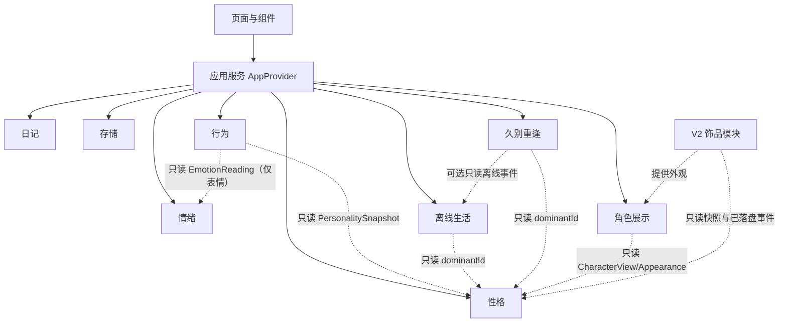

# 拾绪 ShiXu · 系统架构

> 状态：V1 架构基线。标注「已实现」的以 `main` 分支代码为准；「阶段 N 规划」表示尚未合入。产品范围见 [PRODUCT_SPEC](PRODUCT_SPEC.md)，性格与行为参数见 [COMPANION_SPEC](COMPANION_SPEC.md)。
>
> 存档 `schemaVersion` 为 3；本文档版本与存档版本无关。截至本版，`main` 只有 `schemaVersion` 2、`companion-v1` 三维账本与静态角色占位；v3 尚未发布，因此可在首次实现前修订 v3 形状，但一旦有真实 v3 存档，必须改用新版本号与迁移。

## 1. 架构原则

1. **模块化单体**：一个 Next.js 应用、一个仓库，按职责拆分领域模块；不拆微服务、不做多包发布、不引入消息队列或插件运行时。
2. **契约驱动**：模块之间只通过本文列出的公开类型与函数协作；禁止跨模块读取/修改私有状态，禁止组件直接改存档。
3. **配置驱动**：性格维度、情绪映射、成长幅度、主导规则、行为权重、离线活动、重逢文案由带版本号的配置对象定义；React 组件与页面不得硬编码这些规则。
4. **确定性**：所有正式状态变化由纯函数规则完成；时间、`dayKey`、`eventId`、随机种子由应用层显式提供，领域层不调用 `Date.now()`、`Math.random()` 或网络。
5. **单一写入边界**：只有应用服务（`AppProvider`）可以组合模块并调用存储；存档成功后才更新界面正式状态。
6. **独立任务卡**：每个阶段/模块任务必须填写 [MODULE_TASK_CARD](MODULE_TASK_CARD.md)，先声明契约变更再写代码。

不引入：Tauri/Rust、数据库、登录、微服务、Agent 框架、向量库、复杂全局状态框架、动态插件加载器。

## 2. 模块划分

| 模块 | ID | 负责 | 公开契约 | 私有状态 | 配置 |
| --- | --- | --- | --- | --- | --- |
| 日记 | `diary` | 原文记录、编辑、历史读取 | `Entry`、`DiaryEntryInput` | 日记正文与修订（通过快照持有） | 无业务阈值 |
| 情绪 | `emotion` | 九类情绪、VAD、AI 建议规范化与确认 | `EmotionReading`、`Analysis`、`EmotionSuggestion`、`validateAnalysis` | 无持久状态 | `MANUAL_EMOTION_DEFAULTS` |
| 性格 | `personality` | 五维贡献账本、派生分数、主导性格、描述 | `PersonalityState`、`PersonalitySnapshot`、`PersonalityRuleConfig`、`derivePersonality`、`resolveDominant` | 贡献台账、`dominantId`、规则版本 | `PERSONALITY_RULES_VERSION` + 规则配置 |
| 行为 | `behavior` | 主导行为、普通待机、特殊行为、互动反应 | `BehaviorContext`、`BehaviorDecision`、`BehaviorRuleConfig`、`selectBehavior` | 无持久状态（运行时序号） | `BEHAVIOR_RULES_VERSION` + 规则配置 |
| 离线生活 | `offlineLife` | 按离线窗口生成有限生活事件 | `OfflineLifeState`、`OfflineLifeEvent`、`OfflineLifeRuleConfig`、`planOfflineLife` | 事件历史（通过快照持有） | `offline-life-v1` |
| 久别重逢 | `reunion` | 判断长期未访问、生成问候、记录触发窗口 | `ReunionState`、`ReunionRuleConfig`、`evaluateReunion` | 已触发窗口（通过快照持有） | `reunion-v1` |
| 角色展示 | `character` | 按视图渲染小人、表情、动作、图层 | `CharacterView`、`AppearanceConfig` | 无 | 图层/动作映射 |
| 存储 | `storage` | 版本化存档、加载、保存、恢复、迁移入口 | `StoragePort`、`LoadResult`、`SaveResult` | localStorage 键 | 迁移表 |
| 装扮（V2） | `decoration` | 饰品状态、解锁、穿戴 | 仅预留读取与外观扩展点 | V2 自行持有 | V2 定义 |

### 2.1 依赖方向



- 行为模块不导入性格模块的内部实现，只接收 `PersonalitySnapshot`；主行为池只看 `dominantId`。
- 离线生活模块只读 `dominantId`，不读贡献账本、不写性格分数。
- 久别重逢模块只读 `dominantId` 与可选离线事件，不写性格、不写日记。
- 角色展示模块不导入性格、行为、离线或存储模块，只接收视图数据。
- 存储模块不导入规则模块，不决定分数、奖励、行为或离线事件。
- 页面不直接调用 `localStorage`，不直接修改 `Snapshot`。
- V2 模块不得写 `PersonalityState`，不得修改行为、离线或重逢规则。

### 2.2 模块任务卡的边界要求

每张任务卡必须写明：模块归属、输入/输出、修改了哪些公开契约、内部状态所有权、配置与版本、明确不做、最小验收。跨模块修改必须同时更新本文与调用方，不允许「先改代码再补文档」。

## 3. 目录规划

| 路径 | 状态 | 责任 |
| --- | --- | --- |
| `src/app/{layout,page}.tsx`、`src/app/companion/page.tsx`、`src/app/memories/page.tsx` | 已实现 | 路由与页面壳，共享根布局状态 |
| `src/app/api/emotion/route.ts` | 已实现 | 服务端情绪识别入口 |
| `src/application/AppProvider.tsx` | 已实现，阶段二至五扩展 | 状态编排、保存、会话启动、恢复、跨标签页冲突 |
| `src/application/useEmotionAnalysis.ts` | 已实现 | AI 建议请求、过期响应丢弃、降级 |
| `src/domain/types.ts` | 已实现，阶段二扩展 | 公共类型与契约 |
| `src/domain/emotions.ts` | 已实现 | 手选默认 VAD、规范化 |
| `src/domain/rules.ts` | 已实现，阶段二至五扩展 | 领域事件、原子结算、会话启动入口 |
| `src/domain/schema.ts` | 已实现，阶段二扩展 | 存档结构校验 |
| `src/domain/companion.ts` | 已实现（三维护账） | 阶段二拆分为 `personality.ts` + 配置，之后只作兼容/删除 |
| `src/domain/personality.ts` | 阶段二规划 | 五维派生、主导判定、描述、只读查询 |
| `src/domain/behavior.ts` | 阶段三规划 | 确定性主导行为/待机/特殊/互动选择 |
| `src/domain/offlineLife.ts` | 阶段四规划 | 离线窗口规划、活动选择、幂等 ID |
| `src/domain/reunion.ts` | 阶段五规划 | 长期未访问判断、问候模板选择 |
| `src/domain/characterView.ts` | 已实现（静态占位），阶段三扩展 | 由快照/行为推导视图 |
| `src/config/personality.ts` | 阶段二规划 | `PersonalityRuleConfig` |
| `src/config/behavior.ts` | 阶段三规划 | `BehaviorRuleConfig` |
| `src/config/offlineLife.ts` | 阶段四规划 | `OfflineLifeRuleConfig` |
| `src/config/reunion.ts` | 阶段五规划 | `ReunionRuleConfig` |
| `src/lib/storage/{port,localStorageAdapter}.ts` | 已实现 | 存储接口与浏览器实现 |
| `src/components/character/CharacterRenderer.tsx` | 已实现（静态占位） | SVG 渲染与图层白名单 |
| `src/components/emotion/*`、`src/components/memories/*` | 已实现 | 记录、纠正、历史界面 |

阶段二不要求一次性重命名所有文件；但新代码必须落在上表声明的目标位置，旧文件只做兼容或删除，不允许出现两份性格实现，也不允许把离线/重逢逻辑塞进 `personality.ts`。

## 4. 核心数据模型

### 4.1 情绪与日记（已实现，字段保持）

```ts
type EmotionLabel = "joy" | "calm" | "sadness" | "anxiety" | "anger" | "tired" | "mixed" | "neutral" | "unknown";
type EmotionSource = "ai" | "manual" | "corrected";

interface EmotionReading {
  label: EmotionLabel;
  valence: number;    // 0–1
  arousal: number;    // 0–1
  dominance: number;  // 0–1
  intensity: number;  // 0–1
  confidence: number | null;
  source: EmotionSource;
}

interface Entry {
  id: string;
  text: string;            // 原文，保存后不改写
  createdAt: number;
  updatedAt: number;
  dayKey: string;          // YYYY-MM-DD，保存时冻结
  revision: number;
  originalAnalysis: Analysis | null;
  analysisMeta: AnalysisMeta | null;
  effectiveEmotion: EmotionReading;
  corrections: EmotionCorrection[];
  awardedXp?: number;      // 旧字段，只兼容保留，不读取、不写入
  rulesVersion: string;    // 日记/事件规则版本（V1 为 "rules-v1"），不是性格规则版本
}
```

`Analysis`、`EmotionCorrection`、`AnalysisMeta` 保持 [AI_CONTRACT](AI_CONTRACT.md) 与现有 `src/domain/types.ts` 的定义。`Entry.text` 不设产品字数上限，只校验非空白。九类情绪枚举在本阶段不改名、不增删；中文显示名差异见 [COMPANION_SPEC](COMPANION_SPEC.md) 2.4。

### 4.2 性格（阶段二，schemaVersion 3）

```ts
type DimensionId = "gentleness" | "curiosity" | "cheerfulness" | "fearfulness" | "low_mood";

interface PersonalityContribution {
  dayKey: string;
  label: EmotionLabel;
  entryRevision: number;
  deltas: Record<DimensionId, number>; // 结算后的最终增量，派生只求和
  rulesVersion: string;                // 该条贡献结算时使用的 personality-* 版本
}

interface PersonalityState {
  contributions: Record<string, PersonalityContribution>; // key = entryId
  dominantId: DimensionId | null;      // 持久化，避免并列抖动
  rulesVersion: string;                // 新结算使用的版本，候选 "personality-v2"
}

interface PersonalitySnapshot {
  scores: Record<DimensionId, number>;        // 派生，不落盘
  dominantId: DimensionId;
  dominantDescription: string;                // 只给当前主导
  descriptions: Record<DimensionId, string>;  // 内部/调试；不进入用户界面
  rulesVersion: string;
}

interface PersonalityRuleConfig {
  rulesVersion: string;
  dimensions: Array<{ id: DimensionId; label: string; description: string }>;
  dominantPriority: DimensionId[];     // 并列顺序：温柔→好奇→开朗→害怕→低落
  initialScore: number;
  minScore: number;
  maxScore: number;
  perSaveCap: number;
  dailyNetCap: number;
  intensityBands: Array<{ maxInclusive: number; factor: number }>;
  roomFactor: number;                  // 未确认惯性公式前为 1.0
  emotionDeltas: Record<EmotionLabel, Record<DimensionId, number>>;
  descriptions: Record<DimensionId, { low: string; balanced: string; high: string }>;
  bands: { lowMax: number; highMin: number };
  rounding: "half-away-from-zero";
}
```

- 分数永远由 `contributions` 纯派生：`clamp(initial + Σdeltas, min, max)`；`deltas` 是写入时已受单次/单日上限约束的最终增量，派生不再按日重算，不存储第二份分数。
- 配置以 `rulesVersion` 为键注册；每条贡献按其自身 `rulesVersion` 解释。`PersonalityState.rulesVersion` 只决定“新结算使用哪个配置”，不能用来重新解释旧贡献或重新拒绝历史日。
- `initialScore`/`minScore`/`maxScore` 是存档级不变量；变更必须走显式迁移，不能只升 `rulesVersion` 就让旧分数随当前配置变化。
- `dominantId` 必须持久化：只有其他维度严格高于当前主导时才切换；并列保留当前主导。首次/迁移后为 `null`，按 `dominantPriority` 从最高分中取第一个。
- 纠正只重算被纠正条目：先扣除旧贡献，以该 `dayKey` 下所有已保存贡献的实际合计为余量（不区分版本），上限参数取原贡献的 `rulesVersion`；其他条目、其他日期不重算。余量不足时该条最终增量可为 0；若该日合计已超原版本上限，则只允许 0 或使合计绝对值严格减小（裁剪规则见 COMPANION_SPEC §2.6）。旧配置缺失时拒绝纠正。
- 旧 `CompanionState.contributions`（三维护账）不进入 `PersonalityState`；迁移后放入 `legacy`，不自动换算。
- 配置集中在 `src/config/personality.ts`，组件与页面不得引用 `emotionDeltas` 自行算分，也不得展示 `scores`。
- 当前 `companion-v1` 的 `dailyNetCap` 为 6，与 [COMPANION_SPEC](COMPANION_SPEC.md) 候选值 4 不一致；阶段二必须显式对齐或由用户确认，不得静默保留。

### 4.3 行为（阶段三，运行时）

```ts
type BehaviorCategory = "ambient" | "dominant" | "special" | "interaction";
type BehaviorId =
  | "idle_breathe" | "idle_glance"
  | "gentle_wave" | "quiet_sit" | "knee_rest" | "gentle_gaze"
  | "look_around" | "observe_object" | "wander_explore" | "approach_novel"
  | "bounce" | "spin" | "greet" | "happy_sway"
  | "curl_up" | "corner_hide" | "hesitant_approach" | "step_back"
  | "blank_stare" | "sit_alone" | "slow_walk" | "window_gaze"
  | "drink" | "smoke"
  | "respond_call" | "respond_pat" | "respond_observe";
type TimeBand = "morning" | "afternoon" | "evening" | "night";
type InteractionType = "call" | "pat" | "observe";

interface InteractionEvent {
  id: string;
  type: InteractionType;
  occurredAt: number;
  seed: number;
}

interface BehaviorContext {
  personality: PersonalitySnapshot;   // 只读；主池只看 dominantId
  emotion: EmotionReading | null;     // 只用于表情/幅度，不参与主池
  interaction: InteractionEvent | null;
  specialEligible: boolean;           // 由应用层只读计算；行为引擎不读日记
  dayKey: string;
  timeBand: TimeBand;                 // 只影响 ambient 权重
  sequence: number;
  seed: number;
  lastBehaviorId: BehaviorId | null;
  consecutiveCount: number;
}

interface BehaviorDecision {
  behaviorId: BehaviorId;
  category: BehaviorCategory;
  dominantId: DimensionId;
  pose: string;
  expression: string;
  animation: string;
  durationMs: number;
  reasonCode: string;
}

interface BehaviorRuleConfig {
  rulesVersion: string;               // 候选 "behavior-v2"
  behaviors: Array<{
    id: BehaviorId;
    label: string;
    category: BehaviorCategory;
    dominantId?: DimensionId;         // 仅 dominant 行为必填
    baseWeight: number;
    pose: string;
    expression: string;
    animation: string;
  }>;
  ambientShare: number;               // 候选 0.15
  specialBehaviorEnabled: boolean;    // 默认 false，待用户确认连续低落语义
  specialProbability: number;         // 候选 0.15
  special: {
    dominantId: "low_mood";
    behaviors: Array<{ id: "drink" | "smoke"; baseWeight: number }>;
  };
  minShare: number;                   // 候选 0.05
  maxConsecutive: number;             // 候选 2
  tickIntervalMs: [number, number];   // 候选 [20000, 40000]
  interactionDurationMs: [number, number]; // 候选 [2500, 4000]
  emotionExpression: Record<EmotionLabel, { expression: string; intensity: number }>;
  ambientTimeWeights: Record<TimeBand, Partial<Record<BehaviorId, number>>>;
}
```

行为决策不写 `Snapshot`，不需要 `eventId` 幂等；互动反馈与保存后情绪表现只存在于运行时内存。特殊行为不是必然触发；只有 `specialEligible`、主导为 `low_mood`、配置开启且概率命中时才可能发生。`specialEligible` 的连续天数判定（含第 4 天 A/B 语义）属于待确认项，见 [COMPANION_SPEC](COMPANION_SPEC.md) 3.5。

### 4.4 离线生活与久别重逢（阶段四/五）

```ts
interface OfflineLifeEvent {
  id: string;                 // offline:<windowStart>:<index>
  windowStart: number;
  occurredAt: number;
  dominantId: DimensionId;
  activityId: string;
  text: string;
}

interface OfflineLifeState {
  lastVisitAt: number | null;       // 上次成功会话启动
  lastActiveAt: number | null;      // 最后一次确认活动；离线/重逢基准
  lastWindowStart: number | null;   // 上次处理的窗口起点
  events: OfflineLifeEvent[];       // 有上限
}

interface ReunionState {
  lastTriggeredWindowStart: number | null;
  lastTriggeredAt: number | null;
}

interface OfflineLifeRuleConfig {
  rulesVersion: "offline-life-v1";
  minAbsenceMs: number;             // 候选 30 分钟
  eventIntervalMs: number;          // 候选 90 分钟
  maxEventsPerWindow: number;       // 候选 6
  maxStoredEvents: number;          // 候选 20
  activities: Record<DimensionId, Array<{ id: string; label: string; text: string; weight: number }>>;
}

interface ReunionRuleConfig {
  rulesVersion: "reunion-v1";
  thresholdMs: number;              // 候选严格 > 3 天
  baseQuestion: string;             // "最近过得还好吗？"
  templates: Record<DimensionId, { tone: string; recentActivity?: string }>;
}
```

- 离线事件在**再次打开**时由纯函数生成，不在关闭期间运行后台 Agent。
- 离线与重逢的缺席基准是 `baseline = lastActiveAt ?? lastVisitAt`，不是只看 `lastVisitAt`；`lastVisitAt` 只记录上次会话启动，不能单独代表用户最后一次在线。
- 应用层在页面隐藏、`pagehide`、刷新前提交 `ACTIVITY_CHECKPOINT`，更新 `lastActiveAt`；可见期间的周期性 checkpoint 最多每 5 分钟一次。同一标签页可用 `sessionStorage` 救援标记避免刷新被误判为离线。该标记不是正式存档，不得替代 `StoragePort`。
- 任何正式保存成功后也在同一 `applyGameEvent` 中顺带更新 `lastActiveAt`；不得按动画帧或行为 tick 写盘。
- 同一次离线窗口最多生成一次：`eventId = session:<windowStart>` + `lastWindowStart` + 事件 `id` 去重；`windowStart = baseline`。
- 重逢在更新 `lastVisitAt` / `lastActiveAt` 之前判断；同一次离线窗口只触发一次；保存成功后才展示。
- 直接关闭、浏览器崩溃或 checkpoint 写入失败时，只能使用最后一次成功的 `lastActiveAt`（或同标签页救援值）作为降级基准。该降级可能把未 checkpoint 的在线时长计入离线，但不得反向少算；保存失败时不得展示离线事件或重逢。
- 离线/重逢都不得修改 `personality.contributions`、`scores` 或 `entries`。

### 4.5 存档（schemaVersion 3）

```ts
interface SnapshotV3 {
  schemaVersion: 3;
  revision: number;
  entries: Entry[];
  character: {
    latestEntryId: string | null;
    currentEmotion: EmotionReading | null;
  };
  personality: PersonalityState;
  offlineLife: OfflineLifeState;
  reunion: ReunionState;
  memories: MemoryEvent[];
  appliedEventIds: string[];
  legacy?: {
    character?: { totalXp?: number; stage?: number };
    decorations?: unknown;      // v2 DecorationState 原样保留
    companion?: unknown;        // v2 contributions/habits/world 原样保留
  };
}
```

- `legacy` 只在迁移旧存档时出现；V1 不读、不展示、不参与结算，只保证原样往返。
- `MemoryEvent` 类型在 V1 只新增 `ENTRY_SAVED`、`ENTRY_TEXT_EDITED`、`EMOTION_CORRECTED`；旧 `ITEM_*`、`STAGE_REACHED` 只用于读取历史，不再产生。离线/重逢不写入 `memories`，避免与日记回忆混淆。
- 旧 `DecorationState`、`HabitProgress`、`WorldTrace` 类型可暂时保留为兼容类型，但不得进入 V1 业务逻辑。
- `character` 不再保存 `totalXp`/`stage`；它们只在 `legacy.character` 中兼容保留。

## 5. 模块接口与领域事件

| 接口 | 模块 | 状态 | 说明 |
| --- | --- | --- | --- |
| `analyzeEmotion(input)` | emotion（服务端） | 已实现 | 调用 Provider 或 mock，只返回 `Analysis` |
| `validateAnalysis(value)` | emotion | 已实现 | 字段、范围、九类标签校验 |
| `createManualEmotion(label, dims?)` | emotion | 已实现 | 手选默认 VAD，`confidence=null` |
| `derivePersonality(state, config)` | personality | 阶段二 | 纯派生五维分数、主导性格与描述 |
| `getDimensionScore(snapshot, id)` | personality | 阶段二 | 只读单维查询；不进入 UI |
| `describeDominantPersonality(snapshot, config)` | personality | 阶段二 | 只返回当前主导描述 |
| `resolveDominant(scores, previous, priority)` | personality | 阶段二 | 严格超过才切换；并列确定性 |
| `selectBehavior(context, config)` | behavior | 阶段三 | 四类行为分离的确定性选择 |
| `planOfflineLife(input, config)` | offlineLife | 阶段四 | 生成有限事件与下一 `lastVisitAt` / `lastActiveAt` |
| `evaluateReunion(input, config)` | reunion | 阶段五 | 判断是否触发并选择模板 |
| `deriveCharacterView(snapshot, decision?)` | character | 阶段三/七 | 视图映射，只读 |
| `applyGameEvent(snapshot, event, context)` | rules | 已实现，阶段二至五扩展 | 唯一正式状态变更入口 |
| `migrateSnapshotV1toV2(v1)` | storage/rules | 已实现 | 保留 |
| `migrateSnapshotV2toV3(v2)` | storage | 阶段二 | 新增；只做结构转换，不调用计分规则 |
| `StoragePort.load/save/readRaw/reset` | storage | 已实现 | 签名不变，`Snapshot` 升为 v3 |

### 5.1 V1 领域事件

| 事件 | 作用 | 幂等键 | 前置校验 |
| --- | --- | --- | --- |
| `CONFIRM_ENTRY` | 创建日记、确认情绪、写贡献 | `eventId` + `entryId` | 正文非空白、entryId 不存在 |
| `EDIT_ENTRY_TEXT` | 原样改正文 | `eventId` + `expectedEntryRevision` | entry 存在、修订匹配 |
| `CORRECT_EMOTION` | 替换情绪与贡献 | `eventId` + `expectedEntryRevision` | entry 存在、修订匹配 |
| `ACTIVITY_CHECKPOINT` | 更新最后活动时间 `lastActiveAt` | 单调 `max`；重复应用无副作用 | `at` 为非负时间且不晚于 `context.now`；不写回忆、不改分数 |
| `SESSION_STARTED` | 记录本次访问、离线事件、重逢触发标记 | `eventId`（候选 `session:<windowStart ?? "first">`） | `windowStart` 等于当前基准 `lastActiveAt ?? lastVisitAt`；事件 id 不与已存事件重复 |

`SESSION_STARTED` 载荷（应用层用纯函数算好后传入）：

```ts
interface SessionStartedEvent {
  type: "SESSION_STARTED";
  eventId: string;                 // session:<windowStart ?? "first">
  windowStart: number | null;      // 本次离线窗口起点；首次为 null
  offlineEvents: OfflineLifeEvent[];
  reunionTriggered: boolean;
}

interface ActivityCheckpointEvent {
  type: "ACTIVITY_CHECKPOINT";
  eventId: string;                 // activity:<at>
  at: number;                      // 最后一次确认活动时间
}
```

- `applyGameEvent` 对除 `ACTIVITY_CHECKPOINT` 外的事件先查 `appliedEventIds`：重复 `eventId` 返回 `changed=false`，不产生副作用。
- `ACTIVITY_CHECKPOINT` 不进入 `memories`，也不写入 `appliedEventIds`；应用 `lastActiveAt = max(lastActiveAt, at)`，因此重复、乱序或重放都不会改变结果。checkpoint 仍走同一条整快照保存路径，失败不改变正式状态。
- 任何成功的日记正式事件（`CONFIRM_ENTRY` / `EDIT_ENTRY_TEXT` / `CORRECT_EMOTION`）在同一 `applyGameEvent` 中把 `offlineLife.lastActiveAt` 推进到 `context.now`；保存失败时与事件一起回滚。
- `SESSION_STARTED` 原子更新：`offlineLife.lastVisitAt = context.now`、`offlineLife.lastActiveAt = context.now`、`lastWindowStart = windowStart`、按 `id` 去重追加事件并裁剪到 `maxStoredEvents`；`reunionTriggered` 为真时写 `reunion.lastTriggeredWindowStart = windowStart`、`lastTriggeredAt = context.now`。
- `RESTORE_DECORATION`、`EQUIP_DECORATION`、`UNEQUIP_DECORATION` **不属于 V1**；`GameEvent` 联合类型可保留兼容分支但必须显式拒绝，不得悄悄执行业务。
- 回忆事件 id 由 `eventId + 类型 + entryId` 确定性生成，保证重放不重复。
- `GameContext` 只含 `now` 与 `dayKey`，由应用层生成；任何新增上下文（种子、时间段）必须显式加入契约。

### 5.2 应用流程（保存与会话启动）

保存：

1. 页面产生草稿（正文、情绪、维度、AI 建议）。
2. 应用服务校验并生成 `eventId`、`entryId`、`now`、`dayKey`；重复点击复用冻结值。
3. 调用 `applyGameEvent` 得到候选 `Snapshot`；`changed=false` 直接结束。
4. 调用 `storage.save(candidate, expectedRevision)`。
5. 只有 `saved` 才更新 React 正式状态与 `lastConfirmedSave`；失败保留草稿与旧状态，不提前结算。
6. `confirmedSave` 只作为运行时上下文，供陪伴页一次性情绪反馈；消费一次即清除，刷新即失。

会话启动（阶段四/五）：

1. 加载快照，取 `context.now`、`context.dayKey`、当前 `dominantId`；计算 `baseline = offlineLife.lastActiveAt ?? offlineLife.lastVisitAt`。
2. 调用 `planOfflineLife({ lastActiveAt, lastVisitAt, now, dominantId }, config)`；首次/迁移存档返回空事件。
3. 调用 `evaluateReunion({ lastActiveAt, lastVisitAt, now, lastTriggeredWindowStart, dominantId }, config)`。
4. 生成 `SESSION_STARTED`；`windowStart = baseline`，事件与 `reunionTriggered` 由纯函数结果填充。
5. `applyGameEvent` 得到候选快照，`storage.save(candidate, expectedRevision)`。
6. 只有保存成功后才展示离线事件与重逢问候；失败保留旧状态，不展示、不提前确认“已经回来过”。
7. 页面隐藏、`pagehide`、刷新前生成 `ACTIVITY_CHECKPOINT`；可见期间最多每 5 分钟一次，`at = context.now`，走同一保存路径；失败只保留旧 `lastActiveAt`，不展示未保存事件。
8. 刷新后 `lastVisitAt` / `lastActiveAt` 已更新，同一窗口不会重复生成或重复问候。

行为循环：可见时由应用层按 `tickInterval` 用显式种子与序号调用 `selectBehavior`，把 `BehaviorDecision` 映射为 `CharacterView` 交给角色层；不写存档。页面隐藏时暂停；关闭网页不运行后台 Agent。

## 6. 本地持久化与迁移

- 键：`shixu.snapshot.v1`（保持不变，值内区分版本）。
- 加载结果：`missing`、`ready`、`unsupported-version`、`corrupt`、`unavailable`；同一套 schema 校验用于读取与写入前检查。
- 保存：一次写完整快照；检查 `expectedRevision`；跨标签页冲突时暂停提交并提示；空间不足保留旧状态与草稿；临时体验模式只改内存，不覆盖正式存档。
- 损坏/版本过新：保留 `raw`，提供导出与重置，不静默覆盖。
- 迁移 v1→v2：已实现（补 `companion` 默认值，保留日记/情绪/历史）。
- 迁移 v2→v3（阶段二）：
  1. `entries`、`memories`、`appliedEventIds`、`revision` 原样保留；`Entry.text`、`effectiveEmotion`、`corrections` 逐字不动。
  2. `character.latestEntryId`、`currentEmotion` 保留；`totalXp`、`stage` 移入 `legacy.character`。
  3. `companion`（三维护账、habits、world）整体移入 `legacy.companion`，不换算、不计分。
  4. `decorations` 整体移入 `legacy.decorations`，不读取、不修改。
  5. 新建 `personality = { contributions: {}, dominantId: null, rulesVersion: "personality-v2" }`，五维从初始分开始。
  6. 新建 `offlineLife = { lastVisitAt: null, lastActiveAt: null, lastWindowStart: null, events: [] }` 与 `reunion = { lastTriggeredWindowStart: null, lastTriggeredAt: null }`。首次会话不生成“过去的生活”；从本次打开开始记录。
  7. 迁移只在内存完成；下次成功保存才落盘；失败不改变原存档。
  8. 不追溯旧日记、不静默改写不可识别字段、不删除用户历史。
  9. 迁移后旧条目没有 `PersonalityContribution`；之后对这些条目的纠正只更新 `effectiveEmotion`、`revision`、`corrections` 与回忆事件，不补建贡献、不改变性格分数。这是“不追溯”的一部分，不属于结算失败。
- 读取校验必须按每条贡献自己的 `rulesVersion` 解析配置，不得用当前 `dailyNetCap` 统一复检历史：单条 `deltas` 的绝对值不超过该版本 `perSaveCap`；同一 `dayKey` 内若所有贡献属于同一版本，每个维度的合计不超过该版本 `dailyNetCap`；同日混合多个版本时只逐条校验单条上限，不按任一版本的日上限重新拒绝，因为各次写入时已分别应用当时规则。
- 写入校验使用当前 `PersonalityState.rulesVersion`，对每个维度独立判断，只约束当前版本的新贡献，不追溯历史：
  - 若该 `dayKey` 该维度的历史合计未超过当前 `dailyNetCap`，写入后合计绝对值必须不超过当前 `dailyNetCap`。
  - 若历史合计已超过当前 `dailyNetCap`，新贡献只允许 `0`，或使合计绝对值严格减小；结果允许仍超过上限（历史 `+6`、上限 `4`，新增 `-1` 得 `+5` 允许；新增 `+1` 得 `+7` 拒绝）。正负方向对称：历史 `-6` 时，新增 `+1` 得 `-5` 允许，新增 `-1` 得 `-7` 拒绝。
  - 具体裁剪区间统一按 [COMPANION_SPEC](COMPANION_SPEC.md) §2.5.2 的 `lower`/`upper` 公式；不得用新规则重算或回写旧贡献。
- 旧 `rulesVersion` 配置缺失时，该贡献不可解释：读取保留原值并标记不可纠正，纠正请求拒绝；不得猜测旧参数、不得静默删除或按当前配置重算。
- 还需校验：`dominantId` 属于五维或为 `null`；`offlineLife.lastActiveAt` 为 `null` 或不早于 `lastVisitAt`；`offlineLife.events` 的 `id` 唯一、`windowStart` 合法、数量不超过上限；`reunion.lastTriggeredWindowStart` 为 `null`，或为不晚于 `offlineLife.lastWindowStart` 的已处理窗口起点（不能要求与当前窗口相等，否则后续正常会话会被误判为损坏）。
- 迁移函数只读类型与配置，不导入计分/派生逻辑；`storage` 不得因新增 v2→v3 迁移而依赖 `rules`（既有 v1→v2 兼容迁移后续可一并移出，不阻塞阶段二）。
- 旧三维护账是否换算成五维：**待确认**；确认前一律不换算，只保留 `legacy`。旧文档中的五维草案 `personality-v1` 从未在 `main` 实现，不作为迁移来源。

## 7. 角色渲染

- 原创全白小人使用 React + SVG；V1 规划 `viewBox="0 0 240 320"`。
- 图层顺序：后景特效 → 身体/四肢 → 表情/五官 → 头部细节 → 装饰图层（V2）→ 前景特效。
- 图层 ID 必须来自白名单；未知 ID 忽略并回落到基础形象，不得崩溃。
- `CharacterRenderer` 只接收 `CharacterView` 与可选外观，不读取 `Snapshot`、不调用规则函数。
- `CharacterView` 可增加 `behaviorId`、`category` 便于调试；渲染层不得据此反推性格或重新选择行为。
- 尊重 `prefers-reduced-motion`；页面隐藏时暂停动画与行为调度。
- 现有静态占位渲染属于阶段七之前的临时载体，不得当作定稿视觉继续美化。

## 8. 兼容与交付

- 新增/修改公共类型必须同步本文、[COMPANION_SPEC](COMPANION_SPEC.md) 与调用方；不同步视为未完成。
- 存档结构变化必须提供迁移函数、失败路径与最小验证（旧档读取、正文/情绪不变、重复保存幂等、离线窗口不重复、重逢不重复）。
- V1 不引入 V2 业务字段；V2 接入时新增独立字段与迁移，不允许复用 `legacy` 执行业务。
- 演示前检查：手选主流程、AI 降级、刷新恢复、损坏存档提示、纠正替换、主导行为确定性、离线事件幂等、重逢只触发一次、长时间离线不增加 `low_mood`。
