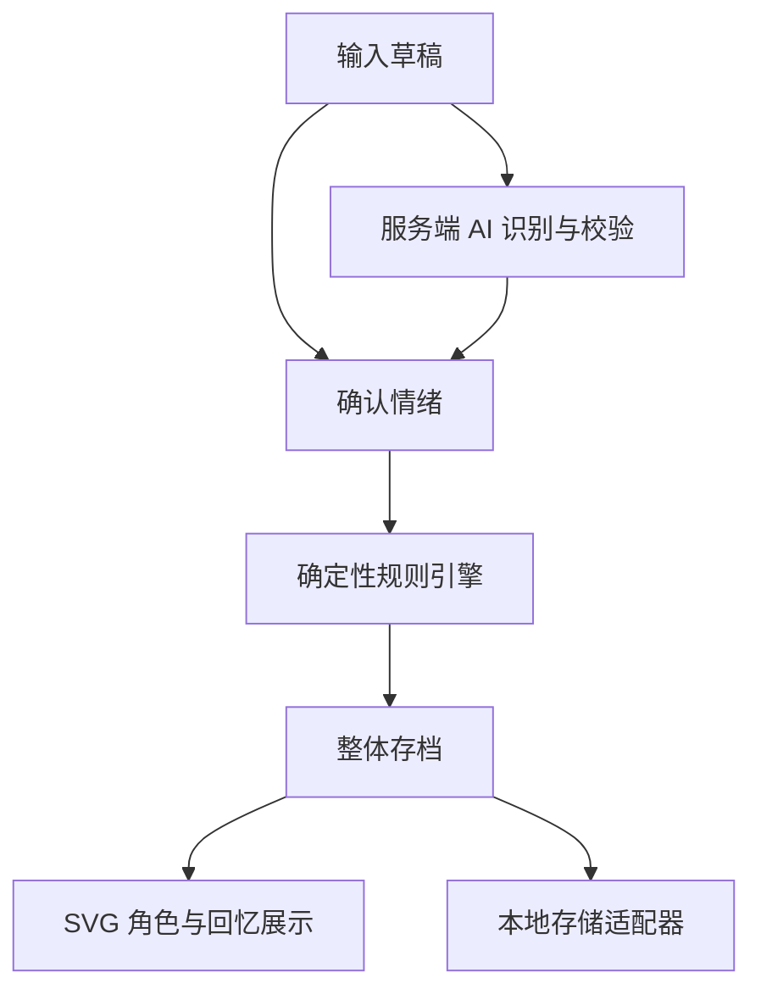

# 拾绪 ShiXu · 系统架构

状态：规划接口，不代表代码已经存在。采用简单模块化单仓库，先完成可运行 MVP，再按 [ROADMAP](ROADMAP.md) 扩展。项目约束见 [AGENTS](../AGENTS.md)。

## 1. 技术决策

| 层 | 固定方案 | 责任与边界 |
| --- | --- | --- |
| 页面 | Next.js App Router + React + TypeScript | 路由、输入、确认、回忆和状态展示 |
| 样式 | Tailwind CSS | 响应式布局、组件外观、减少动态效果 |
| 角色 | React + 原创 SVG 独立图层 | 只消费规则产生的 CharacterView，不改经验或存档 |
| 领域 | TypeScript 纯函数 | 情绪到视觉、经验、解锁、隐藏、恢复、纠正 |
| AI | Next.js 服务端 Route Handler + TypeSafe Jev provider 适配器 | Choice / Score 原生 answers → 校验与明确映射 → EmotionReading；不生成日记、不读写游戏存档 |
| 状态编排 | React Context + reducer / 应用服务 | 确认事件、串行规则调用、保存、刷新界面 |
| MVP 持久化 | 浏览器 localStorage | 单个带版本 snapshot；未来通过同一接口换数据库 |

不引入 Tauri、Rust、微服务、复杂 Agent、消息队列、云数据库、向量库。具体依赖版本在骨架分支选用当时兼容的稳定组合，提交锁文件并记录 Node 要求；指南不抄参考仓库过期或相互冲突的运行条件。

## 2. 数据流与权限

直接手选绕过 API；任何识别响应均不能跳过确认进入规则。AI 调用不接收角色状态，不持有写入工具。应用服务生成 id、now、dayKey，再显式传给规则；规则内部不访问网络、localStorage、Date.now 或 Math.random。

一次确认：校验输入 → 基于当前 snapshot 计算新 snapshot → 存储成功 → 更新 React 状态与成功提示。保存失败保留草稿和旧 snapshot，可重试；不显示已保存。动作播放是提交结果的表现，不再次触发奖励。请求和确认串行处理，防双击；同一 entryId 重试幂等。

日记 text 无产品人为字数上限，只校验非空白而不修改正文；存储、历史展示和编辑均保留完整原文，正文按纯文本保留空白显示（如 white-space: pre-wrap）。AI 输入超限独立降级为手选，不截断日记。正文编辑走 EDIT_ENTRY_TEXT，不自动重识别或改变心情；主动重识别/手选经确认后才走 CORRECT_EMOTION。API 的 inputRevision 是草稿/选择版本，与存档 Entry.revision 区分；正文或手选改变、切换记录、保存/取消时使旧请求失效，详见 AI 契约。

## 3. 目录规划

| 路径 | 内容 |
| --- | --- |
| src/app/layout.tsx、page.tsx、globals.css | 页面入口和全局样式 |
| src/app/api/emotion/route.ts | POST 情绪接口，无游戏写权限 |
| src/components/emotion/ | 草稿输入、AI 建议、手选与纠正 |
| src/components/character/ | CharacterRenderer 与 SVG layers |
| src/components/memories/ | 回忆列表、隐藏装饰恢复入口 |
| src/domain/types.ts | EmotionReading、Entry、Snapshot、GameEvent、CharacterView |
| src/domain/rules/ | 配置、状态转移、视觉派生；无 React 和 IO |
| src/application/ | React 状态容器与用例编排；唯一游戏提交入口 |
| src/lib/ai/server/ | server-only provider、提示词、原始输出校验 |
| src/lib/storage/ | StoragePort、localStorage 实现与版本迁移 |
| docs/ | 本套指南 |

以上路径按需要创建，不预先铺设空目录或占位框架。可在同模块中少量合并文件，但领域、AI、存储、渲染的依赖边界不能混淆。

## 4. 核心数据模型

| 类型 | 必要字段与约束 |
| --- | --- |
| EmotionReading | label、VAD、intensity、confidence（manual 时 null）、source；边界见 AI 契约 |
| Entry | id、text（完整原文）、createdAt、updatedAt、dayKey、revision（初始 0）、originalAnalysis（可空的规范化建议）、analysisMeta（可空）、effectiveEmotion、corrections、awardedXp、rulesVersion；存在于 entries 即已确认保存，草稿只在应用层 |
| CharacterState | totalXp、stage、latestEntryId、currentEmotion；经验/阶段永久保留 |
| DecorationState | ownedIds、equippedBySlot、hiddenById；隐藏记录含 hiddenEventId、sourceEntryId、slot、hiddenAt、reason |
| MemoryEvent | id、type、entryId（可空）、occurredAt、rulesVersion、有限结构 payload |
| Snapshot | schemaVersion=1、revision、character、entries、decorations、memories、appliedEventIds |
| CharacterView | expression、pose、animation、visibleLayerIds、effects；只读派生结果 |

MemoryEvent 类型至少有 ENTRY_SAVED、ENTRY_TEXT_EDITED、EMOTION_CORRECTED、ITEM_UNLOCKED、ITEM_HIDDEN、ITEM_RESTORED、ITEM_EQUIPPED、ITEM_UNEQUIPPED、STAGE_REACHED。GameEvent 是用户确认后的领域输入（CONFIRM_ENTRY、EDIT_ENTRY_TEXT、CORRECT_EMOTION、RESTORE_DECORATION、EQUIP_DECORATION、UNEQUIP_DECORATION，后期 TICK），不能由 AI 直接创建。originalAnalysis / corrections 仅保存规范化情绪与修订信息；analysisMeta 记录 provider、model、mappingVersion 和 dimensionSources，见 AI 契约，禁止将 Jev 原生 answers 或整份响应写入 Snapshot。

entries 中固定保存 awardedXp，日上限按该 dayKey 的首次奖励合计，纠正不重算奖励。ownedIds 单调增加；隐藏记录不删除所有权。角色 stage 阈值、物品目录、情绪表和数值只在领域配置维护，对应 PRODUCT_SPEC 的 rules-v1。

## 5. 模块接口（规划签名）

| 接口 | 输入 → 输出 | 不允许做的事 |
| --- | --- | --- |
| analyzeEmotion(request) | EmotionRequest → Promise<EmotionResponse> | 直接写 Snapshot |
| validateAnalysis(raw) | unknown → Result<Analysis, ValidationError> | 静默制造成功情绪 |
| applyGameEvent(snapshot, event, context) | Snapshot + GameEvent + {now, dayKey} → {snapshot, events, changed} | IO、随机、隐式读取时间 |
| deriveCharacterView(snapshot) | Snapshot → CharacterView | 存储或状态变更 |
| StoragePort.load() | → Promise<LoadResult> | 自行修改奖励规则 |
| StoragePort.save(snapshot, expectedRevision) | → Promise<SaveResult> | 失败时伪报成功 |
| StoragePort.export / import | 后期按同一 schema 校验 | 执行导入文本中的代码 |

重复 eventId 返回 changed=false；重复 CONFIRM_ENTRY 的 entryId 也不能重复奖励。时间戳、随机效果种子若以后需要，一律由 context 显式提供；当前可用 eventId 的稳定散列选择有限动作变体。新增事件先增加判别联合和消费端，不能将 unknown 直接断言为有效事件。

### 5.1 领域事件与修订幂等

所有输入含稳定 eventId，重试复用，成功保存 snapshot 时原子写入 appliedEventIds 与回忆。先查重复 eventId，再做修订/状态校验；无效操作不产生部分写入。应用以加载状态及 StoragePort 的 expectedRevision 控制提交，不采用事件回放系统。

| GameEvent / 主要载荷 | 转换与约束 |
| --- | --- |
| CONFIRM_ENTRY：entryId、text、确认情绪、规范化建议/元信息（可空） | 校验非空白但不 trim 正文；entryId 已存在则 changed=false。新记录一次性结算原有经验/解锁/隐藏或恢复规则，固定 dayKey，设置 latestEntryId，不因后续编辑改变最新顺序 |
| EDIT_ENTRY_TEXT：entryId、expectedEntryRevision、text | 仅原样更新正文、updatedAt，Entry.revision 加 1，记编辑回忆；保留心情、建议、奖励、创建时间和 dayKey；不运行成长或装饰规则 |
| CORRECT_EMOTION：entryId、expectedEntryRevision、新确认情绪、规范化建议/元信息（可空） | Entry.revision 加 1；corrections 保存旧/新有效情绪、旧/新修订号、时间、此次规范化建议及元信息，originalAnalysis 保留首次建议。仅最新记录更新 currentEmotion；装饰处理严格按下段；不重算经验或解锁 |
| RESTORE_DECORATION：itemId、expectedHiddenEventId | 仅恢复已拥有且隐藏事件匹配的物品，清除标记并记录所恢复的 hiddenEventId；无标记视为无变化，标记已换为其他隐藏事件则拒绝过期操作。不更改装备槽位 |
| EQUIP_DECORATION：itemId | 必须已拥有、存在于装饰目录且未隐藏；按目录 slot 设置 equippedBySlot，同槽旧物品仅卸下，不删除所有权。已在该槽则无变化；不运行经验/解锁/隐藏规则 |
| UNEQUIP_DECORATION：itemId | 仅清除仍指向该物品的槽位，可卸下隐藏物品；已卸下则无变化。保留所有权、hiddenById、来源槽位与回忆；不运行经验/解锁/隐藏规则 |

EDIT_ENTRY_TEXT 和 CORRECT_EMOTION 仅接受 expectedEntryRevision 等于现有 Entry.revision，下一修订由规则设为旧值 + 1，不允许以新 eventId 绕过旧修订校验。Entry.revision 与 Snapshot.revision 分别表示记录修订和整体保存版本；任一修订都不赋予同一 entryId 第二次首次结算资格。回忆 id 由 eventId + 事件类型 + 目标 id 确定性生成；ITEM_HIDDEN 的 id 即 hiddenEventId，恢复回忆引用它，不删除旧回忆。

最新记录纠正若不再满足 `V <= 0.35 && intensity >= 0.6`，仅移除 hiddenById 中 sourceEntryId 与它匹配的现存标记并产生恢复回忆；否则不变。任何纠正均不创建隐藏事件，不执行积极新记录的全量恢复；旧记录纠正不改变装饰和当前情绪。用户恢复已移除的标记不会因同一记录的新修订重建；另一条新记录产生的隐藏也不会被旧记录纠正清除。

隐藏不自动移除 equippedBySlot；可见图层只取已穿戴且不在 hiddenById 的物品。用户换装/卸下后恢复只清标记：原物品仍装备才重新显示，否则回到可穿戴列表，不抢占已用槽、不自动填回用户清空的槽。新积极记录的批量恢复沿用此规则；实际换装、卸下和恢复才记对应回忆，所有权与原有 SVG 目录不变。

## 6. 本地持久化与恢复

- localStorage key 为 `shixu.snapshot.v1`；一次写入完整 snapshot，避免日记已保存但库存未保存的分裂。初始化只在客户端 hydration 后执行，服务端渲染不能读取 window。
- load 结果区分 missing、ready、unsupported-version、corrupt、unavailable。只有 missing 可生成全新存档；损坏或未知版本保留原值，不静默覆盖。页面允许导出原始文本或在用户明确选择后重置。
- save 校验 schema 和 expectedRevision，拒绝过期更新；成功增加 snapshot.revision。MVP 只支持一个写入标签页，检测另一个标签页变化后暂停提交并提示重新加载，不宣称 localStorage 支持跨标签页事务锁。
- 空间不足/访问被禁时保留旧状态与草稿，提示本次未保存；可提供明确的临时会话模式，但不得显示持久化成功。
- 上述基础状态与恢复入口从 P1 提供，localStorage 访问异常由适配器捕获并返回 unavailable，页面仍可使用；用户主动选临时体验时显著告知“仅本次会话，刷新后无法保留”，只更新内存且不覆盖异常存档。损坏/未知版本的原始文本导出与明确重置入口也在 P1；P5 完善 UI 及校验后的正式存档导出/导入，不推迟核心错误处理。
- 将来换 IndexedDB/数据库只替换 StoragePort 与必要迁移；不为未来数据库提前引入 ORM/鉴权。新 schema 需迁移或明确保留旧数据，不因升级丢档。

## 7. SVG 图层与动作

固定 viewBox 建议 `0 0 240 320`，图层由后到前：后景特效 → 身体与四肢 → 服饰 → 五官 → 头部/徽章配件 → 前景特效。每层独立 React 组件，使用稳定 id、锚点、slot 和有限配置；本体白色，装饰不改基础身体资源。初始不绘制五官图层。

规则决定 expression/pose/animation；渲染器仅选取本地白名单 SVG，未知图层 id 安全跳过并回落到基础身体。不将 AI 字符串作为 SVG、HTML 或组件代码。MVP 用 CSS/React 控制短动作，无需额外动画引擎；prefers-reduced-motion 下改静态表现。首屏不随机生成外观，避免 hydration 不一致。

## 8. 兼容与交付

公共类型为模块协作基线；新增字段优先可选默认，破坏性改动同步所有调用方和存档版本。不为后续模块无限等待：骨架用简化界面，情绪模块用手选，角色模块用固定 CharacterView，均明确标识。最后一次最小主流程验证范围见 [WORKFLOW](WORKFLOW.md)。
