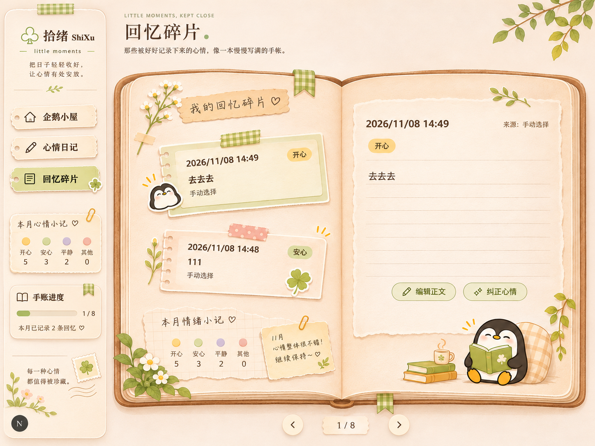
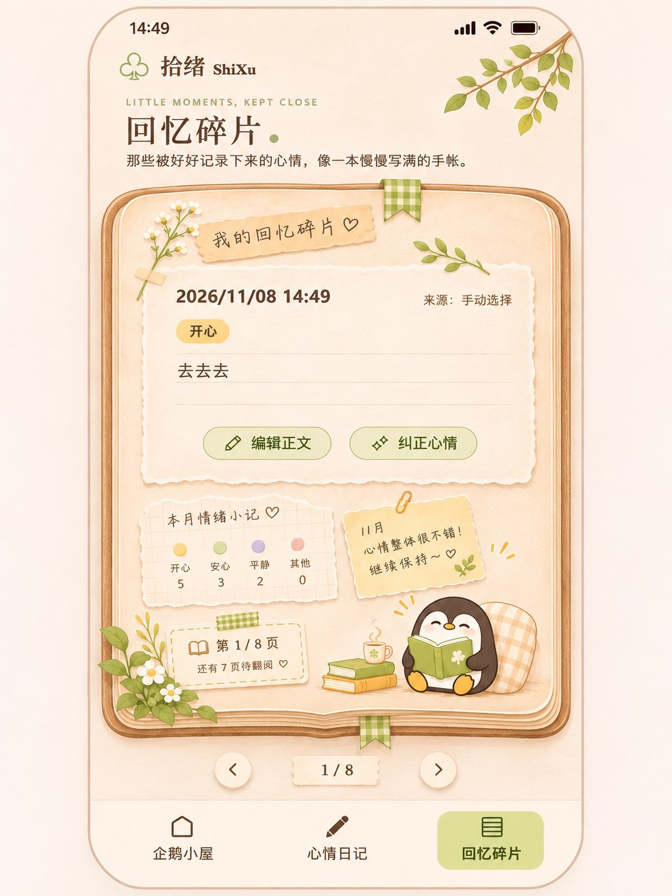

# 拾绪 ShiXu · 回忆碎片翻页手账正式视觉验收基线

> 日期：2026-11-16。**回忆页 `/memories` 的桌面端与手机端视觉方向已由用户确认。**
> **实现状态：第二轮正式 UI 已在 PR #41 分支实现，桌面与手机视觉已由用户确认并冻结；真实翻页已提交，待用户最终功能验收。** 本文仍是视觉方向基线，不是像素级生产切图；翻页规则以实现分支与任务卡为准。
> 产品、领域与权限仍以 [AGENTS](../AGENTS.md)、[PRODUCT_SPEC](PRODUCT_SPEC.md)、[COMPANION_SPEC](COMPANION_SPEC.md)、[AI_CONTRACT](AI_CONTRACT.md) 和 [ARCHITECTURE](ARCHITECTURE.md) 为事实来源；概念图中的示例日期、正文、情绪数量与页码不产生新规则。

## 0. 验收记录与文件校验

| 项目 | 记录 |
| --- | --- |
| 视觉确认日期 | 2026-11-16 |
| 确认范围 | 回忆页 `/memories` 的桌面端与手机端视觉方向、页面结构与装饰语言 |
| 用户指定桌面基线 | 最新一组概念图的**第一张**：左侧导航目录 + 中央双页展开手账 |
| 用户指定手机基线 | 最新一组概念图的**第三张**：单页竖向手账 |
| 未采用的图 | 同组第二张桌面概念图不是本次基准，不得据此实现或替换已确认方案 |
| 实施状态 | 正式 UI 已在 PR #41 分支实现；第二轮视觉由用户确认后冻结。真实翻页已提交，功能待最终验收；PR #41 保持 Draft，不合并，不启用自动合并 |
| 图片校验 | 两张 PNG 按原样入库，未重新压缩、裁剪或重绘；实测 SHA-256 与 §1 一致 |
| 图片来源 | 用户提供的交接包；原始文件分别为 1448×1086 与 1086×1448，8-bit RGB PNG |

> 视觉验收通过不等于页面功能已实现或真实 UI 已验收。概念图中的布局、装饰比例、分页形式与示例内容仍需在实现阶段结合真实存档和浏览器验收确定。

## 1. 已确认参考图

| 页面 | 端 | 已确认设计预览 | 图片路径 | SHA-256 |
| --- | --- | --- | --- | --- |
| 回忆碎片 `/memories` | 桌面 |  | `docs/assets/ui-approved/memories-scrapbook/Shixu_Memories_Scrapbook_Desktop_Approved.png` | `ca7d69abb864b408a9047f3dc9fee14cbc893db2251e528c74fe5251cddfedbf` |
| 回忆碎片 `/memories` | 手机 |  | `docs/assets/ui-approved/memories-scrapbook/Shixu_Memories_Scrapbook_Mobile_Approved.png` | `bc9925c1d87ecf4153f00f5ff5ca1a05093e582fe0400c736a90fcb16177c7be` |

两张图是**视觉方向基线**：用于确定布局关系、信息层级、装饰语言与翻阅方式。它们不是像素级切图，不替代仓库中已验收的原创企鹅 SVG 组件，也不代表以下参数已经定稿：具体 Hex 配色、字体、字号、间距、圆角、阴影、断点、触摸目标、场景比例、翻页动画时长。

## 2. 全局视觉方向

继续沿用 ShiXu 既有风格：

- 奶油白与暖纸张底色，浅木色书页边缘，鼠尾草绿作为主要强调色，暖棕文字；
- 温暖绘本插画氛围，柔和阴影、轻描边、少量手绘植物与纸张纹理；
- 信息可读性优先：正文、日期、情绪、来源和操作按钮必须清楚，不被装饰遮挡；
- 保持安静、私密、被珍藏的手账感，不采用科技仪表盘、强烈霓虹或复杂游戏 HUD；
- MoodSpace 仅作为排版与剪贴簿结构参考，**不复制其美术素材、配色主题或业务功能**。

具体设计 token 可由实现者统一收敛，但不得把候选数值写成已获用户确认。

## 3. 桌面端布局（`/memories`）

### 3.1 左侧手账式导航目录

- 固定或随页面稳定的左侧纸卡侧栏，包含：
  - 品牌「拾绪 ShiXu」、英文小字「little moments」与一句品牌文案；
  - 植物点缀与柔和分隔线，形成手账目录质感；
  - 三个书签式页面入口：**企鹅小屋 `/`、心情日记 `/diary`、回忆碎片 `/memories`**；
  - 当前页「回忆碎片」以鼠尾草绿胶囊/书签态突出，其余入口保持纸签样式；
  - 「本月心情小记」统计卡、「手账进度」卡与底部手写便签、植物点缀。
- 侧栏中的头像、书签、贴纸与小装饰均为**静态视觉元素**，不得暗示账号、设置、通知、商店、饰品或家具等未确认功能。
- 「本月心情小记」与「手账进度」只能读取真实存档聚合结果，不能使用概念图中的数字作为种子数据。
- 侧栏导航入口是既有三页的真实入口，不是新增页面；不得改变已确认路由。

### 3.2 中央双页展开手账

- 页面主体是一本摊开的厚书/手账：
  - 浅木色封面与书脊，奶油纸页，纸张纹理与轻微撕纸边缘；
  - 中缝装订、页面层次与柔和投影，形成真实翻开的书本感；
  - 左页为**错落回忆便签拼贴**，右页为**当前选中日记的完整详情**；
  - 书页底部之外提供上一页、下一页与页码控件。
- 双页结构是阅读层级而非两张独立长列表：左页承担回忆索引，右页承担完整正文阅读。
- 书页与装饰必须可滚动或自适应，长正文、窄视口和浏览器缩放下不得被裁切或遮挡操作。

### 3.3 左页：胶带固定的错落回忆便签

- 顶部用胶带固定的纸片标题，例如「我的回忆碎片」；标题文案属于视觉示例，实现时可用既有页面标题语义承载。
- 多条回忆便签以轻微旋转、错落层叠、胶带和别针式装饰固定，展示：
  - 真实保存日期与时间；
  - 已确认情绪标签；
  - 正文摘要或开头片段；
  - 来源（`ai / manual / corrected` 对应的真实来源文案）。
- 便签可承载“选中某条回忆”的交互，选中后右页展示该条完整日记；具体选中态、悬停/焦点表现与键盘操作由实现阶段确定。
- 胶带、四叶草、雏菊、枝叶、企鹅贴纸等装饰为静态点缀，不得遮挡日期、情绪、摘要与点击区域。
- 左页底部可放「本月情绪小记」统计卡与手写便签；统计与文案同样只能来自真实记录聚合，手写便签文案不得伪造用户心情或成长结论。

### 3.4 右页：完整日记详情

- 展示当前回忆的完整信息：
  - 真实保存日期与时间；
  - 真实来源（AI 建议、手动选择或纠正后的来源）；
  - 已确认情绪标签；
  - 完整日记原文，按纸页横线可读排版，长文可滚动；
  - 保留「编辑正文」与「纠正心情」入口。
- 正文必须原样展示，不得截断、摘要化、AI 改写或润色；编辑与纠正仍沿用现有事件台账、贡献替换与存档原子提交规则。
- 右下角阅读企鹅、书本、茶杯与软垫属于概念图插画装饰：
  - **不得用图中的装饰企鹅替换已验收的原创企鹅 SVG 母版**；
  - 正式实现可使用既有已验收角色组件，或仅保留植物/书本等静态装饰；不得据此新增未经确认的企鹅美术资产或行为。
- 右侧植物枝叶、便签与胶带不得压住正文、按钮、错误提示与加载状态。

### 3.5 底部翻页控件

- 书页下方居中提供圆形上一页/下一页按钮与页码书签（概念图为「1/8」）。
- 页码与进度必须由真实记录数量计算；首尾页的禁用态、键盘可达性、焦点顺序和页码语义由实现阶段按可访问性要求处理。

## 4. 手机端布局（`/memories`）

### 4.1 单页竖向手账

- 手机端不是桌面双页的等比压缩，而是**单页竖向手账**：
  - 顶部为品牌行、英文小字、页面标题「回忆碎片」与说明文案；
  - 主体是一本有浅木色边缘和叠页厚度的单页手账；
  - 正文详情优先，回忆便签、统计与装饰顺次排列在下方；
  - 底部提供上一页、下一页与页码书签；
  - 页面最底部为三个导航入口：企鹅小屋、心情日记、回忆碎片，当前页以鼠尾草绿胶囊态突出。
- 单页内部顺序建议（以概念图为基线）：
  1. 胶带固定的标题纸片；
  2. 当前回忆详情：日期时间、来源、情绪标签、完整正文、编辑正文/纠正心情按钮；
  3. 本月情绪小记统计卡；
  4. 手写便签与植物、书本、茶杯、企鹅等静态装饰；
  5. 「第 X / Y 页，还有 N 页待翻阅」进度卡；
  6. 书页之外的页码与上一页/下一页控件。
- 手机端优先保证完整正文与操作按钮可见、可点；装饰不得挤占正文可读宽度或造成横向滚动。
- 固定底部导航需沿用 PR #38 已完成的移动端安全区修复：保留三入口，底部留白与 `safe-area-inset-bottom` 共同保证保存、编辑、纠正与翻页控件不被遮挡。

### 4.2 手机翻页

- 翻页是手机端的主要浏览方式，而不是展开式列表的替代装饰。
- 页码、待翻阅数量与进度必须来自真实记录；概念图中的「1/8」「还有 7 页待翻阅」只是视觉示例。
- 单条记录、空记录、长正文与最后一页都要有真实边界状态；不得显示示例日记冒充用户数据。

## 5. 纸张、胶带、植物与装饰规范

- **纸张**：暖奶油纸色、轻微纤维/水彩纹理、撕纸或毛边、纸页横线；纹理需轻量且不影响正文对比度。
- **胶带**：格纹、波点、牛皮纸色等和纸胶带样式，用于固定标题与便签；仅作视觉装饰，不可点击，不承载业务。
- **植物**：雏菊、枝叶、四叶草、压花等静态插画，用于页角、侧栏和书页边缘；不得遮挡文字、按钮与焦点态。
- **便签**：黄色手写便签、方格统计纸、书签与页码缎带；其中的文字如「心情整体很不错」属于概念图示例，不得伪造用户情绪结论或成长评价。
- **木质书页边缘**：浅木色封面、叠页厚度与柔和阴影，营造实体手账感；不得以整张概念图作为不可交互的页面背景来冒充 UI 开发。
- **装饰可控性**：装饰是实现层静态资源或 CSS/SVG 元素；必须支持低动态设置、文本缩放与窄屏布局，不得拦截点击、聚焦或屏幕阅读器语义。
- **授权边界**：所有插画、胶带、植物与纸张纹理必须原创或具备适用授权；不得复制 MoodSpace 或任何第三方受版权保护的素材。

## 6. 翻页交互的设计目标

- **必须能翻页**：用户可在回忆页逐页浏览真实日记记录，并可清楚知道当前位置与总页数。
- **真实分页规则待实现阶段确定**：每页承载一条日记还是一个双页组合、左页便签数量、排序方式（时间倒序为现有列表语义）、选中详情与翻页的联动方式，都必须依据实际日记记录与真实存档结构决定；本文不预设固定页大小，也不授权硬编码 8 页或 2 条记录。
- **桌面**：左页便签作为索引，右页显示选中回忆全文；上一页/下一页切换页面组合，选中态与键盘焦点清晰。
- **手机**：单页显示当前回忆全文，上一页/下一页切换记录；底部导航保持固定。
- **边界状态**：首页禁用“上一页”、末页禁用“下一页”，或采用等价的明确禁用态；空记录显示真实空态，不显示虚假页码。
- **可访问性**：翻页按钮具备可读标签与键盘操作；页码变化应可被辅助技术感知；触摸目标尺寸、焦点可见性与对比度在实现阶段验收。
- **不虚构动效参数**：是否使用纸张翻转、淡入或位移过渡，以及时长、缓动与低动态降级方式均未定稿；不得把概念图的静态书页理解为已批准的 3D 翻页动画。
- **不得自动翻页**：不设置定时轮播、自动切换或后台播放；用户主动翻阅。

## 7. 数据与功能边界

以下边界与概念图同时生效：

1. **翻页必须真实可用**：手账必须能翻页；真实分页规则在后续开发时依据实际日记记录确定，不在本文或代码中预设。
2. **示例内容不得硬编码**：图中的日期、日记正文、情绪数量、来源文案、页码 `1/8` 与「本月已记录 2 条回忆」均为视觉示例，不得写入种子数据、默认内容或真实存档。
3. **统计只能来自真实存档**：侧栏「本月心情小记」、左页统计卡、手机统计卡与手账进度，只能从真实已保存记录聚合计算；空月份显示真实空态，不虚构数字。
4. **保留既有能力**：保留日记全文展示、正文编辑与情绪纠正；编辑/纠正不得破坏事件记录、贡献替换与历史完整性。
5. **不修改领域规则**：不得修改情绪评分、五维性格、主导判定、AI 权限、行为选择、离线生活、久别重逢或存档规则；本视觉任务不新增持久化字段，`schemaVersion` 不变。
6. **不新增图片上传**：不提供用户图片上传、裁剪、存储或展示功能。
7. **不新增默认图片业务系统**：不建立图库、相册、图片持久化或默认配图选择机制。
8. **装饰是静态视觉**：插画、胶带、植物、便签、纸纹与书页边缘均为静态装饰，不承载新玩法、奖励、解锁或收集。
9. **禁止整图冒充 UI**：不得把已验收概念图作为不可交互的整页背景，再叠加少量按钮来冒充正式 UI 开发。
10. **不得替换企鹅母版**：图中的装饰企鹅不能直接替换已验收的原创企鹅 SVG 母版，也不得据此新增未经确认的角色资产或行为。

补充约束：

- 九类情绪继续使用 `src/domain/types.ts` 的 `EMOTION_NAMES`；概念图中的「平静」等分类与四格统计仅为视觉示例，不得新增或改写情绪字典。真实统计的分类口径、分组与标签由实现阶段基于既有情绪定义确定。
- 来源展示必须映射真实的 `ai / manual / corrected`，不得把示例「手动选择」写成固定文案。
- 空态、错误态、加载态、保存失败、长正文、单条记录与跨标签页冲突仍需可用；视觉不得遮挡错误消息、确认按钮或编辑入口。
- 不出现服装、饰品、家具、商店、金币、经验值、等级或排行榜入口；V1 不为这些概念图装饰新增业务模块。
- 如实现需要新的只读聚合视图或分页视图，必须先更新 [ARCHITECTURE](ARCHITECTURE.md) 与调用方；不得由渲染组件直接读取完整存档或修改正式状态。

## 8. 与 PR #37 及既有设计规范的关系

- **PR #37（已合入 `main`，2026-11-15）**：确认了三页桌面视觉方向，并入库三张验收图：
  - `docs/assets/ui-approved/Shixu_01_企鹅小屋_视觉验收稿.png`
  - `docs/assets/ui-approved/Shixu_02_心情日记_视觉验收稿.png`
  - `docs/assets/ui-approved/Shixu_03_回忆碎片_视觉验收稿.png`
  - 以上文件**保留且不覆盖**；本次新增图片放入独立子目录 `docs/assets/ui-approved/memories-scrapbook/`。
- **本次更新**：回忆页 `/memories` 的桌面与手机视觉以本文两张图和本文规范为准；[STAGE7_UI_VISUAL_APPROVED](STAGE7_UI_VISUAL_APPROVED.md) 中回忆页「左侧列表 + 右侧全文详情」的桌面描述与「手机单列/展开式」的待定描述，由本文的翻页手账方案补充和替代；小屋与日记两页的既有视觉基线不受影响。
- **历史基线**：旧回忆概念图继续作为历史验收记录保留，可追溯，但不再作为当前实现规范；不得用旧图否定本次用户确认的新布局。
- **交互规格**：[STAGE7_UI_INTERACTION_SPEC](STAGE7_UI_INTERACTION_SPEC.md) 中关于回忆页保留历史浏览、正文编辑与情绪纠正的要求继续有效；其导航与移动端表现以本次确认为准补充。
- **产品与领域**：本视觉方案不改变 [PRODUCT_SPEC](PRODUCT_SPEC.md)、[COMPANION_SPEC](COMPANION_SPEC.md)、[AI_CONTRACT](AI_CONTRACT.md)、[ARCHITECTURE](ARCHITECTURE.md) 的定义；如发生冲突，以这些产品与领域文档及 `AGENTS.md` 为准。
- **PR #38**：该 PR 是阶段七正式 UI 的实现分支，本次仅追加设计文档与概念图，不修改产品代码；正式 UI 仍等待用户验收，PR #38 不合并。

## 9. 本次用户批准的回忆页面视觉调整

1. 回忆页桌面端从既有「左侧列表 + 右侧全文详情」升级为**左侧手账目录 + 中央双页展开手账**。
2. 桌面左页采用**胶带固定的错落回忆便签拼贴**，右页展示当前选中回忆的**完整日记详情**。
3. 桌面保留并强化左侧品牌、植物、三个书签式入口、本月心情小记、手账进度与底部手写便签。
4. 手机端正式采用**单页竖向手账**：正文详情优先，回忆便签、统计、便签与装饰顺次下排，底部三入口导航与翻页控件同时保留。
5. 明确纸张纹理、撕纸边缘、和纸胶带、植物与小贴纸的装饰语言。
6. 明确必须支持翻页，但真实分页单位、页大小、页码与统计均来自真实记录，不采用概念图示例数字。
7. 保留完整正文、正文编辑与情绪纠正能力，不因视觉升级丢失现有功能。

## 10. 实施与验收状态

### 10.1 当前状态

- 正式 UI 已在 PR #41 的 `feature/memories-scrapbook-codex` 分支实现；**第二轮桌面与手机视觉已由用户确认，视觉冻结**。
- 真实翻页已实现：按创建时间倒序每页一条，最新为第 1 页；桌面左页当前及相邻便签、右页当前全文；手机单页；页码、总页数与进度由真实记录计算。
- 桌面使用两段式纸张轻翻与光影，手机使用轻量过渡；`prefers-reduced-motion` 下直接切换；动画期间防止重复翻页；未保存草稿阻止翻页。
- 未修改存档 Schema、五维评分、企鹅行为、AI 或其他页面。
- 功能状态：**已提交，待用户最终功能验收**。PR #41 保持 Draft，未合并，未启用自动合并，未进入许愿屋或阶段八。

### 10.2 实现阶段的最小验收方向

- 桌面与手机均以真实存档驱动：翻页、页码、本月统计、便签生成与详情展示不使用示例数据。
- 完整正文、正文编辑、情绪纠正与来源展示均可用，且不破坏既有事件与贡献规则。
- 翻页在首尾页、空记录、单条记录、长正文与窄屏下均有正确边界与可访问性。
- 装饰不遮挡正文、按钮、错误提示与导航；不出现横向溢出。
- 手机底部导航与翻页控件不被安全区或固定栏遮挡。
- 不出现 V2 或未确认业务入口；角色继续使用已验收母版；概念图不被当作整页背景。
- 真实浏览器、桌面与手机视口、低动态模式与必要回归检查通过后，仍需用户进行正式视觉验收。

### 10.3 尚未验证

- 实体设备、非零安全区、其他浏览器、文本缩放与屏幕阅读器体验；
- 翻页动画在真实设备上的最终手感、不同刷新率与低性能设备表现；
- 超大量记录的性能、虚拟化与长期的跨设备视觉一致性；
- 具体像素尺寸、断点、字体与颜色 token 仍属于实现参数，不作为已获产品确认的数值。

已在 Chrome 生产构建中验证：真实翻页、首尾页禁用、0/1/9 条记录、2160 字长文、编辑草稿保护、正文保存、情绪纠正往返、键盘 Enter、低动态切换，以及 360/375/390 宽度无横向溢出与底部导航避让。

## 11. 相关基线

- [AGENTS](../AGENTS.md)
- [STAGE7_UI_VISUAL_APPROVED](STAGE7_UI_VISUAL_APPROVED.md)
- [STAGE7_UI_INTERACTION_SPEC](STAGE7_UI_INTERACTION_SPEC.md)
- [STAGE7_TASK_CARD](STAGE7_TASK_CARD.md)
- [STAGE7_DESIGN](STAGE7_DESIGN.md)
- [ROADMAP](ROADMAP.md)
