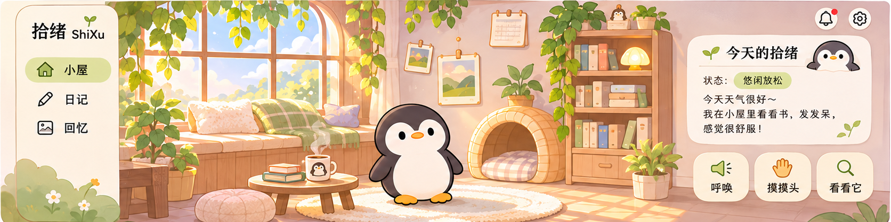
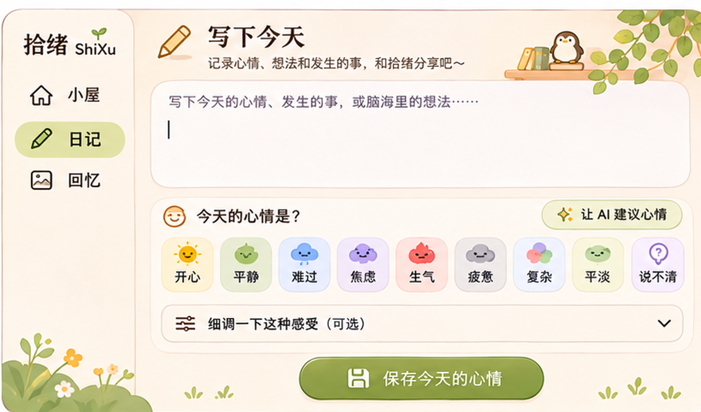
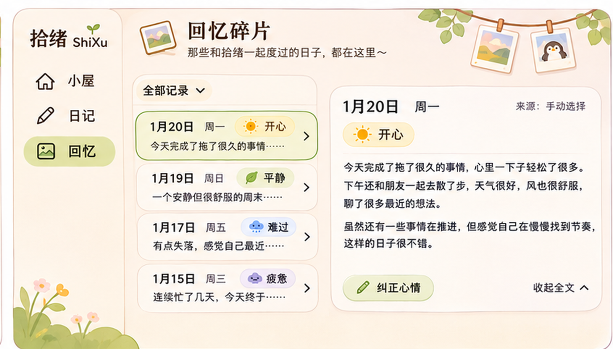

# 拾绪 ShiXu · 正式 UI 三页视觉验收基线 V1

> 日期：2026-11-15。**视觉方向与三页概念图：用户已确认通过。**
> **实现状态：正式 UI 代码已随 PR #38 合入 `main`；真实浏览器视觉验收、移动端、具体像素与动画参数仍待用户验收。** 本文仍是视觉基线，不代表已验收。
> 本包附三张经过用户确认的概念图 PNG。以 `AGENTS.md`、`PRODUCT_SPEC.md`、`COMPANION_SPEC.md`、`AI_CONTRACT.md` 和已确认的角色 SVG / 领域契约为产品事实来源；图中示例文案、装饰按钮与数据不产生新业务规则。

## 0. 验收记录与同步校验

| 项目 | 记录 |
| --- | --- |
| 视觉验收日期 | 2026-11-15 |
| 验收范围 | 桌面端三页整体视觉方向与页面结构：企鹅小屋 `/`、心情日记 `/diary`、回忆碎片 `/memories` |
| 用户结论 | 通过。风格与结构已确定，不得自行重新选型或推翻 |
| 实施状态 | 第六开发包代码已随 PR #38 合入 `main`；正式视觉验收、移动端、精确尺寸、断点与动效参数仍待验收 |
| 图片校验 | 三张 PNG 的实测 SHA-256 与 §1 表格一致；文件按原样入库，未重新压缩、重绘或改名 |

> 三张 PNG 是桌面视觉方向的概念/验收图，不是可直接用于生产的切图，也不替代仓库中已验收的企鹅 SVG 组件。视觉验收通过不等于页面功能、响应式或动画参数已经实现。

## 1. 已确认参考图

| 页面 | 正式路由 | 已确认设计预览 | 图片 SHA-256 |
|---|---|---|---|
| 企鹅小屋 | `/` |  | `459e57be552c1ac7cf94f53c514e35f17350b24994ba94117772edd03063a68d` |
| 心情日记 | `/diary` |  | `9a924228c276da1ed0802e9c72d6b745a42133274e12edb10c37da29c40c52e3` |
| 回忆碎片 | `/memories` |  | `4a63a100b81fa15dafb253dcd60312faa97fd73565fe7bf74f94853067ba4cde` |

三图是已验收的**桌面视觉方向**；绘画生成的标题、数据、文字与部分图标可能不同于真实领域规则，落地时以现有代码为准。角色在图中的画法仅供位置和比例参考，不能替代用户此前验收的原版企鹅 SVG。

> **后续更新（2026-11-16）**：用户已另行确认回忆页 `/memories` 的桌面与手机**翻页手账**视觉，以 [回忆手账正式视觉验收基线](STAGE7_MEMORIES_SCRAPBOOK_APPROVED.md) 为准。本表第三张回忆图保留为历史验收记录，不覆盖、不删除；§5 中此前的回忆页布局描述由新基线补充和替代。小屋与日记两页的视觉基线不变。

原始文件尺寸：小屋 1672×419、日记 1638×964、回忆 1692×964；均为 8-bit RGB PNG，按原样保存。

## 2. 视觉体系（已确认方向）

- **主氛围参考 Kinder World**：温暖阳光、宁静日常、绘本式生活空间，少量植物/书本/软垫/浅木家具，重视企鹅的真实存在感；只借鉴氛围，不复制商业游戏场景或素材。
- **角色系统借鉴 React Kawaii 的分层思路**：身体与表情分离，维持原创幼态黑白企鹅；圆润体态，橘黄色嘴和脚，短翅膀，表情丰富，**不加腮红**。已有 PenguinFront、PenguinFace、PenguinPoses 和特殊动作应直接复用，不擅自重画母版。Behance LINEpenguin 仅为表情语言参考；Penguin-Pet 仅为动作状态切换参考。
- **界面语言**：暖奶油纸张底、浅木色、鼠尾草绿点缀、温和的淡橙/浅蓝/淡紫；圆角卡片、轻描边、柔影、稀疏手绘小装饰；足够的正文对比度和清楚焦点；不得变成科技仪表盘、强烈霓虹或复杂游戏 HUD。
- **桌面共用结构**：左侧窄侧栏固定“拾绪 ShiXu”品牌，三个入口“企鹅小屋 / 心情日记 / 回忆碎片”；当前页以淡绿色胶囊态突出。三页独立展示，**日记与企鹅不在同屏分栏**。
- **响应式**：手机底栏三入口是此前建议的落地方案，**不因本次桌面视觉通过而认定手机稿已验收**；具体断点、触摸目标、窄屏层级、动画耗时和尺寸依然待开发阶段人工验收。2026-11-16 已单独确认回忆页手机手账视觉，小屋与日记手机端仍未验收。
- 具体 Hex 配色、字体、间距、阴影、场景比例、企鹅像素尺寸和动效毫秒数**未产品定稿**。可由实现者使用设计 token 统一实现，但不得宣称数值已获用户确认。

## 3. 小屋页面（`/`）

**构图**：以房间为主视觉。中央留给企鹅自然活动；固定生活场景包括窗边软垫、暖光窗户、植物角、浅木书架/小桌、软地毯、柔软小窝。设置五个只读展示区域：中央、窗边、植物角、小窝、过渡路径。景深与前景遮挡自然，企鹅脚底贴地。固定背景物件并非家具收集/布置系统。

**信息层次**：轻量的“今天的企鹅”信息卡可展示既有领域视图真实支持的状态、当前活动和主导性格**自然语言描述**，绝不展示五维分数、排行榜或虚构 AI 状态。信息卡不可压住企鹅；离线回顾与久别重逢同样应有可用入口。

**互动**：仅保留现有三项 `call`（呼唤）、`pat`（摸摸头）、`observe`（凑近看看），不得把参考图中的爱心图案或临时装饰当作新玩法。现有 27 个行为及权重、种子、防连续、特殊触发与隐藏暂停逻辑不变，表现层只处理去哪里、转向与如何画动作。

**保存反馈**：日记页保存成功不强制切换页面；用户主动返回小屋后、反馈仍有效时，企鹅暂停当前动作、看向用户、短暂回应，随后继续自主生活。仅真实已确认并成功保存的 `joy` 可以在本次有效反馈出现至多一轮轻量爱心，其余八类情绪、长期 `cheerfulness`、普通互动、未保存 AI 建议均不出现爱心。重逢未确认时先显示重逢；刷新/隐藏/重复事件不能重复反馈。现有 TTL 300000ms 为**候选参数，未因视觉稿通过而定稿**。

**特殊动作**：`smoke`、`drink` 继续遵守已确认的 `sadness` 连续四自然日和 `low_mood` 主导等规则，临时香烟与深绿啤酒瓶不进入饰品、背包或商店，不增加奖励、不美化烟酒。

## 4. 日记页面（`/diary`）

- 安静、留白、易读的手账纸页布局；标题“写下今天”，大面积文本输入框；**正文原样保存且不设产品人为字数上限**，不得出现 `maxLength=1000` 或 0/1000 字计数。
- 九类情绪按 `src/domain/types.ts` 的 **`EMOTION_NAMES` 原样显示**：`joy` 开心、`calm` 安心、`sadness` 悲伤、`anxiety` 焦虑、`anger` 愤怒、`tired` 疲惫、`mixed` 复杂、`neutral` 平常、`unknown` 说不清。图片中的“平静/难过/生气/平淡”等只是绘图示例，不是修改现有字典的许可。
- 保留可选“让 AI 建议心情”：仅作为建议，采纳或手动选定并确认后才进入正式保存；AI 超时、失败、文本超出模型限制时仍可手选保存完整正文。
- 保留折叠的四维 VAD 细调，清楚的选中态、禁用/加载状态与“保存今天的心情”按钮；不用装饰遮挡输入。
- 保存失败保留草稿并提供重试；成功显示真实提示和自愿“回小屋看看”入口，**不自动跳转**。不显示常驻企鹅动画或未确认的新增反馈按钮。

## 5. 回忆页面（`/memories`）

- 纸页/时间轴氛围，快速阅读列表与选中日记的清晰主次层级。桌面参考图采用“左侧列表 + 右侧全文详情”的视觉形式；允许在不丢功能的前提下复用现有展开式逻辑，但应达到清楚的阅读层级。
- **2026-11-16 更新**：回忆页桌面与手机视觉已另行确认翻页手账方案（[回忆手账正式视觉验收基线](STAGE7_MEMORIES_SCRAPBOOK_APPROVED.md)）：桌面为“左侧手账目录 + 中央双页手账”，手机为单页竖向翻阅；本节此前的桌面布局与手机列表/详情描述由该方案补充和替代。历史浏览、正文编辑与情绪纠正必须保留。
- 展示真实保存时间、完整原文、已确认情绪和来源 `ai / manual / corrected`；保留原有**正文编辑与情绪纠正**入口，且修改逻辑不得破坏事件与贡献台账。
- 长文全文可滚动、可读；手机小屏改为单列或列表到详情的渐进结构；空记录要有真实空态，不要展示示例日记为用户数据。
- 所有日期、示例日记、情绪标签和记录数量仅为概念图占位，不是种子数据、默认内容或自动生成的回忆。

## 6. 禁止误读与不变量

1. **视觉已确认 ≠ 功能已开发或真实 UI 已验收**。小屋、第六开发包、真实浏览器呈现、移动端和动效仍待实现/验收。
2. 参考图中铃铛通知、设置齿轮、投喂/商店/装扮/家具收集、经验值、金币、排行榜等并非已确认功能；V1 不为它们新增模块。
3. 不因视觉调整修改五维评分、主导判定、行为权重/种子、离线/重逢、持久化 schemaVersion 4 或 AI 权限边界。
4. 渲染层只读现有角色/行为视图；AI 只建议情绪，不能调用动作选择或写正式游戏状态。
5. 保留存档异常恢复、跨标签页冲突、草稿、编辑/纠正、低动态和后台暂停；视觉不能遮挡错误消息与确认按钮。
6. 设计美术资源必须为原创或已获适用授权，不能直接复刻 Kinder World、React Kawaii、Behance 等第三方素材。

## 7. 第六开发包交接与验收

- 迁移正式路由：`/` 小屋、`/diary` 日记、`/memories` 回忆；现有 `/companion` 建议做兼容或重定向。`/character-preview` 仍仅用于开发预览。
- 当前代码映射（截至同步分支基线 `0fc4921`）：

| 正式页面 | 当前入口 | 目标入口 | 主要复用/改造模块 |
| --- | --- | --- | --- |
| 企鹅小屋 | `src/app/page.tsx` → `HomeScreen`（当前为日记） | `/` 小屋 | `AppShell`、`CompanionScreen`、`CharacterRenderer`、行为运行时只读视图 |
| 心情日记 | 暂无独立路由 | `/diary` | `EmotionDraftForm`、`EmotionCategoryPicker`、`EmotionDimensionSliders` |
| 回忆碎片 | `src/app/memories/page.tsx` → `DiaryHistory` | `/memories` | `DiaryHistory`、`EntryEmotionCorrection` |
| 旧陪伴页 | `src/app/companion/page.tsx` → `CompanionScreen` | 兼容或重定向（建议） | 不作为正式导航入口 |

- 组件入手：`src/components/AppShell.tsx`、`src/app/globals.css`、`src/components/character/CompanionScreen.tsx`、`src/components/HomeScreen.tsx`、`src/components/emotion/EmotionDraftForm.tsx`、`src/components/memories/DiaryHistory.tsx` 和角色既有 SVG 组件。
- 先复用现有角色/情绪/行为/存档契约，新增设计 token、固定房间装饰层、可访问性与响应式呈现；不需要数据库、Agent 或新增长期存档字段。
- 最小验收：真实桌面浏览器三页截图与本包图稿视觉吻合；小屏可用；九类情绪字典准确；长日记手选完整保存，存档失败草稿保留；历史原文/编辑/纠正完整；自主行为可观察；反馈只出现一次且非 `joy` 没有爱心；重逢门控、低动态与后台暂停有效；无 V2 入口。
- 代码提交用新功能分支和 PR；本次设计提交仅为**纯文档+概念图**，不提前修改产品代码；最终实现 PR 需要用户人工验收真实 UI。

相关基线：[AGENTS](../AGENTS.md)、[STAGE7_DESIGN](STAGE7_DESIGN.md)、[STAGE7_UI_INTERACTION_SPEC](STAGE7_UI_INTERACTION_SPEC.md)、[STAGE7_TASK_CARD](STAGE7_TASK_CARD.md)、[ROADMAP](ROADMAP.md)。
