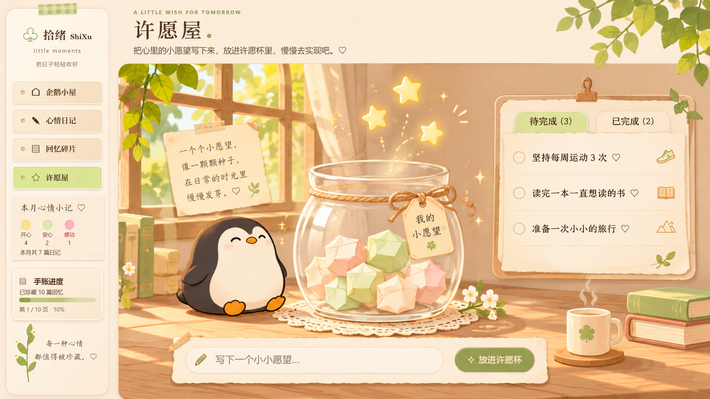
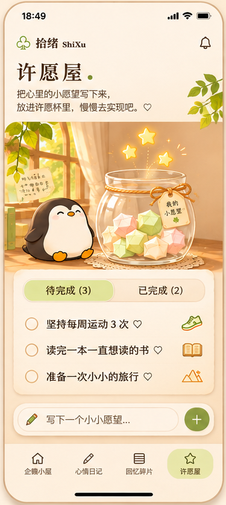

# 拾绪 ShiXu · 许愿屋桌面与手机正式视觉验收基线

> 日期：2026-11-16。**许愿屋的桌面端与手机端视觉方向已由用户确认。**
> **实现状态：视觉方案已确认，正式功能尚未开发。** 本轮只入库两张概念图并同步视觉规范，未修改 `src`、存档结构、领域契约或既有导航实现；许愿屋入口、玻璃杯、纸团、星星与愿望持久化均待后续独立任务卡和开发授权。
> 产品、领域与权限仍以 [AGENTS](../AGENTS.md)、[PRODUCT_SPEC](PRODUCT_SPEC.md)、[COMPANION_SPEC](COMPANION_SPEC.md)、[AI_CONTRACT](AI_CONTRACT.md) 和 [ARCHITECTURE](ARCHITECTURE.md) 为事实来源；概念图中的愿望文字、数量、统计与日期均为示例，不产生新业务规则。

## 0. 验收记录与文件校验

| 项目 | 记录 |
| --- | --- |
| 视觉确认日期 | 2026-11-16 |
| 确认范围 | 许愿屋桌面端与手机端整体视觉方向、页面结构、信息层级与装饰语言 |
| 用户结论 | 通过。桌面与手机许愿屋视觉方向已确定，不得自行重新选型或推翻 |
| 实施状态 | 未开发。没有许愿屋路由、第四导航入口、愿望存储或交互实现；本 PR 仅包含图片与文档 |
| 图片校验 | 两张 PNG 按原样入库，未重新压缩、裁剪、重绘或改名；实测 SHA-256 与 §1 一致 |
| 图片来源 | 用户提供的许愿屋视觉交接包（2026-11-16）；桌面 1672×941、手机 375×836，均为 8-bit RGB PNG |
| 基线依赖 | 最新 `origin/main`（`4ef3721`，PR #41 已合入）；桌面端复用已合入的公共侧栏架构 |

> 两张图是**视觉方向基线**，不是像素级生产切图、可直接部署的页面代码或数据模型。视觉验收通过不等于页面功能、路由、响应式断点或动画参数已经实现或验收。

## 1. 已确认参考图

| 页面 | 端 | 已确认设计预览 | 图片路径 | SHA-256 |
| --- | --- | --- | --- | --- |
| 许愿屋 | 桌面 |  | `docs/assets/ui-approved/wish-house/Shixu_WishHouse_Desktop_Approved.png` | `a50cddb0d5f2113c5881cf85eff1abfbb03740fbbb858c582511efd4a26ce0db` |
| 许愿屋 | 手机 |  | `docs/assets/ui-approved/wish-house/Shixu_WishHouse_Mobile_Approved.png` | `98c593dfd15f500c4b964a65313c2ba40fc3d5086ed316d181a5f25a92042d94` |

两张图用于确定布局关系、信息层级、主角关系与装饰语言；不替代仓库中已验收的原创企鹅 SVG 组件，也不代表具体 Hex 配色、字体、字号、间距、圆角、阴影、断点、触摸目标、玻璃杯容量、星星布局或动效时长已经定稿。

## 2. 全局视觉方向

继续沿用 ShiXu 既有绘本/手账风格，不另立不兼容的第二套 UI 主题：

- 奶油白与暖纸底色，浅木色、暖棕文字，鼠尾草绿作为主要强调色；
- 温暖阳光感、柔和阴影、轻描边、少量手绘植物与纸张纹理；
- 暖木家具、便签、小书本等生活化装饰，营造安静、私密的许愿空间；
- 信息可读性优先：愿望正文、状态、数量与操作入口清楚可辨，不被装饰或动效遮挡；
- 不采用科技仪表盘、强烈霓虹、复杂游戏 HUD 或与现有三页割裂的视觉语言。

具体设计 token 可由实现者统一收敛，但不得把候选数值写成已获用户确认。

## 3. 桌面端布局结构

以已确认桌面概念图为准：

- **左侧公共侧栏**：沿用已合入 `main` 的 ShiXu 公共侧栏与品牌结构，不新建另一套导航；后续为许愿屋增加第四个导航入口「许愿屋」，当前页以既有选中态突出。
- **中央许愿杯**：透明玻璃许愿杯是主视觉，杯内展示对应真实未完成愿望的纸团。
- **完成状态**：愿望由用户手动确认完成后，纸团从杯中升起并变成漂浮星星；星星对应真实已完成的愿望。
- **企鹅陪伴**：原创企鹅在杯旁形成陪伴关系，可复用既有角色视觉与轻量姿态；不修改已验收的企鹅 SVG 母版，不新增未确认的长期行为或计分规则。
- **右侧愿望面板**：展示待完成与已完成愿望的状态区分及完整列表入口；面板数字与示例愿望仅为视觉示意。
- **底部写愿望区域**：提供明确的写愿望输入入口与提交动作，输入与保存状态需在真实实现中清楚呈现。
- **场景装饰**：暖木、阳光、植物、便签及小书本只作为静态氛围元素，不暗示家具收集、商店、饰品或账号等未确认功能。

## 4. 手机端布局结构

以已确认手机概念图为准：

- **单列布局**，自上而下保持清楚的阅读与操作顺序；
- **顶部**：品牌与「许愿屋」标题；
- **主视觉**：玻璃杯与企鹅构成页面主要视觉中心，杯内纸团与完成后的星星可辨认；
- **愿望列表**：位于主视觉下方，待完成与已完成状态清楚区分，长列表可滚动且正文可完整访问；
- **写愿望入口**：提供与桌面一致的写愿望输入能力，不因窄屏省略核心动作；
- **底部四入口导航**：在后续实现中加入「许愿屋」，形成四个入口的底部导航；
- **安全区适配**：底部导航与输入区域避让系统安全区，键盘弹出、窄屏、浏览器缩放与长文本下不遮挡核心操作。

## 5. 统一导航要求

- 桌面端必须复用现有公共侧栏，后续只增加第四个入口「许愿屋」；不得复制出第二套侧栏或为许愿屋单独设计割裂导航。
- 手机端使用底部四入口导航，与桌面入口语义一致；现有「企鹅小屋 `/`」「心情日记 `/diary`」「回忆碎片 `/memories`」路由保持不变。
- 许愿屋正式路由仍为候选 `/wishes`，需在独立任务卡与实现验收中最终确定；本视觉基线不授权提前改路由或导航。
- 第四入口、路由与页面均**不在本轮实现**；本轮不修改 `src`、组件或导航代码。
- 未登录、账号、通知、设置、商店、饰品、家具等图标或入口不得因概念图出现而进入开发范围。

## 6. 纸团与星星的状态区别

这是已确认的产品语义，优先于概念图的抽象画法：

1. **未完成愿望**的正式表现是玻璃杯内的**纸团**；每个纸团必须对应已保存且未完成的真实愿望。
2. **已完成愿望**由用户**手动确认**后进入完成状态；随后纸团升起并变成**星星**，星星对应真实已完成的愿望。
3. 概念图中的折纸星形及其他彩色纸艺属于美术示意；**不得把未完成愿望错误实现为已完成星星**，也不得据图默认存在示例愿望。
4. 图中愿望文字、数量、日期与统计均为演示数据，不是种子数据、默认内容或真实持久化记录。
5. 保存与完成必须**可靠持久化**；写入失败、存储不可用或额度不足时不得播放“完成变星星”的成功动效，也不得伪造成功状态。
6. 图标、颜色或动效可以在实现阶段细化，但“杯内纸团 = 未完成、升起星星 = 已完成”的状态映射不可含糊或互换。

## 7. 许愿屋功能边界

- 愿望是独立业务数据，与日记、情绪、性格、企鹅行为规则相互隔离；不计入九类情绪、五维贡献、主导判定、离线生活或久别重逢。
- 愿望保存、完成状态与恢复必须可靠；读取损坏、版本不兼容或存储失败时提供可理解的提示与恢复路径，不覆盖用户现有日记与存档。
- **AI 不得自行创建、判定、写入或完成愿望**；不得把私人愿望发送给 AI 服务或外部服务器。
- 愿望正文按纯文本渲染，禁止执行用户输入中的 HTML/脚本。
- 删除愿望、编辑愿望、撤销完成、完成感想、纸团上是否显示文字等均**未确认**，不得擅自加入开发范围。
- 不得使用整张概念图作为静态页面背景冒充可交互 UI；页面必须由真实组件、真实状态与真实数据驱动。
- 不得修改已经验收的企鹅 SVG 母版；角色表现只复用现有视图与能力。
- 未完成愿望不触发处罚、催促、断签、金币或任何奖励体系；不新增 V1 明确不做的商店、家具、饰品或货币玩法。

## 8. 视觉与交互的后续验收要求

正式开发与验收时至少需要确认：

- 桌面端在真实浏览器中与已确认概念图的布局关系、信息层级和氛围一致，公共侧栏与第四入口自然衔接；
- 手机端单列结构、玻璃杯与企鹅主视觉、愿望列表、写愿望入口、底部四入口与安全区适配可用；
- 未完成纸团与已完成星星在真实数据下状态准确，空状态、多个愿望与大量愿望时不溢出且完整列表仍可访问；
- 新建愿望 → 刷新仍存在；手动完成 → 刷新仍保持完成；存储失败保留输入并准确提示；
- 低动态模式下以静态状态切换表达完成，不依赖动画才能理解状态；
- 键盘可操作、焦点清楚、窄屏与缩放下核心操作不被遮挡；
- 具体断点、动效时长、玻璃杯容量视觉、星星布局、精确配色与尺寸在实现阶段人工验收，不以本基线宣称已定稿。

## 9. 本轮交付性质

- 本轮为**纯文档 + 概念图**提交：新增两张已确认 PNG 与本视觉基线，定点同步 [POST_STAGE7_SCOPE](POST_STAGE7_SCOPE.md) 与 [ROADMAP](ROADMAP.md) 的状态说明。
- 不修改 `src`、测试、存档 schema、迁移链、领域契约、已验收企鹅组件或既有导航实现。
- 不创建许愿屋分支功能代码，不启用自动合并；正式功能需独立任务卡、独立实现分支与用户验收。
- 历史 PR 与已完成阶段的记录不追溯改写。

## 10. 相关文档

- [POST_STAGE7_SCOPE](POST_STAGE7_SCOPE.md)：许愿屋已确认产品行为、最小闭环与待确认项。
- [ROADMAP](ROADMAP.md)：阶段七后续独立开发包、交付顺序与阶段八前置。
- [STAGE7_UI_VISUAL_APPROVED](STAGE7_UI_VISUAL_APPROVED.md)：小屋、日记、回忆三页已确认视觉基线。
- [STAGE7_MEMORIES_SCRAPBOOK_APPROVED](STAGE7_MEMORIES_SCRAPBOOK_APPROVED.md)：回忆页桌面与手机翻页手账基线。
- [STAGE7_UI_INTERACTION_SPEC](STAGE7_UI_INTERACTION_SPEC.md)：阶段七正式页面与交互规范。
- [AGENTS](../AGENTS.md)、[PRODUCT_SPEC](PRODUCT_SPEC.md)、[COMPANION_SPEC](COMPANION_SPEC.md)。
